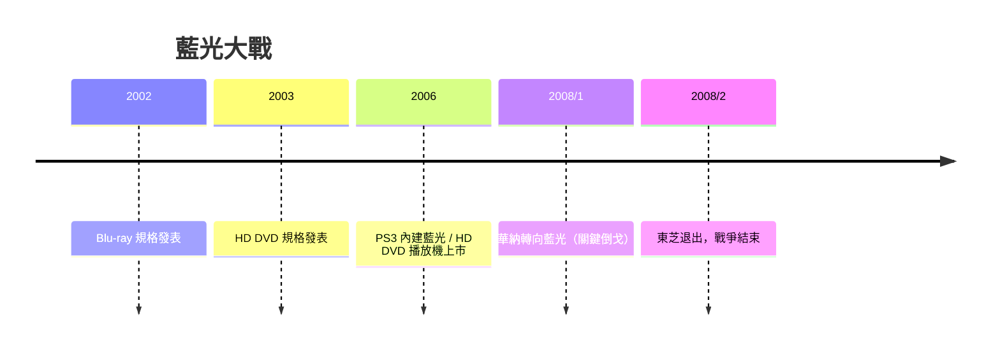

# 第 8 章 · 第 1 節 藍光大戰：405nm 的短波之爭

2002 至 2008 年，影音產業重演了一場似曾相識的戰爭：兩個陣營、兩種規格、一場豪賭。這次賭注是高畫質光碟，武器是**更短波長的雷射**。

## 物理：波長決定容量

光碟容量由光點大小決定。繞射極限下，光點直徑大致正比於

$$d \propto \frac{\lambda}{\mathrm{NA}}$$

$\lambda$ 是雷射波長，NA 是物鏡數值孔徑。CD 用 780nm 紅外光（約 0.7GB），DVD 用 650nm 紅光（4.7GB）。要再進一個數量級，只能縮短波長、加大 NA。1990 年代末，**405nm 藍紫光半導體雷射**（實際工作於 405nm，俗稱「藍光」）實用化，配合 **NA 0.85** 的大孔徑物鏡，光點縮到 DVD 的約五分之一，**單層 25GB** 成為可能。

## 兩大陣營

- **Blu-ray**（藍光，2002 年發表）：Sony、松下、飛利浦等領軍。容量優先（25GB/層），但碟片結構大改——覆蓋層極薄（0.1mm 貼近雷射），讀取精密、初期碟片良率與硬度是難關。
- **HD DVD**（2003）：東芝、NEC 主導。聰明地沿用 DVD 的 0.6mm 覆蓋層結構與生產設備，**碟片與機器成本較低**，單層 15GB。

## 陣營鬥爭：硬體、內容與站隊

這是一場三線作戰：

1. **微軟支持 HD DVD**：Xbox 360 外接 HD DVD 光驅，比爾・蓋茲公開讚許其成本優勢；英特爾也曾靠向 HD DVD。
2. **Sony 的豪賭**：2006 年 **PS3 內建藍光**，以虧本賣遊戲機的方式，把數百萬台藍光播放器塞進家庭——這是 Betamax 失敗後 Sony 最決絕的復仇。
3. **內容陣營**：環球、派拉蒙押 HD DVD；Sony 影業、迪士尼、二十世紀福斯押藍光。**2008 年 1 月，華納兄弟宣布獨家轉向藍光**——最大的片商倒戈，市場天平瞬間傾斜。此後 Netflix、沃爾瑪相繼棄 HD DVD，**2008 年 2 月，東芝宣布退出 HD DVD**，戰爭結束。

## 誰贏了，誰付出代價

藍光的勝利是**內容比硬體便宜、生態比成本重要**的又一次驗證：消費者不怕買錯播放機，只怕買錯格式。Sony 贏了格式，卻為 PS3 的定價與虧損付出多年代價；東芝輸了戰爭，數年後卻在快閃記憶體（NAND）業務上重振雄風。

更深的影響在制度：藍光內建 **AACS** 加密（比 CSS 更強），並留下「管理複製」的後門——內容產業學到了 DVD 時代的教訓，把保護機制寫得更深。諷刺的是，藍光還沒來得及收割勝利果實，**串流**已經越過光碟，直接把電影變成了訂閱的電。藍光大戰，因此成為光碟影視時代最後、也是最盛大的一場戰役。

這場戰役常被拿来與 Betamax 對 VHS 相提並論，但兩者的教訓恰好相反：Betamax 輸在拒絕開放錄影與授權，藍光則贏在**陣營的廣度與內容的深度**——Sony 學乖了，這一次它開放規格、廣結盟友、並把自家的遊戲機變成特洛伊木馬。產業史的殘酷在於：企業必須輸過一次，才真正學會怎麼贏。
