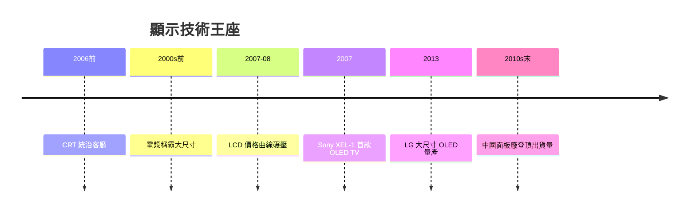

# 第 8 章 · 第 2 節 面板大決戰：CRT 的終結與薄型帝國

2006 年前後，統治客廳半世紀的 CRT 電視在短短數年內被掃進歷史。這不是一次產品升級，而是一場**資本密集、賭上國運的面板大戰**。

## CRT 的黃昏

陰極射線管（CRT）用電子束轟擊螢光粉，畫質出色，但身體注定厚重——深度與螢幕尺寸成正比，34 吋機種重達近百公斤。物理極限決定了：大畫質的未來，必須是「平面」的。

## 電漿：先來的大尺寸王者

電漿顯示器（PDP）以數百萬個微型氣體放電胞激發螢光體發光。**自發光**帶來深邃黑位與寬視角，且尺寸越大越有優勢。2000 年代前期， Pioneer、松下的高階電漿是影音發燒友的夢幻機。但電漿有硬傷：發光效率低（耗電大）、靜態畫面燒屏、較高亮度環境下表現平平，更重要的是**良率成本難以下探**——當 LCD 以量產經濟學壓境，電漿的技術優勢無法轉成價格優勢。Pioneer 2009 年退出自產，松下 2014 年停產電漿，王者先隕。

## LCD：資本與良率的勝利

液晶本身不發光，靠背光＋液晶閥調光。早年色域窄、殘影、可視角小，看起來全是輸家；但它押對了三件事：

1. **產線投資**：夏普（Sharp）自 1990 年代起押注液晶，龜山工廠（2004）樹立「龜山品質」招牌；韓國三星、LG 與台灣面板五虎（友達、奇美等）以世代線軍備競賽狂砍成本；
2. **規模經濟**：越大尺寸世代線，單位成本越低——這是資本密集產業的滾雪球邏輯；
3. **LED 背光與技術補丁**：側光式 LED 背光讓機身薄至數公分，區域調光、120Hz 補插幀逐項解決畫質短板。

**2000 年代末，LCD 靠價格曲線碾壓一切**；2010 年代再以高亮度、HDR 奪下主流。日本面板業在 2010 年代後因投資循環失速而節節敗退，**中國面板廠（京東方 BOE、華星光電）憑國家級投資與巨大內需在 2010–20 年代崛起，成為全球出貨量最大**——面板重心的東移，是這場大戰的地緣政治註腳。

## OLED：自發光的復仇

**2007 年，Sony 推出全球首款 OLED 電視 XEL-1**（11 吋），宣告自發光像素回歸——每個像素自亮自滅，對比無限、毫秒級響應。但 Sony 因成本與策略退場；**LG Display 持續押注大尺寸 OLED（白光 OLED），2013 年推出量產大尺寸 OLED TV**，經十年爬坡終於在高階市場站穩。QD-OLED（三星）等新變體加入，OLED 成為高階的代名詞。

## 重構的客廳

薄型化帶來的不只是器材革命：電視從「傢俱」變成「掛牆的畫」，客廳動線、音響擺位、家庭劇院生態全部重排；畫質軍備競賽（Full HD → 4K → 8K）則為藍光與串流的位元經濟提供了完美的終端理由。面板大戰證明：顯示器產業的勝負，一半在實驗室，一半在**資本市場與良率曲線**上。
