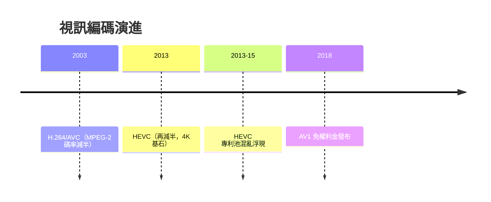

# 第 8 章 · 第 3 節 H.264、HEVC 與 AV1：編碼的頻寬經濟學

當音樂與電影都變成檔案，誰統治了「壓縮」，誰就統治了網路影音的命脈。H.264 與 HEVC，是串流時代真正的無形帝王。

## 壓縮原理：冗餘的三重壓榨

影片的原始碼率大得驚人：1080p/30 未壓縮超過 1Gbps。編碼標準的任務是榨乾三種冗餘：

1. **空間冗餘**：畫面內相鄰像素高度相似 → 以巨集區塊（macroblock）為單位做**幀內預測**，只編碼「預測殘差」；
2. **時間冗餘**：相鄰幀內容幾乎不變 → **運動補償**：為區塊找位移向量，只編碼「參考幀＋位移＋殘差」；
3. **統計冗餘**：殘差經變換（DCT/整數變換）量化後，高頻係數大量為零 → **熵編碼**（如 CAVLC/CABAC）以最短位元表示最常見符號。

再加上碼率控制、去方塊濾波與 B 幀雙向預測，構成完整系統。

## H.264：串流時代的基石

**2003 年定案的 H.264/AVC**（MPEG-4 Part 10，由 ITU-T VCEG 與 ISO MPEG 聯合制定，JVT）是集大成者：相同畫質下碼率約為 MPEG-2 的一半。它趕上了寬頻普及的時代窗口，成為 YouTube、藍光、HDTV、視訊會議的通用語言——至今仍是全球部署最廣的視訊編碼。

## HEVC：兩倍的誘惑與授權的混亂

**H.265/HEVC（2013 年定案）** 將巨集區塊升級為最大 64×64 的編碼樹單元（CTU）、更細的預測模式與更強的環路濾波，**同畫質碼率再降約一半**——4K 時代的理論基石。但它絆倒在一個非技術問題上：**專利授權**。HEVC 有多個互不統一的專利池（MPEG LA、HEVC Advance、Velos Media），權利金規則疊床架屋、總成本與法律風險難以估算，瀏覽器與硬體廠商普遍觀望，部署遠遜於 H.264。

## AV1：開放聯盟的反叛

授權亂局催生了制度性反擊：Google、Amazon、Netflix、微軟、蘋果、Intel 等組成 **AOMedia（Alliance for Open Media）**，於 **2018 年發布免權利金的 AV1**。AV1 在 HEVC 技術路線上再進一步，且以「零授權費」直擊要害——Netflix、YouTube 陸續大規模部署，成為串流巨頭的戰略解藥。

## 頻寬經濟學

對 Netflix 或 YouTube，編碼效率就是**真金白銀**：位元率減半＝CDN 與頻寬成本減半，或同等頻寬下畫質翻倍。H.264 讓 1080p 串流在 2010 年代成為日常；HEVC/AV1 讓 4K 與行動端高畫質可行。編碼標準從來不只是工程——**它是內容產業（誰收權利金）、平台（誰付頻寬）、消費者（誰看得到）三方博弈的制度戰場**。

從 CD 的 Red Book 到 AV1 的免權利金條款，影音史的主線清晰可見：**技術定義可能性，制度決定誰能用得起**。當編碼走向開放、面板走向 OLED、內容走向雲端，影音機器的故事，正翻到下一頁。

值得注意的是，編碼戰爭還遠未結束：AOMedia 已在推進 AV2（2020 年代中後期），VVC/H.266（2020）也由傳統標準組織接力上場，而硬體解碼晶片的普及速度，往往比標準本身更決定成敗——再好的演算法，沒有手機 SoC 裡的那顆解碼器，就只是論文。串流時代的鐵律因此再添一條：**演算法、專利與晶片，三者同時就位，一個編碼標準才真正贏得世界**。
