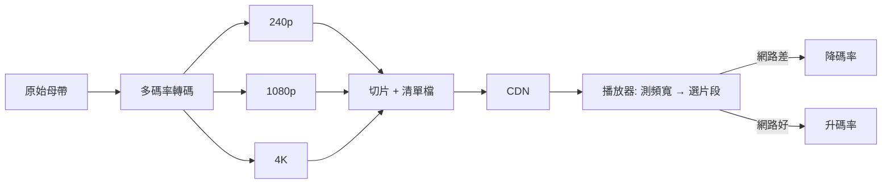

# 第 9 章 · 第 1 節 串流帝國與 ABR：碟片的黃昏

## 從郵寄 DVD 到串流帝國

1997 年，Reed Hastings 與 Marc Randolph 在加州創立 Netflix，最初的商業模式荒謬得近乎笑話：用郵寄 DVD 取代百視達的實體租片。但它精準命中兩個痛點——沒有逾期費、片庫不受店面坪效限制。百視達曾拒絕以 5,000 萬美元收購 Netflix（2000 年，金額有不同記載，此處保守表述），後來在 2010 年破產。歷史用整整十年，演完了一場「組織慣性 vs 模式創新」的教科書劇目。

2007 年，Netflix 推出串流服務。真正的引爆點在兩處：一是 2011 年起原創內容策略成型，2013 年《紙牌屋》（House of Cards）一次上架整季，證明「數據驅動的內容決策」可以與好萊塢製片規格抗衡；二是 2019 年 Disney+ 上線，把 IP 巨頭的百年片庫直接導入自家平台，終結了「Netflix 向各大片廠授權內容」的黃金蜜月。串流從此從通路之爭，升級為內容主權之戰。

YouTube 則是另一條演化路徑：2005 年創立，2006 年被 Google 以約 16.5 億美元收購，以 UGC（使用者生成內容）與演算法推薦，把「收看」變成無限滑動的注意力黑洞。

## ABR：串流的心臟

串流之所以可行，核心技術是**自適應位元率（Adaptive Bitrate, ABR）**。2009 年，Apple 為解決 iPhone 上的即時播放問題，發表 HTTP Live Streaming（HLS），隨後 MPEG 制定了開放標準 DASH。原理如下：

1. **切片**：影片先轉碼成多組不同位元率/解析度的版本（如 240p 300kbps 到 4K 25Mbps），再切成 2–10 秒的小片段，存放在普通 HTTP 伺服器上。
2. **清單檔**：m3u8 或 MPD 清單描述各碼率版本的片段位址。
3. **即時切換**：播放器持續測量下載吞吐與緩衝區水位，動態選擇下一個片段該抓哪一檔——頻寬驟降時先降畫質保住流暢，頻寬恢復再逐級爬升。

這個設計的巧妙之處在於**把複雜性交給邊緣**：伺服器只需笨拙地發檔案，所有智慧都在播放端的演算法裡。CDN 得以用最廉價的 HTTP 基礎設施，承載全球過半的網路流量。

## 光碟的黃昏

ABR 吃掉的不是「看影片」這件事，而是碟片存在的經濟理由：壓片、物流、庫存、門市租金，全部被「一次轉碼、無限複製、零邊際成本」取代。零售通路的光碟部門逐年萎縮，好萊塢的家娛（home entertainment）收入重心全面倒向數位。2023 年，Netflix 正式終結營運逾 25 年的 DVD-by-mail 業務，最後一片紅色信封寄出——當年養活串流帝國的商業模式，被帝國親手送葬。

> 媒介史的殘酷定律：殺死舊技術的，往往正是它親手哺育的繼承者。
