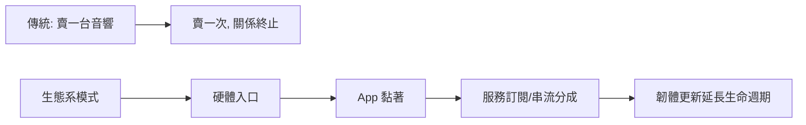

# 第 9 章 · 第 3 節 無線多房間音響：音樂的居住革命

## Sonos：把音樂搬出客廳

2002 年，Sonos（原名預計更名為 Rincon Networks 的團隊，後定名）在加州 Santa Barbara 創立。創辦人 John MacFarlane 等人的洞察極其簡單卻革命性：**音樂不該被鎖在一台音響、一個房間裡**。2000 年代中期，數位音樂已塞滿每個人的 PC，但要用音響聽，還得拉線或 iPod 接底座。Sonos 的答案：用 Wi-Fi 把多台喇叭連成網，每個房間一台，全部**同步播放**。

技術核心有三：

1. **Wi-Fi mesh**：早期 Sonos 喇叭之間自成私有 mesh 網路（SonosNet），喇叭互為中繼，繞過家庭路由器的擁塞與設定地獄。
2. **精準同步**：多房間同播時，各喇叭的播放延遲須對齊至人耳無法分辨的程度（毫秒級），否則走過廊道時音樂會「追著人跑」。
3. **App 即控制中心**：2000 年代末 iPhone 與 App Store 出現，Sonos 迅速從實體遙控器轉向手機 App，把「控制」與「播放」解耦。

## Apple、Google 進場：音響變成生態系

Sonos 驗證了市場，巨頭隨後碾壓而來。Apple 於 2017 年推出 **HomePod**，主打音質與 Siri；關鍵的生態武器是 **AirPlay 2**（2018）：作業系統層級的多室同步協定，任何第三方喇叭取得認證即可加入蘋果的多房間王國。AirPlay 2 同時解決了延遲緩衝的同步問題，並讓 HomePod 可組立體聲對。**Chromecast built-in** 則是 Google 的同構策略：喇叭裡埋一支 Cast 接收器，手機只是遙控器，串流由喇叭直接向雲端抓取——省電、省手機電池，也把入口留給 Google 服務。

## Wi-Fi vs 藍牙：頻寬與延遲的取捨

| | Wi-Fi 音訊 | 藍牙音訊 |
|---|---|---|
| 頻寬 | 高，可承載無損/多聲道 | 受 codec 限制（SBC/AAC/aptX 等） |
| 距離 | 全屋覆蓋（經路由器） | 約 10 公尺 |
| 延遲 | 緩衝型，適合串流但需同步處理 | 版本演進後可壓低，適合即時 |
| 多裝置 | 原生多房間 | 點對點為主 |

簡言之：**藍牙是「隨身線材的無線化」，Wi-Fi 是「家庭音響基礎設施」**。前者解決個人，後者解決空間。

## 商業模式的範式轉移

多房間音響真正的革命不在聲學，而在**商業模式**：

喇叭從「終端設備」變成「生態入口」：硬體毛利換取長期用戶關係，App 掌握控制權，串流服務（Spotify Connect、Apple Music 等）深度整合帶來持續營收想像。音響業百年來第一次，賣的不是喇叭，而是**居住空間裡的音樂基礎設施**。

Sonos 後續的授權整合、與巨頭的競合起伏，正是這個轉型的活教材——先驅者發明了品類，平台巨頭卻拿走了生態的鑰匙。
