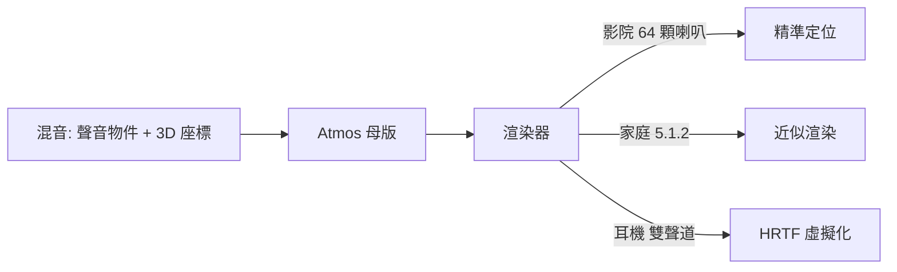

# 第 10 章 · 第 1 節 空間音訊革命：從通道到物件

## 通道的百年牢籠

立體聲（1958 商用化）用兩個聲道騙過兩隻耳朵；5.1、7.1 環繞聲加上了後方與超低音，但本質未變——**錄音時聲音就被固定分配到某幾顆喇叭**。工程師混音時，把吉他 pan 到左聲道、對白鎖定中置，聲場的幾何在混音台上就已焊死。這套「channel-based」範式統治了超過半世紀，它的天花板清晰可見：喇叭數量固定，聲音永遠在「平面」上，頭頂永遠沉默。

## Dolby Atmos：聲音變成物件

2012 年，Dolby 為電影《勇敢傳說》首映發表 **Atmos**，核心是範式轉移：**object-based audio**。

- **聲學物件**：混音師不再指定「這個聲音從哪顆喇叭出來」，而是為每個聲音標註 **3D 座標與移動軌跡**——直昇機是一個會從銀幕後方飛越頭頂、消失在影院右後方的「物件」。
- **頂置聲道**：影院天花加裝喇叭陣列，聲場首次包覆頭頂。
- **渲染器（Renderer）**：這是真正的技術心臟。母版只存「物件 + 座標 + 房間資訊」，放映時由 Atmos 渲染器**即時運算**：依據該廳實際喇叭數量與位置（可能是 64 聲道的杜比影院，也可能是 5.1.2 的家庭劇院），即時把物件分配、渲染到現有的喇叭上。

一次製作，處處渲染——這與串流「一次轉碼、端點自適應」的哲學完全同構。**計算取代了固定的物理配置。**

## Apple Spatial Audio：耳機裡的劇院

Apple 並未自創標準，而是支援 Atmos 並用耳機把它「個人化」：以 **HRTF（頭部相關傳遞函數）**模擬 3D 聲場於雙耳——HRTF 描述聲音從空間中某方向抵達耳膜時，被頭部、耳廓塑形後的頻譜變化；方向感正藏於其中。AirPods 加入**頭部追蹤**：感測器偵測頭部轉動，聲場固定於世界座標（螢幕方向），頭動聲不動，虛擬劇院於焉成立。Apple 並推動以 iPhone 掃描耳廓的**個人化空間音訊**，因為每個人的 HRTF 皆有差異，通用曲線終究差一口氣。

## 音樂產業的 Atmos 混音潮

2021 年，Apple Music 上線支援 Dolby Atmos 的空間音訊內容，並以高解析無損（ALAC）同場加映而不加價，掀起音樂圈的 Atmos 混音熱潮。唱片公司與串流平台共同把「沉浸式混音」從電影後製的特殊工種，推向流行音樂的常規選項。業界亦有審慎的保留意見——某些 Atmos 版本的動態與原混音取向不同，評價兩極——但方向已然確立。

> 從「把聲音塞進通道」到「把聲音放進空間」，Atmos 改變的不是聽起來如何，而是**聲音被創作時的心智模型**——與當年從單聲道到立體聲的躍遷，同一量級。
