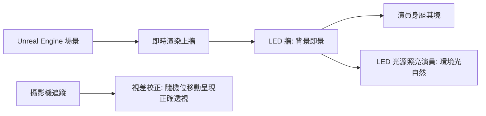

# 第 10 章 · 第 2 節 計算攝影與虛擬攝影棚：真實的邊界溶解

## 計算攝影：鏡頭不再只靠光學

2016 年，Google 推出 Pixel 手機，其 HDR+ 技術揭露了一個新時代的公理：**手機畫質的上限，由演算法決定，而非鏡頭直徑。**

HDR+ 的原理：按快門前，手機其實已持續拍攝並暫存一連串欠曝的短曝光幀（避免手震糊掉）；按下快門的瞬間，回溯合併這些幀——對齊、堆疊、去噪，把每個像素的雜訊在統計上抵消，同時以欠曝幀保住高光細節。這是**多幀合成**與 **HDR 堆疊**的結晶：物理上不可能的「又亮又暗都清楚」，由運算縫合出來。

此後的演化一脈相承：夜景模式以長曝堆疊在近乎全黑處還原街景；超解析度以手震的微小位移補取不同位置的像素；人像模式以分割模型計算景深、虛化背景。計算攝影的哲學一句話：**照片是運算的輸出，快門只是起點。** 這也反轉了百年攝影的權力結構——光學大廠的護城河（鏡片、感光元件）被軟體與 SoC 的演算法能力部分繞過，手機吞噬了消費相機市場。

## LED Volume：把後期搬到前期

另一端，好萊塢的攝影棚正在經歷同樣的溶解——方向相反：**特效從後期前移到現場。**

傳統綠幕流程：演員對著綠牆演戲，數月後後期團隊再把背景「貼」上去。代價慘烈——光線不匹配（綠幕反光染綠演員）、演員無對手環境可入戲、導演看不到成品導致返工。

**LED Volume 虛擬攝影棚**改寫了這一切。2019 年，Industrial Light & Magic（ILM）與 Disney+ 影集《曼達洛人》（The Mandalorian）以 **StageCraft** 技術公開示範：環繞表演區的巨型 curved LED 牆，即時播放 **Unreal Engine** 即時渲染的外星場景。

三大技術支柱：

1. **即時渲染**：遊戲引擎逐幀產生影像，延遲低到可與攝影機即時互動。
2. **攝影機追蹤 + 視差**：牆上顯示的是隨攝影機位姿即時校正的畫面，拍出來的透視才正確（牆外區域顯示擴張視野供環境反射與照明）。
3. **LED 本身是光源**：場景的光就是打在演員身上的光，黃昏的橙、沙漠的熱，不再需要後期硬拗。

## 邊界的消融與制度的改變

《曼達洛人》之後，虛擬製作（virtual production）迅速成為產業基建，遊戲引擎（Unreal Engine、Unity）正式進入影視工作流。這帶來的不只是省下外景與轉場成本：

- **工作流的制度性改變**：美術指導、燈光師必須在開拍前完成數位場景——傳統「先拍後補」的彈性消失，前期製作（pre-production）的權重與預算前移；工程師成為劇組的新物種。
- **權力結構位移**：技術決策（引擎、即時渲染管線）深入創意現場，遊戲產業的人才與工具鏈向影視逆向輸出。

> 計算攝影把後期壓進快門的瞬間，虛擬攝影棚把後期抬進開機的前一天。真實與虛構的邊界，正在工作流的首尾兩端同時溶解。
