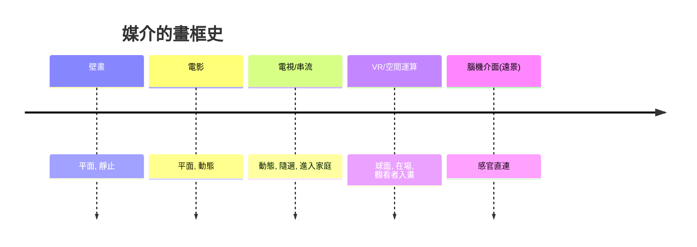

# 第 10 章 · 第 3 節 沉浸式影音未來：從「觀看」到「進入」

## Apple Vision Pro：把銀幕放進空間

2024 年，Apple 出貨 **Vision Pro**，宣稱開啟「空間運算」時代。其硬體規格勾勒出頭戴裝置的當代工程頂點：

- **雙 micro-OLED**：單眼解析度遠超 4K 等級，畫素密度高到在近距離觀看時難以分辨單一畫素，足以呈現印刷體文字——這正是「空間影片」可行的前提。
- **空間影片（spatial video）**：以雙鏡頭錄製、帶深度視差的 3D 影片，戴著頭顯回放時獲得宛如置身現場的立體回憶。iPhone 可拍、Vision Pro 可看，Apple 試圖複製當年「相機 + iPod」的軟硬閉環。
- **眼追蹤 + 手追蹤**：以眼睛為指標、捏合手指為點擊——介面從觸控螢幕躍遷至「注視即選擇」，取代搖桿與控制器。

Vision Pro 的定位揭示了產業的猶豫：它既是 VR 頭顯，又刻意迴避「元宇宙」敘事，以「外接螢幕的無限延伸」作為過渡語彙——先用熟悉的隱喻販賣陌生的媒介。

## 8K 全景影音的物理噩夢

沉浸式影音的第一道牆是**解析度與頻寬**。VR 頭顯視野（FOV）約 100–120 度，但全景影片是 360 度的完整球面——你只看著其中一角，頻寬卻得吞下整顆球。要達到視網膜等級的清晰度，全景影片需遠超 8K 的解析度；就算配合 **foveated rendering（注視點渲染）**——以眼追蹤只對視線中心高清渲染、周邊降級——串流傳輸與編碼仍是嚴峻考驗。8K 全景在頭顯上的實際感受，往往仍不及普通 4K 平面影片的銳利。這是沉浸式影音始終慢於想像的物理根源。

## 內容生態的冷靜現況

誠實地說：VR 影視內容生態至今仍在早期階段。360 度全景影片與 VR 敘事作品持續出產（紀錄片、演唱會轉播、實驗短片是相對活躍的類型），但相較平面串流的海量供給，規模仍小；頭戴裝置的普及率與配戴時長，制約了內容投資的意願。平台與創作者仍在摸索「什麼樣的故事值得戴上頭顱」——這個問題尚無公認答案。

## 腦機介面：感官介面的遠方地平線

再往前推，是介面的終極想像：跳過眼與耳，直接讀寫神經。真實的研究現況應保守看待：**Neuralink 於 2024 年完成首例人體植入試驗**，初期目標是讓癱瘓患者以意念控制游標與鍵盤——是醫療輔助，而非娛樂介面。學術界亦有以視覺假體（retinal implant、皮質視覺假體）為目標的長期研究，但離「輸入高清影音至大腦」仍有本質性的距離。關於意識、感官編碼的基礎科學，人類所知仍然有限。

## 媒介哲學：觀看的終結？

從洞穴壁畫到 IMAX，人類影音史是一條「把視窗越開越大」的線：畫框不斷擴張、解析度不斷逼近肉眼，但**觀看者始終在畫面之外**。頭顯第一次把觀看者**裝進畫面裡面**——媒介從「再現世界」變成「模擬在場」（presence）。這不只是解析度問題，而是本體論問題：當記憶可以空間影片的形式重臨，當「在場」可以被運算合成，觀看與經歷的界線將如何定義？

> 每一代媒介都重新發明「真實」這個詞。下一個時代的問題或許不是「畫面有多真」，而是——我們還需不需要「畫面」。
