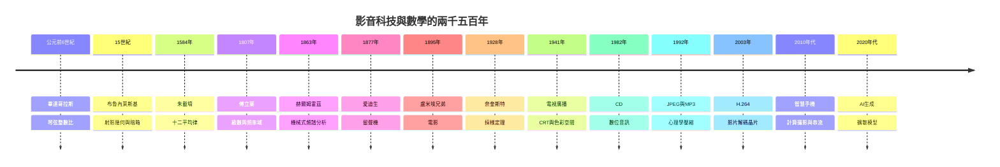

# 前言：萬物皆波動——捕捉光影與聲響的科技演進史

> 影音的科技與數學

聲音是空氣的振動，光是電磁的振動。人類文明最偉大的成就之一，就是學會了把這些稍縱即逝的波動「固定」下來——先用弦與刻針，再用電流與真空管，最後用 0 與 1，以及今日的神經網路。

本書講述的，就是這場跨越兩千五百年的長征。但它不只是一份發明年表。我們刻意將三條線索交織在一起：

1. **數學與樂理的本質**——從畢達哥拉斯的整數比、朱載堉的 $\sqrt[12]{2}$、傅立葉的正弦波疊加，到香農的採樣定理與擴散模型的隨機微分方程。影音科技的每一次躍升，背後都是一次數學觀念的革命。
2. **硬體裝置的演化**——暗箱、留聲機、馬爾他十字間歇機構、真空管與 CRT、CMOS 感光元件、DSP 晶片與 AI 加速器。觀念必須凝固成機器，才能觸及大眾。
3. **歷史的前因後果**——技術從不是孤立的火花。法國大革命後的綜合理工學院孕育了傅立葉；AT&T 的壟斷利潤供養了貝爾實驗室；冷戰的雷達研發外溢成電視廣播；撥接網路與 Napster 的盜版經濟催生了 MP3；雲端資本與先進製程的地緣政治，則塑造了今天的 AI 影音。經濟、制度、文化、政治、思想與教育，始終是技術的身軀。

閱讀本書時，建議留意每一章末的「延伸思考」：它們把歷史問題接到當代——例如當 AI 能生成任意影音，我們兩千五百年來建立的「記錄即真實」的信任制度，將如何重構？

萬物皆波動，而波動皆可被書寫。
