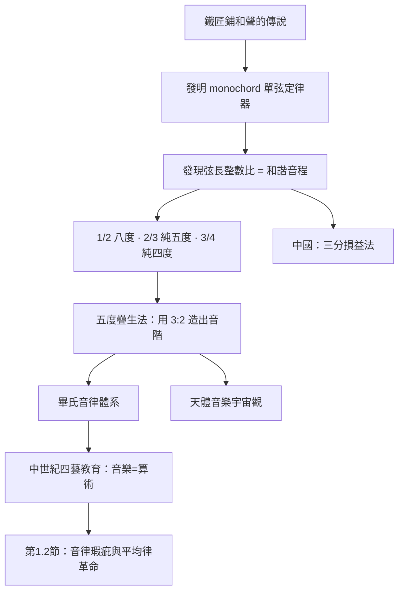

> 第一篇 · 第1章

# 第1.1節 琴弦分段與和聲整數比：1/2（八度）、2/3（純五度）的頻率規律

## 一個鐵匠鋪裡的宇宙密碼

傳說公元前 6 世紀，畢達哥拉斯（Pythagoras，約前 570–前 495）路過一家鐵匠鋪，聽見不同重量的鐵鎚敲擊鐵砧時，發出的音高之間竟有和諧的關係。他回家後以弦進行實驗，發現了西方音樂理論的基石：**當兩條相同張力、相同材質的弦，長度呈簡單整數比時，所發出的音聽起來格外和諧**。

無論鐵匠鋪的故事是否屬實，畢達哥拉斯學派確實發明了一種劃時代的實驗裝置——**單弦定律器（monochord，一弦琴）**：一塊木箱上架一根弦，下方設一個可滑動的「琴馬」（bridge），移動琴馬即可精確改變發音弦長，箱側往往刻有刻度。這是人類史上最早的「聲學計量儀器」之一——用幾何測量對抗主觀聽感，也體現了畢氏「萬物皆數」的哲學信念。

## 弦長比、頻率比與音程

弦振動的基頻近似為：

$$f = \frac{1}{2L}\sqrt{\frac{T}{\mu}}$$

其中 $L$ 為弦長、$T$ 為張力、$\mu$ 為線密度。在 $T$、$\mu$ 不變時，**頻率與弦長成反比**。因此「弦長比」取倒數即為「頻率比」：

| 音程 | 弦長比 | 頻率比 | 聽感 |
|---|---|---|---|
| 八度（Octave） | $1:2$ | $2:1$ | 完全融合，如同一音 |
| 純五度（Perfect Fifth） | $2:3$ | $3:2$ | 明亮和諧 |
| 純四度（Perfect Fourth） | $3:4$ | $4:3$ | 沉穩和諧 |
| 大全音（Whole Tone） | $8:9$ | $9:8$ | 兩個全音構成大三度 |

若原弦全長發 $f = 440\,\text{Hz}$，則：

- 按弦至 $\frac{1}{2}$ 長度：$f' = 440 \times 2 = 880\,\text{Hz}$（高八度）
- 按弦至 $\frac{2}{3}$ 長度：$f' = 440 \times \frac{3}{2} = 660\,\text{Hz}$（純五度）

## 疊加原理：從 3:2 造出整個音階

畢氏學派的重大洞見在於：和諧音程可透過**比率連乘**不斷衍生。由純五度 $3:2$ 連續上疊十二次、再以八度 $2:1$ 下折歸位，即可生成幾乎全部音階中的音——這就是「五度圈」的數學原型。例如：

$$\left(\frac{3}{2}\right)^2 = \frac{9}{4} \xrightarrow{\div 2} \frac{9}{8}\ (\text{大全音})$$

兩個全音相乘：$\frac{9}{8} \times \frac{9}{8} = \frac{81}{64}$，即「畢氏大三度」。整個系統只需整數運算，不需要任何無理數——對畢氏學派而言，這正證明了宇宙的理性秩序。他們甚至將八度、五度、四度對應到宇宙天體，提出「天體音樂」（Musica Universalis）之說：行星運行如琴弦般按固定比例振動。

## 中國與希臘的平行發現

值得注意的是，同時期的中國文獻《管子・地員》記載了「三分損益法」：將弦長「三分損一」（乘 $\frac{2}{3}$）得純五度、「三分益一」（乘 $\frac{4}{3}$）得純四度，與畢氏方法在數學上完全等價，只是方向相反。兩大文明在互不知情的情況下，從同一根弦上讀出了同一組整數比——這說明和聲整數比並非文化約定，而是振動物理的普遍規律。

## 前因後果

**驅動因素**：畢氏音律誕生於古希臘城邦重視幾何與論證的教育傳統（畢氏學派本身即是兼具宗教、數學與政治色彩的社群）；音樂在希臘教育中佔核心地位（謬斯女神），調音問題因此成為嚴肅的哲學與數學議題。在東方，三分損益法則與禮樂制度相連——宮、商、角、徵、羽的音高標準由國家頒定，是政治秩序的一部分。

**技術傳承**：單弦定律器作為教學與調律工具延用近兩千年，中世紀大學「四藝」（quadrivium）中的音樂課程，就是用 monochord 教算術比例。五度疊生的方法直接催生了中世紀管風琴的音栓設計（如 $2\frac{2}{3}$ 呎的 Nasat 音栓即發五度泛音），並為第 1.2 節的畢氏音律體系、乃至第 3 章的平均律革命埋下伏筆。

## 延伸思考

1. monochord 是史上第一個「用測量取代權威」的科學儀器：和諧與否不再由祭司或樂師說了算，而由可重複的實驗與整數比裁定——這正是科學方法的雛形。
2. 為什麼人耳偏愛簡單整數比？這牽涉頻率比值化為最簡分數時的分子分母大小——分母越小、週期重合越快、拍頻越少、聽感越純。此一「複雜度—和諧度」關係至今仍是音樂心理學的研究課題。
3. 若改用「音程相加即頻率相乘」的對數觀點回看，畢氏的連乘法其實是在對數空間做加法——這為第 3.1 節用 $\sqrt[12]{2}$ 建構平均律提供了概念橋樑。
