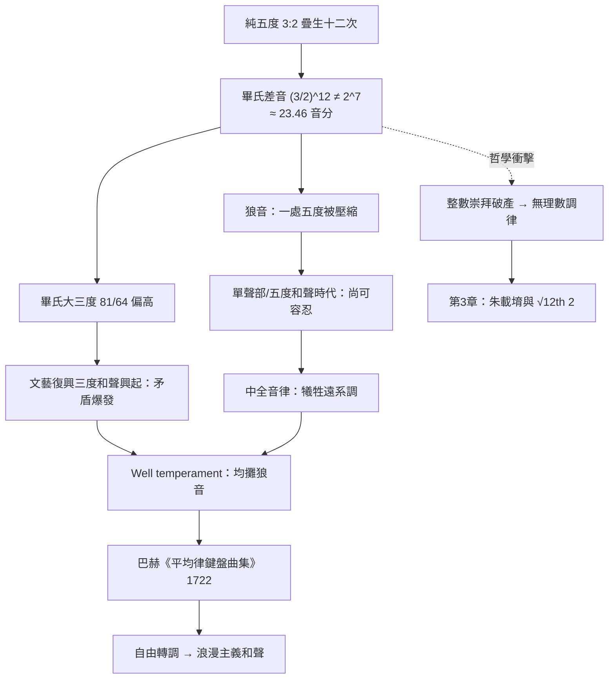

> 第一篇 · 第1章

# 第1.2節 畢達哥拉斯音律與「狼音」瑕疵：數學對稱性與自然和諧的衝突

## 用 3:2 織出的十二音之網

承接第 1.1 節，畢達哥拉斯音律（Pythagorean tuning）的生成規則極為單純：以純五度 $\frac{3}{2}$ 連續相乘，每超出八度 $2$ 就除以 $2$ 折回。沿五度鏈 F–C–G–D–A–E–B 依次生成，可得完整的七聲音階，各音與主音 C 的頻率比如下：

| 音 | C | D | E | F | G | A | B |
|---|---|---|---|---|---|---|---|
| 頻率比 | $\frac{1}{1}$ | $\frac{9}{8}$ | $\frac{81}{64}$ | $\frac{4}{3}$ | $\frac{3}{2}$ | $\frac{27}{16}$ | $\frac{243}{128}$ |

這套音律在單聲部音樂時代近乎完美：每個五度、四度都是精確的 $\frac{3}{2}$、$\frac{4}{3}$，中世紀的奧爾加農（organum，平行五度復調）唱起來清澈純淨。

## 狼音：對稱系的斷裂點

問題出在「閉合」。數學上：

$$\left(\frac{3}{2}\right)^{12} \approx 129.75 \quad\text{vs.}\quad 2^{7} = 128$$

十二個純五度疊起來，比七個八度**多出約 23.46 音分**，這個差額稱為**畢氏差音（Pythagorean comma）**。五度圈無法閉合：若從 B 繼續疊五度得到升 F，它與八度生成的降 G **不是同一個音**。鍵盤上被迫共用一個琴鍵，於是必有一處五度被壓縮成 $\frac{3}{2} \div \frac{531441}{524288} \approx 1.4798$——比純五度窄了 23 音分，聽起來粗糙、拍音明顯，中世紀樂師稱之為**「狼音」（wolf fifth）**，因為它像野狼的嚎叫般混在羊群（純和聲）之中。

另一個更致命的缺陷：畢氏大三度 $\frac{81}{64}$ 比自然和聲的大三度 $\frac{5}{4}$ 高出 21.5 音分（「敘利亞語調」syntonic comma）。當複調音樂在 15–16 世紀走向三度、六度為骨幹的完全和聲時，畢氏音律的 **三度刺耳** 的問題被徹底暴露。

## 數學對稱性與自然和諧的衝突

畢氏音律的困境是一場深刻的哲學危機。畢氏學派主張「萬物皆（整）數」，但 $\left(\frac{3}{2}\right)^{12} = \frac{3^{12}}{2^{12}}$ 永遠不等於 $2^{7}$——**質因數 $3$ 與 $2$ 的冪永不相等**，這其實是算術基本定理的直接推論。和諧整數系在自身內部產生了無法消解的「餘數」。

這一衝突驅動了兩千年的調律史：

| 調律系統 | 策略 | 代價 |
|---|---|---|
| 畢氏音律 | 純五度全純 | 大三度刺耳、狼音集中一處 |
| 中全音律（1/4 comma meantone，16 世紀） | 壓窄五度 $\approx 696.6$ 音分，讓大三度近純 $\frac{5}{4}$ | 狼音更兇，遠系調不可用 |
| Well temperament（17–18 世紀） | 狼音均攤到所有五度 | 各調有微差「色彩」但皆可演奏 |
| 十二平均律（見第 3 章） | 五度全窄 $\frac{1}{12}$ comma | 完全自由轉調，五度略失純 |

## 前因後果

**制度與經濟驅動**：中世紀教會的禮儀音樂以五度、四度為和聲基礎，畢氏音律足敷使用；但文藝復興時期世俗宮廷音樂興起、三度和聲成為主流，加上鍵盤樂器（管風琴、羽管鍵琴）**調音一次便固定數月**、無法像弦樂器那樣即時微調，「選擇哪套妥協方案」成了鍵盤製造師與風琴師的技術難題，甚至上升為教會與宮廷之間的品味之爭。

**思想史意義**：狼音是「理想數學」第一次被「物理現實」打臉的著名案例。它迫使歐洲音樂理論從畢氏的神秘整數崇拜，轉向對數、連分數、無理數的實用數學——十六世紀的西蒙・斯特芬（Simon Stevin）與明代朱載堉（見第 3.1 節）正是在此問題壓力下，各自算出了 $\sqrt[12]{2}$。

**催生後世**：Well temperament 使每一調皆可演奏，巴赫（J. S. Bach）遂於 1722、1744 年出版《平均律鍵盤曲集》（Das Wohltemperierte Klavier），用二十四個大小調各寫前奏曲與賦格，宣示「全調自由」時代的到來。轉調自由 → 大小調功能和聲體系成熟 → 浪漫主義音樂的遠系轉調與半音化和聲（舒伯特、華格納）→ 二十世紀的調性瓦解——一條始於 23.46 音分「餘數」的技術長鏈。

## 延伸思考

1. $\left(\frac{3}{2}\right)^{12} \neq 2^{7}$ 可由算術基本定理證明（$3^{12}$ 與 $2^{12}\cdot 2^{7}$ 不可能相等）——狼音因此不是工藝缺陷，而是**數學定理**。人類第一次被自己的整數美學逼進死角。
2. 狼音是「零和妥協」的典型案例：純度總量近乎守恆，只能在音程間搬移。這種「資源分配」視角使調律史成為一本微型的工程最佳化教材。
3. 「Well temperament ≠ 十二平均律」是常見誤解：巴赫曲集裡各調聽感不同（升種調明亮、降種調柔和），這正是作曲家選調表達意義的語料——平均律的「無色彩」反而是後世批評者嫌它乏味的理由。
