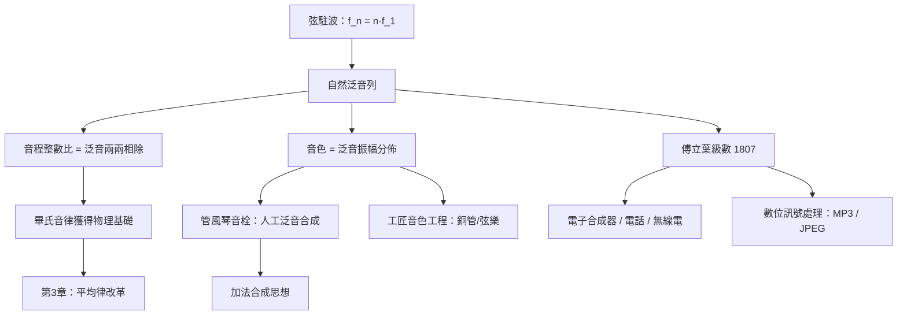

> 第一篇 · 第1章

# 第1.3節 自然泛音列（Harmonic Series）：樂器發聲的物理本質

## 一根弦的秘密合唱

撥動一根弦，你聽到的是一個音，實際上卻是一場**合唱**。弦不僅以全長振動（基音），還同時以 $\frac{1}{2}$、$\frac{1}{3}$、$\frac{1}{4}$ 長度振動，各自產生頻率為基頻整數倍的分音——這就是**自然泛音列（harmonic series）**。以基頻 $f_1 = 110\,\text{Hz}$（A2）為例：

| 泛音次數 $n$ | 頻率 | 相對基音的音程 | 頻率比 |
|---|---|---|---|
| 1 | $110\,\text{Hz}$ | 基音 | $\frac{1}{1}$ |
| 2 | $220\,\text{Hz}$ | 高八度 | $\frac{2}{1}$ |
| 3 | $330\,\text{Hz}$ | 高十二度（純五度） | $\frac{3}{1}$ |
| 4 | $440\,\text{Hz}$ | 高兩個八度 | $\frac{4}{1}$ |
| 5 | $550\,\text{Hz}$ | 大三度（純律 $\frac{5}{4}$） | $\frac{5}{1}$ |
| 6 | $660\,\text{Hz}$ | 純五度 | $\frac{6}{1}$ |
| 7 | $770\,\text{Hz}$ | 偏低的小七度（「藍調七度」） | $\frac{7}{1}$ |
| 8 | $880\,\text{Hz}$ | 高三個八度 | $\frac{8}{1}$ |

弦的振動可用駐波模型描述：兩端固定的弦只允許波長滿足 $\lambda_n = \frac{2L}{n}$ 的駐波存在，代入波速公式 $v = f\lambda$ 得：

$$f_n = n \cdot \frac{v}{2L} = n f_1, \quad n = 1, 2, 3, \dots$$

頻率恰好是基頻的整數倍。而第 1.1 節的和聲整數比，正是這組整數**兩兩相除**的結果：$\frac{3}{2}$ 來自 $\frac{f_3}{f_2}$、$\frac{4}{3}$ 來自 $\frac{f_4}{f_3}$——**畢氏音律原來早已寫在泛音列裡**。

## 音色：泛音列的指紋

兩件樂器演奏同一音高（基頻相同），人耳仍能分辨小提琴與長笛——決定因素就是**泛音振幅的分佈**，即「頻譜」。數學上任何週期訊號都可展開為傅立葉級數：

$$x(t) = \sum_{n=1}^{\infty} A_n \cos(2\pi n f_1 t + \phi_n)$$

- 小提琴：弓的黏滑運動近似鋸齒波，泛音豐富，$A_n \sim \frac{1}{n}$ 衰減緩慢，音色明亮；
- 長笛：近似正弦波，高泛音極弱，音色純淨；
- 單簧管：僅奇次泛音強（近似方波），音色圓潤帶鼻音。

「音色 = 頻譜形狀」這一現代聲學常識，要等 19 世紀亥姆霍茲（Hermann von Helmholtz）用**共鳴球（Helmholtz resonator）**逐音分析才被確立；但在古代，樂器工匠早已用雙手實作了這門科學——

## 古代工匠的泛音工程

- **管風琴音栓系統**：一根鍵盤同時驅動多排音管。Principal 管（8 呎）發基音，Octave（4 呎）發二次泛音、Nasat（$2\frac{2}{3}$ 呎）發三次泛音、Tibia（2 呎）發四次泛音……工匠用硬體「合成」了泛音列，這是 11 世紀起就存在的**加法合成器（additive synthesizer）原型**。
- **銅管的自然音階**：小號、號角無活塞，只能吹出泛音列中的音（用嘴唇張力選擇激發的 $n$）。巴洛克「自然小號」作曲家刻意選用第 8–16 泛音區，因該區音程密集、近似音階。
- **弦樂器的泛音奏法**：手指輕觸弦的 $\frac{1}{2}$、$\frac{1}{3}$、$\frac{1}{4}$ 點，抑制基音，讓指定泛音獨響——蒙臺威爾第時代的作曲家已用此技法製造特殊音色。

## 前因後果

**文化與制度驅動**：中世紀教會音樂理論（以波愛修斯譯介的希臘理論為本）把泛音現象神學化，五度、八度被視為「三一」與「圓滿」的象徵，管風琴因而成為「唯一能奏出完整和聲的教會樂器」，獲得鉅額建造投資——大型教堂管風琴是中世紀最複雜的機械裝置之一，其音栓分部設計直接影響了後世管弦樂配器的「分部」思維。

**思想史意義**：泛音列提供了「和諧整數比」的物理機制，使畢氏神秘主義轉化為可檢驗的聲學。16 世紀札利諾（Gioseffo Zarlino）將純律大三度 $\frac{5}{4}$ 納入音程體系（承認 5 是「和諧數」），正是受了泛音列（與其倒影、下泛音列）的啟發。

**催生後世**：泛音列理論是整條影音技術鏈的物理底座——傅立葉分析（1807）源於對弦振動與熱傳導的研究；貝爾電話的載波概念、無線電調變、以及 20 世紀的電子合成器（Moog 的減法合成：用濾波器雕塑鋸齒波的泛音），全是「操縱泛音分佈」的工程學。在影像端，同一套頻譜分解思想也成為 JPEG 壓縮（DCT 變換）的數學祖先。

## 延伸思考

1. 畢氏音律的 $\frac{81}{64}$ 大三度與泛音列的 $\frac{5}{4}$ 大三度為何不同？因為音律是「循環生成」的代數系統，而泛音列是「一次列出」的物理清單——兩者只在五度、八度上重合，在三度上分道揚鑣。這正是第 1.2 節調律衝突的深層原因。
2. 人耳的耳蝸是一台「生物傅立葉分析器」：基底膜不同位置共振不同頻率。所以「聽見泛音」不是抽象數學，而是硬體（內耳）的物理分工。
3. 第 7 次泛音 $\frac{7}{4}$ 不屬於十二平均律中的任何音，卻是藍調「彎音」與爵士和聲魅力的來源——標準化調律「遺棄」的泛音，反成為流行音樂的表達資源。
