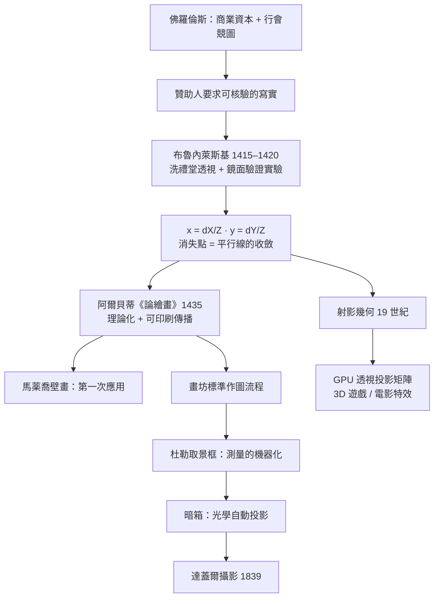

> 第一篇 · 第2章

# 第2.1節 布魯內萊斯基的射影幾何：消失點（Vanishing Point）如何建立視覺深度

## 佛羅倫斯洗禮堂前的一場實驗

約 1415–1420 年，佛羅倫斯金匠出身的建築師菲利波・布魯內萊斯基（Filippo Brunelleschi, 1377–1446）做了一件藝術史上堪稱「科學實驗」的事。他畫了一幅八角形洗禮堂（Battistero di San Giovanni）的精確透視圖，然後在畫面消失點處鑽一個小孔，請觀者背對實物、從畫背透過小孔窺看一面放在畫前的鏡子——如果畫中的洗禮堂與鏡中反射的畫面嚴絲合縫，就證明他的幾何作圖**重現了真實光學**。

這個「畫—孔—鏡」裝置意義重大：它把繪畫從匠人的經驗手藝，變成可驗證、可重複的**數學命題**。據傳他另一幅示範作描繪市政廣場（Palazzo della Signoria），同樣以鏡面檢核。可惜原作皆已佚失，但史料記載的驗證方法本身，就是一次「以光線為公理」的演示。

## 消失點的數學

布魯內萊斯基的核心洞察（後由阿爾貝蒂在《論繪畫》Della Pittura, 1435 系統化）是：**畫面是光線錐與平面截出的截面**。設眼睛在原點，畫面位於 $z = d$，空間中一點 $(X, Y, Z)$ 投影為：

$$x = d\,\frac{X}{Z}, \qquad y = d\,\frac{Y}{Z}$$

所有與畫面成角度的平行線，延伸至 $Z \to \infty$ 時都收斂到同一點——**消失點（vanishing point）**，其位置由直線方向與畫面法線的夾角決定。一組水平平行線收斂於地平線上的一點；三維中所有方向各有一個消失點，全體構成「地平線／滅線」。更深的數學事實是：**消失點是平行線的公共方向與平面相交的無窮遠點的像**——這正是十九世紀射影幾何（projective geometry）的胚芽：平行線在射影平面上「相交於無窮遠點」。

技術上，作圖流程為：①選定視點高度畫地平線；②在地面線上標出等距分割點；③從各點向消失點引「正交線」；④用對角線法（或距離點法）切出進深格子——這套「透視格架」成為文藝復興畫坊的標準工具，馬薬喬的《聖三位一體》（約 1427）是最早按此法繪製的壁畫之一。

## 前因後果

**經濟與政治驅動**：透視法誕生於佛羅倫斯並非偶然。美第奇家族等銀行資本家巨額贊助公共藝術，需要的是**可核驗的寫實**——贊助人以「像真」衡量工匠的專業水準；行會制度（布魯內萊斯基所屬的絲綢行會）則以競圖、考核驅動技術精進。同時佛羅倫斯市民文化崇尚「測量」：商業複式簿記（也是義大利發明）培養了整個城市對精確計量的信任文化，透視法與簿記法共享同一套「比例—記錄—核驗」的思維。

**教育與思想**：阿爾貝蒂的《論繪畫》首度將藝術寫成「理論教科書」，畫坊師徒制之外出現了可印刷傳播的知識體系；透視法與人文主義「以人（的眼睛）為尺度」相契合——畫面不再以上帝視角平鋪，而以單一視點的肉眼組織空間。

**催生後世**：透視機器化在文藝復興接連出現——杜勒（Dürer）的格子取景框與拉線裝置（1525）、暗箱（見第 2.2 節）都是「把消失點寫進機器」的嘗試；最終通往 1839 年達蓋爾攝影（相機就是自動執行透視投影的裝置）與當代電腦圖學——今日 GPU 中的頂點著色器執行的正是矩陣形式的透視投影 $\mathbf{p}' = P\,\mathbf{p}$，與布魯內萊斯基 600 年前的公式同構。攝影、電影、3D 遊戲的全部深度感，都建立在這條直線上。

## 延伸思考

1. 透視法是一種「觀看體制的選擇」：它假設單眼、定點、靜止的觀者。中國傳統繪畫的散點透視與軸測法同樣「正確」——差別不在物理，而在文化選擇了什麼作為繪畫的目的。
2. 消失點與畢氏音律在思想史上互為鏡像：一個用比例組織**聽覺空間**，一個用比例組織**視覺空間**；文藝復興人相信兩者共享同一數學秩序，這種信心正是「影音科技同源」的最早宣言。
3. 鏡面驗證實驗可視為最早的「圖形正確性單元測試」：把主觀判斷（畫得像不像）轉成可重複的比對程序——科學儀器思維正式入侵藝術領域。
