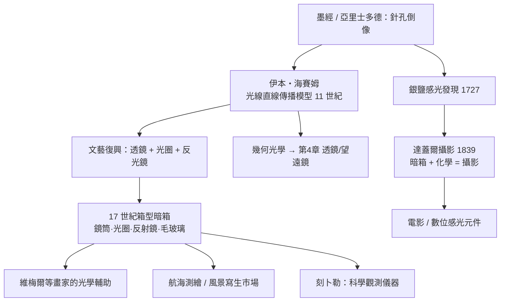

> 第一篇 · 第2章

# 第2.2節 早期光學裝置：暗箱（Camera Obscura）的構造與光線直線成像模型

## 從亞里士多德的針孔到黑屋

「Camera Obscura」拉丁文意為「黑暗的房間」。其物理原理早在古代已被觀察：亞里士多德記錄了針孔把日蝕的月牙狀影子投在地上；中國《墨經》（約公元前 4 世紀）更明確記載「景到（倒）」——光線穿過小孔後**上下顛倒成像**。十世紀阿拉伯學者伊本・海賽姆（Ibn al-Haytham, 965–1040）以實驗確立了**光線直線傳播**模型：他在暗室牆上開孔，觀察燭光經孔後的投射，證明每一發光點沿直線穿過小孔、在對面牆上各得一小光斑，全體光斑拼成**倒立實像**。

## 針孔成像的數學模型

設物距為 $u$、孔至成像面距離（像距）為 $v$、物高 $H$，由相似三角形得像高：

$$h = H \cdot \frac{v}{u}$$

像永遠倒立，且大小只取決於 $v/u$。針孔相機的「焦深無窮遠」是它的優點（任意距離皆可成像），也是弱點：孔徑 $a$ 決定了兩項矛盾的解析度——

- 幾何模糊：光斑直徑 $\approx a\left(1 + \frac{v}{u}\right)$，孔越小越清晰；
- 繞射模糊（波動光學）：艾里斑直徑 $\approx 1.22\,\lambda \frac{v}{a}$，孔越小越模糊。

因此存在最佳孔徑，實際選取約 $1$–$5\,\text{mm}$。這組「矛盾最適化」至今仍是所有光學系統設計的核心。

## 裝置構造的演進

| 時代 | 關鍵改良 | 發明/記錄者 |
|---|---|---|
| 前 4 世紀–11 世紀 | 針孔暗室、倒像原理 | 墨家、亞里士多德、伊本・海賽姆 |
| 1550 | 凹透鏡替代針孔（像更亮更清晰） | 卡爾達諾 |
| 1568 | 加裝光圈（diaphragm）控制像差 | 丹尼埃洛・巴爾巴羅 |
| 1646 | 45° 反射鏡 + 毛玻璃屏（正像、便於描圖） | 基歇爾《光影大藝》 |
| 17–18 世紀 | 折疊式箱型、可伸縮皮腔、平面鏡取景 | 各地工匠，成為旅人寫生工具 |

典型 18 世紀箱型暗箱的構造：一個木箱，前端為**鏡筒**（可調像距，即今日「對焦」的原型），筒內凸透鏡之後設 45° 平面反射鏡，把倒像翻成正像投到箱頂的毛玻璃屏，屏上加遮光罩以便戶外描圖——**人只需用筆沿著像的輪廓描繪**。

## 從「機器之眼」到藝術爭議

文藝復興至巴洛克時期，暗箱成為畫坊的秘密武器：維梅爾（Vermeer）畫中的高光「珍珠狀」失焦點、誇張的透視變形，被學者認為帶有暗箱光學的痕跡（近年在其《繪畫藝術》等作中甚至檢出透鏡特有的色差輪廓）。當時透視描繪從此由「手算幾何」轉為「光學自動化」——第 2.1 節的作圖法被做成了機器。

## 前因後果

**驅動因素**：①地理大發現時代，航海與製圖業需要精確描繪陌生地貌，暗箱成為測繪輔具；②靜物畫與風景畫市場興起，荷蘭黃金時代的中產階級收藏推高了對「逼真」的需求；③自然哲學從亞里士多德權威轉向海賽姆式實驗傳統，暗箱成為「研究視覺」的標準實驗室儀器——刻卜勒曾攜帶小型暗箱進行天文觀測輔助。

**催生後世**：暗箱完成了三項歷史使命——(1) **證明**影像可由光線機械生成，破除「圖像必然出自神/手藝」的觀念；(2) **沉澱**了相機的所有硬體基因：鏡筒、光圈、反光鏡、毛玻璃對焦屏；(3) **製造**了缺口：影像會轉瞬即逝，只能用筆記錄。填補這個缺口需要化學——1727 年舒爾策（J. H. Schulze）發現銀鹽見光變黑、1802 年韋奇伍德嘗試「光畫」、最終 1839 年達蓋爾攝影術（daguerreotype）問世：達蓋爾本人正是暗箱描圖的職業畫師，他從「用銀盤代替畫布」起步。相機（camera）一名，就直接繼承自 camera obscura。

## 延伸思考

1. 暗箱史上最深刻的教訓是「最佳孔徑」：幾何（孔越小越清晰）與波動（孔越大越清晰）兩套理論給出相反指令——真正的工程解答只能來自**兩種物理的疊加最適化**。這種多模型衝突下的設計思維，貫穿整部影音技術史。
2. 暗箱證明了「看見」本身可以被機器中介：人眼從感知的主體降級為記錄的終端。這一哲學位移，是兩百年後「機器視覺」與今日 AI 生成影像的觀念起點。
3. 達蓋爾的職業路徑（畫師→光學→化學）提示我們：重大影音突破常發生在**技藝瓶頸與新材料相遇**之處——暗箱缺的是感光介質，正如今日 AI 影片缺的是算力與資料，歷史總在找下一塊拼圖。
