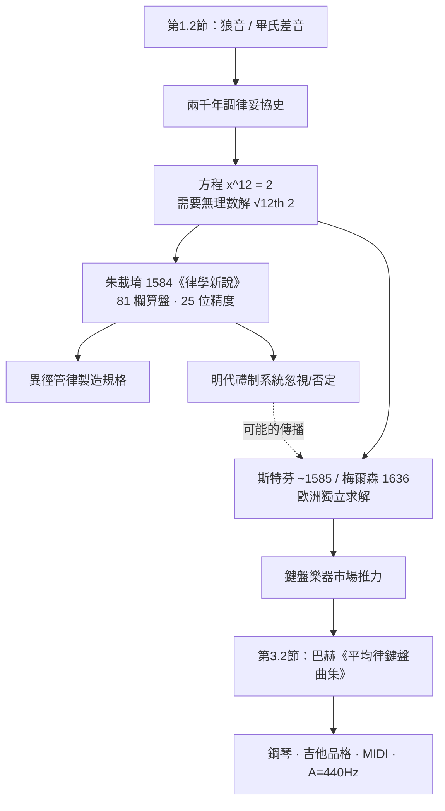

> 第一篇 · 第3章

# 第3.1節 朱載堉與梅爾森的超越方程：如何用算術求出 12 個相等的半音間隔（$\sqrt[12]{2}$）

## 一位不願襲爵的王子

朱載堉（1536–1611），明朝宗室鄭恭王的世子。十一歲時父親因獲罪被囚，他築土室於宮門外獨居十九年，潛心算學與音律；父平反後他七次上疏**讓出王位**，世稱「讓國高士」。這種身分使他同時擁有頂尖教育資源與逃離政治的動機——明代宗室被禁止參政，反而給了他三十年時間做純粹研究。萬曆十二年（1584 年），他在《律學新說》中公布了震古爍今的解法；其《律呂精義》更詳述整套理論。

## 平均律的數學：一個超越方程

問題：在八度（頻率比 $2:1$）內插入 12 個**完全相等**的半音，使轉任何調音程結構都不變（見第 1.2 節的狼音困境）。設每個半音的頻率比為 $x$，則：

$$x^{12} = 2 \quad\Rightarrow\quad x = \sqrt[12]{2} \approx 1.059463094$$

$\sqrt[12]{2}$ 是無理數，**不可能**用畢氏學派的整數比表示——這正是「超越」之處（在本書脈絡中，它指「超出有理數算術」的方程求解）。朱載堉的驚人成就在於：**在沒有對數、沒有西方代數符號的情況下，用 81 欄超大算盤完成了 25 位有效數字的計算**。

他的方法：先算 $\sqrt{2} = 1.059463094359295264561825$（誤差極小的近似？不——他精確算出），再開四次方得 $\sqrt[4]{2}$，進而由 $\sqrt[12]{2} = \sqrt{\sqrt[4]{2}}\cdot\frac{1}{\sqrt{2}}$ 之類的開方組合逐次求得，每步以算盤配合「累乘驗算」核對。他在《律呂精義》中開列了十二律的完整頻率比表，記錄至二十五位：

$$\sqrt[12]{2} = 1.059463094359295264561\,825\ldots$$

以標準音黃鐘律管為基準，各律的弦長（管長）依 $1/(\sqrt[12]{2})^n$ 逐次遞減，並以「新法密率」命名——「密率」意即比例細密到無隙。他甚至給出了**異徑管律**：為修正管口修正效應，十二根律管的內徑按 $\sqrt[24]{2}$ 逐管縮小，這是兼具聲學洞見的製造規格。

## 平行與孤立：梅爾森與歐洲

幾乎同時，法國數學家、修士馬蘭・梅爾森（Marin Mersenne, 1588–1648）在《和諧通論》（Harmonie universelle, 1636–37）中獨立給出 $\sqrt[12]{2}$ 並系統論證平均律，加上西蒙・斯特芬 1580 年代的前期嘗試（數值精度較低），歐洲才逼近同一解答。兩人相隔五十年、互不知曉——與第 1.1 節的三分損益/畢氏生律一樣，這是聲學問題普遍性的又一次印證。

| 系統 | 半音比 | 五度（音分） | 大三度（音分） |
|---|---|---|---|
| 畢氏律 | $\frac{256}{243}$ | 702 | 408 |
| 中全音律 | $\left(\frac{5}{4}\right)^{1/4}$ | 696.6 | 386 |
| **十二平均律** | $\sqrt[12]{2}$ | 700 | 400 |
| 純律（自然） | — | 702 | 386 |

平均律的五度、三度都不「純」，但**誤差被均攤到小於人耳通常容忍的 5–14 音分**，任何調皆可演奏——以微小的普遍失真，換取徹底的調性自由。

## 前因後果

**制度驅動**：朱載堉的工作有明確的制度背景——明代朝廷歷代「頒定律呂」以象徵政治正統（「同律度量衡」），宗室修律是合法且崇高的學術活動；但他的密律觸怒了墨守三分損益的樂官系統，《明史》記載其說「宣付史館，以備督律講求」後即束之高閣，清代更被康熙御製律呂正義變相否定。**算術戰勝了禮制，卻敗給了禮制**。

**傳播之謎與歐洲的收割**：朱氏律學有無西傳（經傳教士利瑪竇一線）至今無定論，但無論如何，十七、十八世紀的歐洲在「鍵盤樂器市場 + 復調音樂需求」的推力下（見第 1.2、3.2 節），把平均律從數學珍玩變成了工業標準。

**催生後世**：$\sqrt[12]{2}$ 是音樂工業的第一個「國際標準」——鋼琴的 88 鍵、吉他品格的計算（第 $n$ 格位於弦長 $\frac{L}{(\sqrt[12]{2})^n}$ 處）、今日 $f = 440\,\text{Hz}$ 的調音標準、MIDI 訊號的整數音高編碼，全都在這個等比數列上。朱載堉用算盤算出的那個數，就嵌在你手機的每一個音符裡。

## 延伸思考

1. 朱載堉與梅爾森的對照凸顯了「知識的制度容器」：同樣的數學，在歐洲撞上市場與行會就成為標準，在明帝國撞上禮制官僚就被封存——技術的存續不只取決於發明，更取決於接收它的社會結構。
2. 開 81 欄大算盤做 25 位開方，可視為「手工浮點運算」：每一步的捨入誤差管理（他的「累乘驗算」）正是現代數值分析的核心課題——古代算學家已自覺實作。
3. 平均律證明了一個深刻的工程哲學：**完美往往不可達，而「均勻的次完美」可以無所不能**。這與數位通訊「以量化誤差換取通用性」是同一策略。
