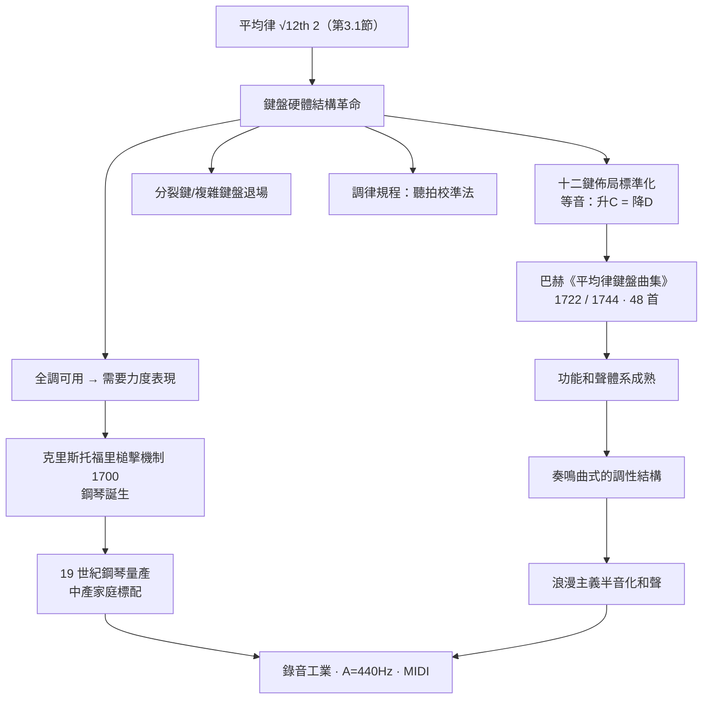

> 第一篇 · 第3章

# 第3.2節 鍵盤樂器結構革命：平均律如何解放音樂自由轉調的權力

## 從調律的枷鎖到全調的自由

平均律給出了 $\sqrt[12]{2}$ 這把鑰匙（第 3.1 節），但鑰匙要開的門是一台**硬體**：鍵盤樂器。管風琴、羽管鍵琴、楔槌鍵琴的結構特性是——**每一鍵對應固定的一根（排）弦/管，調音一次維持數月**。這使它們成為音律矛盾的「受災大戶」：提琴可以靠手指微調避開狼音，歌者可以靠耳朵靠攏純律，而鍵盤手只能與那組寫死的音高共存。因此歷史上鍵盤樂器長期受「易調限制」：用中全音律的樂器在降 E 小調等遠系調上，和聲裡全是狼嚎（第 1.2 節）。

## 鍵盤硬體與平均律的互相塑造

平均律一旦採用，鍵盤的物理結構反而獲得重大解放與標準化：

1. **十二鍵一組的八度佈局定於一尊**：七個白鍵（C D E F G A B）+ 五個黑鍵（升/降共用），因平均律保證升 C = 降 D（等音，enharmonic），鍵盤無需再加分裂鍵。對照之下，16 世紀的義大利曾流行**分裂鍵管風琴（split keys / archicembalo 式鍵盤）**：把黑鍵剖成前後兩半以容納純律的升、降兩音——平均律的普及使這些複雜機構徹底退場，鍵盤從「每調一套硬體」變成「一套硬體通吃」。
2. **調音工藝的標準化**：調律師的新工作法是「以三度拍音均勻化」設定全部十二音——以 $\sqrt[12]{2}$ 為目標，用聽拍（beats）校準：每個五度收窄至 700 音分，產生每秒約 $\frac{1}{2}$–$1$ 次的規律拍音。鍵盤調律從經驗藝術變成可傳授的技術規程。
3. **槌擊機制的成熟**：平均律全調可用 → 演奏者需要**力度變化**的樂器 → 1700 年前後克里斯托福里（Bartolomeo Cristofori）在佛羅倫斯發明帶逃脫裝置的槌擊機制（gravicembalo col piano e forte，「能弱能強」）→ 鋼琴（pianoforte）誕生。音律與擊弦結構、力度表現，在同一台機器上會師。

## 巴赫：《平均律鍵盤曲集》作為技術認證

1722 年，巴赫（J. S. Bach, 1685–1750）在克滕完成《平均律鍵盤曲集》第一部：**十二個大調與十二個小調，各寫一組前奏曲與賦格，共 24 首**；1744 年再出版第二部，合計 48 首。此曲集的意義有三層：

- **工程測試報告**：48 首作品就是對「全調可用」的窮舉驗證——每個調都被實際演奏、和聲都被實際聽見，等於把 $\sqrt[12]{2}$（或近似它的 well temperament）寫成了可聆聽的規格書；
- **教學課綱**：巴赫為長子撰寫的《威廉・弗烈德曼鍵盤曲集》即收入此曲，曲集從此成為鍵盤教育的通行教材，迄今未斷；
- **觀念宣示**：書名頁上巴赫親筆寫下「Wohltemperirte Clavier」——well-tempered。樂譜出版即「標準發布」，如同今日的技術 RFC。

## 前因後果

**經濟與社會驅動**：18 世紀德意志邦國林立，宮廷教堂樂師職位是音樂家的主要生計；鍵盤樂器（尤其管風琴）是中產市民與宮廷的共同投資，樂器製造（西爾伯曼等作坊）形成產業。全調可用意味著：**同一台琴能服務所有委託案**——婚禮的 C 大調、葬禮的 C 小調、宴會的 D 大調——樂器利用率與樂師的就業彈性同時提升。平均律因此不是純美學選擇，而是音樂勞務市場的效率革命。

**政治與宗教**：路德宗教堂的聖詠傳統要求教眾可唱（主調織體），宮廷需要舞曲的各調色彩，巴赫身處兩種僱主之間，「調性資源最大化」是制度夾縫的最適解。

**催生後世**：轉調自由 → 大小調功能和聲體系（T–S–D–T）全面成熟 → 海頓、莫札特以奏鳴曲式在不同調之間作「結構性旅行」→ 浪漫主義把轉調推向半音化極限（舒伯特的三度轉調、華格納《崔斯坦》開頭的懸置和聲）→ 十九世紀鋼琴成為中產家庭的標配傢俱（歐洲鋼琴年產量在 19 世紀後期達數十萬台）→ 二十世紀錄音工業以 A = 440 Hz、十二平均律為世界標準。今日電子鍵盤、MIDI、手機鈴聲，都是 48 首前奏曲與賦格的直接後代。

## 延伸思考

1. 「平均律解放音樂」其實是「標準解放創作」：放棄每個音程的局部純度，換來系統層級的全域自由——與網際網路「IP 封包放棄專線品質、換取全球互通」是同一辯證。
2. 巴赫曲集示範了「用作品做規格測試」的方法論：軟體工程以測試套件定義標準，巴赫以 48 首賦格定義 temperament——藝術史與工程史在此共用同一思維結構。
3. 值得追問：等音（升 C = 降 D）在平均律中是同一鍵，但在演奏者的心理與樂譜語義中從未真正等同——技術標準抹平了物理，卻沒有抹平意義，這正是後世「調性色彩」論戰的伏筆。
