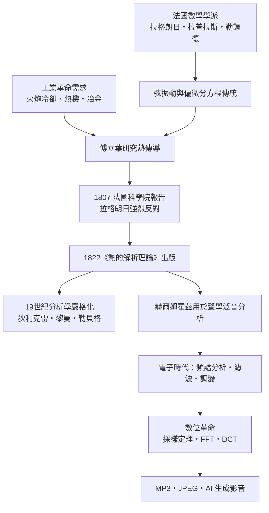

> 第二篇 · 第4章

# 第4.1節 導熱方程式與三角函數：傅立葉級數——「任何複雜函數都能寫成正弦波疊加」

## 歷史背景：工業革命鍛爐裡誕生的數學

1807 年，法國數學家約瑟夫·傅立葉（Joseph Fourier, 1768–1830）在法國科學院宣讀了一篇關於熱傳導的論文。這並非象牙塔中的抽象思辨，而是徹頭徹尾的時代產物：拿破崙時代的法國需要理解火炮鑄件的冷卻速率、需要計算熱機的效率、需要解決工業加熱與冶金中的實際問題。傅立葉年輕時曾隨拿破崙遠征埃及，返國後擔任格勒諾布爾的伊澤爾省行政長官，正是在處理公共工程與工程問題的閒暇中，他鑽研了熱在一固體棒中如何傳播的問題。

傅立葉大膽主張：**任何**（甚至是包含跳躍、角點的）週期函數，都可以表示成一組正弦與餘弦函數的無窮疊加。這在當時是驚世駭俗的。以拉格朗日（Joseph-Louis Lagrange）為首的評審——包括拉普拉斯（Pierre-Simon Laplace）與勒讓德（Adrien-Marie Legendre）——嚴厲反對。拉格朗日早已研究過弦振動問題，他堅持只有「足夠光滑」的函數才能用三角級數表示，認為傅立葉把特殊情形過度推廣了。這場爭論讓傅立葉的論文遲遲無法以完整原貌出版。直到 1822 年，傅立葉才將畢生研究彙整為《熱的解析理論》（*Théorie analytique de la chaleur*）正式出版，書中系統地建立了今日所稱的「傅立葉級數」與「傅立葉變換」。有趣的是，反對者雖然立場保守，但這場辯論反而迫使數學家認真思考「函數」到底是什麼——這直接催生了 19 世紀分析學的嚴格化（狄利克雷、黎曼積分，乃至後來勒貝格的測度論）。

## 數學核心：把波形拆成音叉的合唱

傅立葉級數的現代形式如下。對一個週期為 $T$（角頻率 $\omega = 2\pi/T$）的訊號 $f(t)$：

$$
f(t)=a_0+\sum_{n=1}^{\infty}\left(a_n\cos n\omega t + b_n \sin n\omega t\right)
$$

其中係數由積分求得：

$$
a_0=\frac{1}{T}\int_0^T f(t)\,dt,\quad
a_n=\frac{2}{T}\int_0^T f(t)\cos n\omega t\,dt,\quad
b_n=\frac{2}{T}\int_0^T f(t)\sin n\omega t\,dt
$$

直覺上，這就像把一道菜分解成食譜：$a_0$ 是「平均值」（直流成分），$a_n, b_n$ 則告訴我們第 $n$ 個諧波（基頻的 $n$ 倍頻率）要放多少。最經典的例子是方波——它只包含奇次諧波，振幅按奇數倒數遞減：

| 諧波 $n$ | 頻率 | 振幅（相對） | 貢獻 |
|---|---|---|---|
| 1 | 基頻 $f$ | $1$ | 主要音高 |
| 3 | $3f$ | $1/3 \approx 0.333$ | 明亮、尖銳感 |
| 5 | $5f$ | $1/5 = 0.2$ | 邊緣的「爆音」感 |
| 7 | $7f$ | $1/7 \approx 0.143$ | 細微粗糙感 |
| 9 | $9f$ | $1/9 \approx 0.111$ | 高頻細節 |

疊加項數越多，波形越接近理想方波，但在跳躍點附近始終殘留約 9% 的突起——這就是吉布斯現象（Gibbs phenomenon），提醒我們「無窮疊加」的收斂並不平凡。

## 前因後果：從熱傳導到 JPEG

傅立葉本人研究的是熱，不會想到他的級數日後成為一切影音科技的數學地基：1940 年代香農的採樣定理以頻域語言陳述；1965 年 FFT 演算法讓傅立葉分析從實驗室走入所有晶片；JPEG 影像壓縮的 DCT、MP3 音訊的心理聲學模型，本質上都是在頻域中「丟棄人類感官察覺不到的成分」。甚至本章故事中反對傅立葉的拉格朗日，其弦振動研究也正是傅立葉分析的前身——科學史有時以辯論而非共識推進。

## 延伸思考

1. 拉格朗日的反對並非全錯：傅立葉級數的「任何函數」需要嚴格定義收斂條件。科學爭論中，「錯誤」的一方如何仍能推動學科進步？
2. 方波只需奇次諧波、振幅為 $1/n$ 衰減；若衰減更慢（如鋸齒波的 $1/n$）或更快，訊號聽起來會有何不同？請連結到波形與音色的關係。
3. 吉布斯現象在今日影音中化身為「振鈴效應」（ringing artifacts）。你在壓縮過的影片或 JPEG 邊緣見過它嗎？
