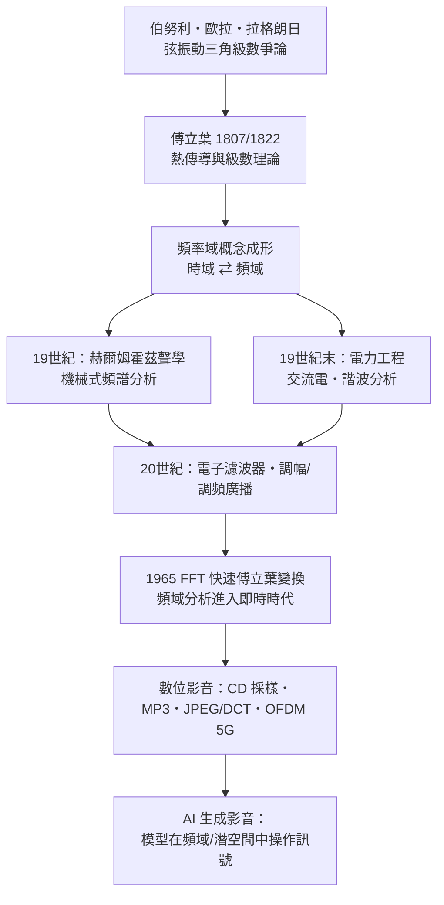

> 第二篇 · 第4章

# 第4.2節 頻率域（Frequency Domain）概念：跳脫時域的革命性分析視角

## 同一個世界的兩種描述

在傅立葉之前，物理學家描述聲音或振動的方式是「時域」：畫出一條曲線，橫軸是時間，縱軸是位移——例如麥克風薄膜隨空氣壓力起伏的記錄。時域描述直觀，但資訊混雜：一把小提琴與一支長笛演奏同一個音高，時域波形截然不同，眼睛看不出它們「為何聽起來不同」。

傅立葉級數帶來了革命性的第二種座標系——「頻域」：橫軸不再是時間，而是頻率；每個頻率成分用一根「譜線」表示，高度即振幅。同一把小提琴的聲音，在頻域中變成基頻 440 Hz 上的一根主峰，加上 880、1320 Hz……處一串遞減的泛音峰。音色的奧祕，在時域中隱形，在頻域中一覽無遺。可以說：**時域告訴你「什麼時候發生」，頻域告訴你「由什麼組成」**，而傅立葉變換就是兩個世界之間的往返票，且不遺失任何資訊。

## 數學核心：從級數到變換

傅立葉級數處理週期訊號；當週期 $T\to\infty$，離散的譜線密集成連續頻譜，級數便演化為傅立葉變換：

$$
F(\omega)=\int_{-\infty}^{\infty} f(t)\,e^{-i\omega t}\,dt,
\qquad
f(t)=\frac{1}{2\pi}\int_{-\infty}^{\infty} F(\omega)\,e^{i\omega t}\,d\omega
$$

使用複指數 $e^{i\omega t}=\cos\omega t + i\sin\omega t$（歐拉公式）讓正弦與餘弦合而為一，$F(\omega)$ 是複數，其大小 $|F(\omega)|$ 是振幅譜、相位 $\arg F(\omega)$ 是相位譜。對數位時代的離散取樣訊號，則對應離散傅立葉變換（DFT）：

$$
X_k=\sum_{n=0}^{N-1} x_n\, e^{-i 2\pi kn/N}, \qquad k=0,1,\dots,N-1
$$

| 比較軸 | 時域 | 頻域 |
|---|---|---|
| 橫軸 | 時間（秒） | 頻率（Hz） |
| 回答的問題 | 何時發生？波形長怎樣？ | 含哪些成分？各占多少？ |
| 典型圖形 | 示波器波形 | 頻譜圖 |
| 運算優勢 | 濾波繁瑣 | 捲積變乘法、濾波變「砍譜線」 |
| 影音應用 | 錄音取樣 | MP3 壓縮、等化器、JPEG/DCT |

頻域最強大的性質是**對偶簡化**：時域中的卷積（濾波、混響）對應頻域中的乘法。這一條數學事實，支撐了此後兩百年所有的訊號處理。

## 前因後果：一張「頻域世界觀」的擴散圖

香農 1948 年的通訊理論以頻寬定義通道容量；1965 年庫利（Cooley）與圖基（Tukey）發表的 FFT 把 $N$ 點 DFT 的運算量從 $O(N^2)$ 降到 $O(N\log N)$，讓頻域分析從離線計算變成即時處理——沒有 FFT，就沒有即時頻譜儀、沒有 MP3 編碼、也沒有手機通訊。今日 AI 生成影音的模型雖然複雜，其輸入輸出仍是經過頻域設計的訊號表示（如影像的 DCT 潛空間、音訊的梅爾頻譜圖）。傅立葉在 1822 年點燃的那盞燈，至今仍照亮整條影音科技之路。

## 延伸思考

1. 頻域分析「丟掉了時間資訊」：一段訊號頻譜相同，但事件順序不同時，頻譜無法區分。短時距傅立葉變換（STFT／聲譜圖）如何解決這個問題？
2. MP3 的心理聲學模型依賴「遮蔽效應」：響亮聲音會遮蔽鄰近頻率的微弱聲音。這與本章的頻域視角有何依存關係？
3. 若傅立葉變換不可逆（只保留振幅、丟棄相位），影像或聲音會變成什麼樣子？試想相位資訊的重要性。
