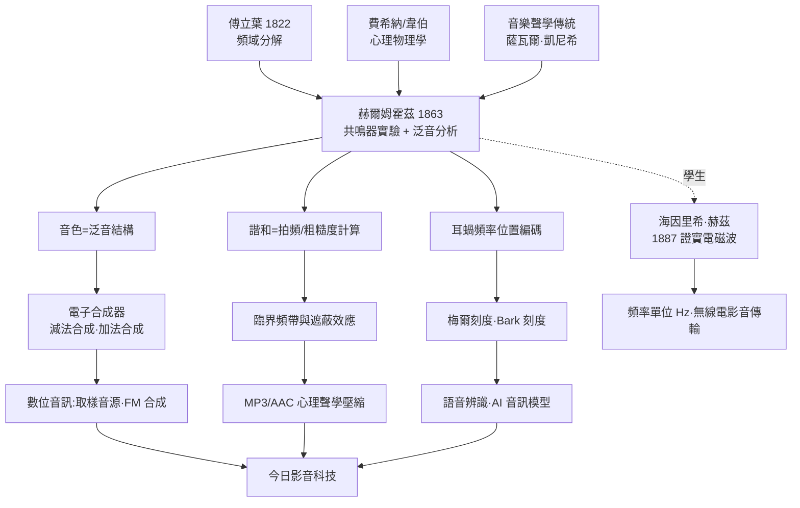

> 第二篇 · 第5章

# 第5.2節 《音感的生理學基礎》：用數學解構鋼琴、小提琴與人聲的泛音結構

## 歷史背景：1863 年，音樂與生理學的交會

1863 年，赫爾姆霍茲出版《論音感的生理學基礎》，副標題「作為音樂理論之生理學基礎」。這本近六百頁的巨著要做的事空前：**把音樂——這個長久被視為純粹美感領域的對象——放上實驗桌**，用物理、數學與生理學解剖它。書中開篇即引用傅立葉定理：任何樂音都是一組諧和正弦成分（泛音列）的疊加。赫爾姆霍茲手中的武器，正是上一節介紹的共鳴器：他把鋼琴、小提琴、長笛、人聲一一湊到球瓶前，逐一驗證其泛音結構。

這項工作深植於 19 世紀中葉的學術土壤：費希納 1860 年出版《心理物理學綱要》，確立「刺激強度—感覺量」的對數關係（費希納定律，奠基於韋伯的實驗）；生理光學、生理聲學興起，感官成為可測量的對象。赫爾姆霍茲承襲康德的認識論傳統，相信「感官是被建構的儀器」，因此研究樂音不能只研究空氣振動，還必須研究**內耳如何把振動轉譯成感覺**。

## 泛音結構：音色的數學身分證

一個頻率為 $f$ 的樂音，實際上常是：

$$
f(t)=\sum_{n=1}^{\infty} A_n \sin(2\pi n f t+\varphi_n)
$$

$n=1$ 是基音（決定音高），$n\ge 2$ 的 $nf$ 成分是泛音（決定音色）。赫爾姆霍茲以共鳴器測得各類樂器的泛音「指紋」：

| 聲源 | 泛音特徵 | 聽感 |
|---|---|---|
| 音叉 | 幾乎只有基音 | 純淨但「平淡」 |
| 長笛 | 低階泛音微弱 | 柔和、空洞 |
| 小提琴 | 高階泛音豐富且可由弓壓改變 | 明亮、有「毛邊」 |
| 鋼琴 | 泛音隨擊鍵力度變強，略有非諧性 | 豐滿、金屬感 |
| 人聲（母音） | 共振峰（formants）強化特定泛音帶 | 母音身分所在 |
| 管風琴（重音栓） | 奇次諧波突出 | 中空、如單簧管 |

他由此提出影響深遠的**音色理論**：音高對應基頻、響度對應振幅、**音色對應泛音的相對強度（及相位細節）**。小提琴與長笛奏同一個 A4 之所以聽來不同，是因為兩者的係數 $\{A_n\}$ 分布不同——傅立葉級數的係數表，成了樂器的「身分證」。

## 兩大理論遺產：諧和論與共振說

**（一）諧和與拍頻理論。** 為何八度、純五度聽來和諧，增四度刺耳？赫爾姆霍茲的答案很「傅立葉」：兩個複合音同時響起時，各泛音兩兩之間會產生**拍頻**（beats）。若泛音頻率比簡單（如 2:1、3:2），多數泛音重合或拍頻極慢，粗糙感低；頻率比複雜（如 45:32）時，泛音間出現大量快速拍頻，產生生理上的「粗糙度」（roughness）。和諧不是形而上的神祕屬性，而是**可以計算的生理事實**。這直接解釋了為何十二平均律（泛音略被「調歪」）在純音上還好、在大聲壓的複合音上聽得出妥協。

**（二）聽覺共振說。** 內耳如何做「傅立葉分析」？赫爾姆霍茲提出：耳蝸內數千條長短不一的科蒂氏纖維，就像一排不同尺寸的共鳴器——短纖維共振高頻、長纖維共振低頻，各有自己的共振頻率，好比一排迷你赫爾姆霍茲球瓶。此說大方向正確（耳蝸確實沿長度做頻率定位，即「位置編碼」），但後續研究（貝凱西 Békésy，1961 諾貝爾獎）顯示機制是行波而非獨立共振器——理論被修正，框架卻存續。

## 前因後果

本書的長鏡頭由此展開：赫爾姆霍茲的「音色=泛音結構」成為電子合成器的設計綱領（加法合成即人工疊加 $A_n\sin 2\pi nft$）；他的拍頻粗糙度理論演進為臨界頻帶與遮蔽模型，成為 MP3「丟棄聽不見的成分」的心理聲學依據；他的耳蝸頻率定位思想化為梅爾頻譜圖，是今日語音辨識與 AI 音訊生成模型的標準輸入表示。而他的學生赫茲讓「頻率」從聲學概念擴展為整個電磁波譜的通用語言——廣播、電視、無線傳輸皆以此計量。一位 19 世紀的生理學家，就這樣寫下了數位影音時代的序章。

## 延伸思考

1. 赫爾姆霍茲用機械共鳴器「聽出」頻譜；今日我們用 FFT「算出」頻譜。哪一種更接近耳朵實際的運作方式？
2. 十二平均律犧牲了純律的簡單頻率比。以拍頻粗糙度理論，說明為何鋼琴調音師仍要對八度做「伸展調音」（stretch tuning）。
3. 若音色完全由泛音振幅決定（相位無關），為何某些實驗顯示相位譜仍會影響聽感？這對「音色=係數表」的理論是挑戰還是補充？
