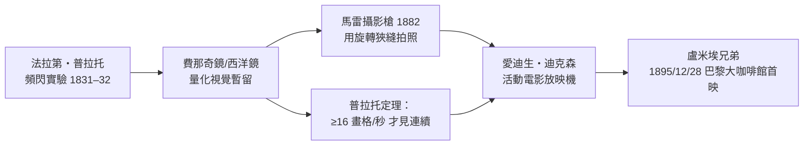

> 第三篇 · 第6章

# 第6.1節 費那奇鏡與西洋鏡：人眼視網膜反應時間的量化裝置

## 一、從科學儀器到娛樂機器

1832 年冬天，比利時物理學家約瑟夫・普拉托（Joseph Plateau）與維也納的西蒙・馮・施坦普費爾（Simon von Stampfer）幾乎同時、互不知情地發明了兩件結構極為相似的儀器：前者稱**費那奇鏡**（Phénakisticope，希臘文「欺騙眼睛」），後者稱**西洋鏡**（Stroboscope）。兩者的原理完全相同——利用視覺暫留（persistence of vision）與頻閃效應，把一系列靜止畫格「黏合」成連續運動的幻象。

普拉托並非玩具匠人，而是眼生理學家。他曾長時間直視太陽研究光對視網膜的傷害，導致晚年失明——科學史上最悲壯的獻身之一。他在 1829 年的論文中已經量化了人眼的關鍵參數：一個影像在刺激消失後，其殘留印象約持續 **0.1–0.2 秒**（後世精確化為視網膜積分時間約 1/16 秒量級）。正是這個「反應時間」，決定了多少張靜態畫格每秒輪替時，大腦會把它們讀作連續運動。

## 二、裝置的機械結構

費那奇鏡是一個帶有等距狹縫的圓盤，狹縫之間畫上相位漸進的畫格（典型 **12–16 格**）。使用者對著鏡子轉動圓盤：狹縫扮演機械快門的角色，只在畫格正對鏡面的一瞬間讓視線通過，其餘時間遮斷——這就是**頻閃遮斷**（stroboscopic interruption）。

設轉盤轉速為每秒 $n$ 轉、有 $N$ 個畫格，則畫格更新頻率為

$$f_{\text{frame}} = n \times N \;\; [\text{Hz}]$$

而狹縫造成的閃爍頻率恰等於 $f_{\text{frame}}$。當 $f_{\text{frame}}$ 落在約 **10–16 Hz** 以上，視覺暫留便將離散畫格融為連續動作；低於此值，運動會「卡頓」，甚至出現車輪倒轉的**頻閃混疊**（aliasing）——這是取樣定理 $f_{\text{frame}} > 2 f_{\text{signal}}$ 在人眼前的一次未經宣告的示範。

## 三、前因：鐘錶傳統與旋轉儀器

這些裝置能精確等速旋轉、狹縫能等分切割，全賴**法國與瑞士鐘錶工匠傳統**提供的精密齒輪與手搖曲柄技術。巴黎的光學儀器商（如 Duboscq）負責量產。同一脈絡下，英國的威廉・喬治・霍納（W. G. Horner）1834 年提出圓筒內壁貼畫的**西洋鏡**（Zoetrope，1860 年代由美國的米爾頓・布萊德利命名量產），觀者透過筒壁狹縫看向內壁畫格，不必照鏡子，成為日後愛迪生「活動影戲」的直接先祖。

## 四、後果：通往電影的因果鏈

費那奇鏡的商業生命不長（1850 年代被更好的玩具取代），但它留下三份遺產：**(1)** 「畫格 + 遮斷快門」的雙頻率架構，至今仍是放映機的幾何；**(2)** 16 畫格/秒這個數字，成為無聲電影的默認規格；**(3)** 頻閃混疊的視覺陷阱，至今仍困擾數位攝影中的車輪與螺旋槳。

| 裝置 | 年代 | 畫格數 | 觀看方式 |
|---|---|---|---|
| 費那奇鏡 | 1832 | 12–16 | 鏡前透狹縫 |
| 施坦普費爾頻閃盤 | 1833 | 12 | 鏡前透狹縫 |
| 西洋鏡 Zoetrope | 1834/1867 | 12–16 | 筒壁狹縫看內壁 |
| 實用鏡 Praxinoscope（雷諾） | 1877 | 12 | 內置稜鏡反射，無狹縫 |

## 延伸思考

1. 普拉托以失明為代價換得視覺暫留的量化——若視網膜積分時間只有 0.01 秒，電影還會以 24 fps 誕生嗎？還是需要更高的畫格率與更亮的放映機？
2. 頻閃混疊（車輪倒轉）本質上是取樣定理的視覺版本：費那奇鏡時代的人如何「解釋」這個現象？他們缺少的正是 20 世紀的取樣理論。
3. 從手繪畫格（費那奇鏡）到實拍照片（馬雷）再到投影放大（盧米埃），每一跳都放大了「欺騙眼睛」的規模——科學儀器變成娛樂產業，是偶然還是必然？
