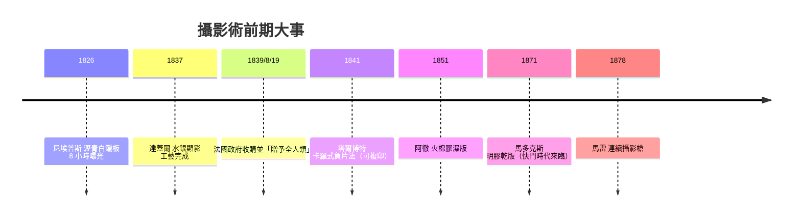

> 第三篇 · 第6章

# 第6.2節 感光化學與早期相機：達蓋爾銀版攝影術與乾片相機的機械結構

## 一、兩個發明者：尼埃普斯與達蓋爾

攝影術的誕生是兩個性格迥異者的合作。約瑟夫・尼塞福爾・尼埃普斯（Nicéphore Niépce），一位法國索恩河畔沙隆的鄉紳發明家，約 1816 年起便試圖用暗箱「留住」影像；1826/27 年，他在白鑞（ pewter 錫銻合金）板上塗布瀝青（bitumen of Judea），經暗箱曝光約 **8 小時以上**，拍出現存最早的照片《勒格拉的窗景》——瀝青在光照下硬化，未硬化處以薰衣草油與白石油洗去，形成負像浮雕。

尼埃普斯 1829 年與巴黎的佈景畫師兼萬花筒發明家**路易・達蓋爾**（Louis Daguerre）簽訂合夥。尼埃普斯 1833 年逝世後，達蓋爾獨自將工藝推向成熟。他的突破在於發現**碘蒸氣能使鍍銀銅板表面生成碘化銀感光層**，而曝光後的「潛影」竟能被**水銀蒸氣「物理顯影」**——汞原子優先凝附於曝光處，形成銀汞齊的珍珠白影像。1837 年他完成整套工藝，1839 年公之於世。

## 二、銀版工藝的化學與機械流程

| 步驟 | 操作 | 化學 |
|---|---|---|
| 鍍銀 | 銅板鍍純銀，磨至鏡面 | 機械拋光 |
| 感光化 | 置於碘化箱中薰蒸 | $2Ag + 2I_2 \rightarrow 2AgI$（另加溴、氯增感） |
| 曝光 | 暗箱裝板，對準景物 | $AgI \xrightarrow{h\nu} Ag^\ast$（潛影），初期需 4–15 分鐘 |
| 顯影 | 板面朝下置於 45–50°C 水銀箱 | $Ag + Hg \rightarrow$ 銀汞齊（亮白影像） |
| 定影 | 海鹽（後為硫代硫酸鈉）溶液 | 溶去未感光 $AgI$：$AgI + 2S_2O_3^{2-} \rightarrow [Ag(S_2O_3)_2]^{3-} + I^-$ |
| 鍍金 | 氯化金/硫氰酸鈉加熱 | 增強對比與耐久 |

機械結構上，達蓋爾的 **Giroux 相機**（1839 年由女婿 Giroux 木器廠製作，史上第一款量產相機）是一個兩層抽屜式木箱：內箱滑動對焦，銜接組合消色差透鏡（演化自望遠鏡光學，Chevalier 磨製），後箱有毛玻璃對焦屏與可滑動的暗盒插板。全機沒有快門——曝光靠取下再蓋上鏡頭蓋，時間由攝影師口數默唸。**「快門」要到 1860–80 年代才隨乳劑感光度提升而出現**，先是簡單的皮腔簾幕，再來是精密的機械擋片。

## 三、「贈予全人類」：一項國有化的發明

達蓋爾與尼埃普斯之子嘗試向私人認購者募資失敗後，轉向法國政府。物理學家阿拉戈（François Arago）在眾議院力陳此發明的科學與國家價值。**1839 年 8 月 19 日**，法國科學院與美術院聯席會議上，政府以終身年金（達蓋爾 6,000 法郎、尼埃普斯遺族 4,000 法郎）買斷專利，並按 Arago 的名言將工藝**「慷慨地贈予全世界」（gratuitement au monde entier）**——除英國外：在英國仍須付專利費，這是英法專利制度對立的縮影。與此對照，四十多年後的愛迪生選擇了完全相反的路：**以專利帝國壟斷**，律師與訴訟成為電影工業的一部分。

## 四、肖像的民主化與繪畫的危機

銀版曝光雖長（須以頭夾固定被攝者），但相較於坐上數小時請畫師描摹，已是革命。1850 年代火棉膠濕版與名片照（carte de visite）把肖像價格拉到平民，**肖像畫行業崩塌**。繪畫被迫回答「照相機能做的，我為何要做」——答案是顏色、主觀與瞬間：**印象派**（莫內 1874 年《印象・日出》）一方面受惠於攝影取景的自由構圖，一方面刻意逃離攝影的客觀性。波德萊爾 1859 年警告攝影是「藝術的死敵」，恰恰證明它已無可迴避。

## 延伸思考

1. 「政府收購、贈予全人類」與愛迪生式專利帝國，哪種制度更能促成技術擴散？達蓋爾術因無專利而十年即被淘汰，是制度的失敗還是成功？
2. 水銀顯影是「物理」顯影（汞原子堆積），現代顯影是「化學」還原（$AgBr + e^- \to Ag$）——為何化學路線最終勝出？
3. 攝影逼繪畫讓出「客觀再現」的職位，於是有了印象派、立體派——若攝影提早一百年出現，西方美術史會如何改道？
