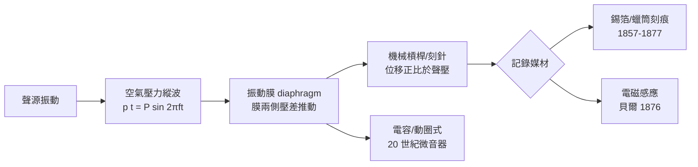

> 第三篇 · 第7章

# 第7.1節 聲波物理與換能：空氣壓力縱波與振幅、頻率的關係

## 一、畢達哥拉斯之弦：聲音科學的兩千年伏筆

傳說畢達哥拉斯（西元前 6 世紀）路過鐵匠鋪，發現錘重與音高有規律的關係；他進一步以單弦實驗證明：弦長減半，音升高**八度**；弦長比 $2:3$ 得純五度，$3:4$ 得純四度。這是人類第一次把「悅耳」化為**簡單整數比**——數學與音樂的婚約就此簽訂，也埋下了本書的母題：影音的歷史就是不斷把感官量化為數的歷史。

17 世紀，伽利略與梅森（Mersenne）給出弦振動定律：弦的基頻

$$f = \frac{1}{2L}\sqrt{\frac{T}{\mu}}$$

其中 $L$ 為弦長、$T$ 為張力、$\mu$ 為線密度。牛頓與拉普拉斯則計算聲音在空氣中的傳播速度：$c=\sqrt{\gamma p/\rho}\approx 343\,\text{m/s}$（20°C）。

## 二、聲波是什麼：空氣的縱向壓力漣漪

聲音不是物質的流動，而是**壓力的擾動**以縱波形式傳播。設某點的瞬時聲壓相對靜壓 $p_0$ 的偏移為

$$p(t) = P \sin(2\pi f t)$$

其中 $P$ 是**聲壓振幅**（單位 Pa），$f$ 是**頻率**（Hz）。質點位移 $\xi(t)=\Xi\sin(2\pi ft)$ 與聲壓相差 90° 相位，兩者關係為 $P = \rho c\, \omega\, \Xi$（$\omega = 2\pi f$）。三個關鍵換算：

| 物理量 | 感覺 | 關係 |
|---|---|---|
| 頻率 $f$ (Hz) | 音高 | 人耳可聽約 20–20,000 Hz；每八度 $f$ 倍增 |
| 振幅 $P$ | 響度 | 聲壓級 $L_p = 20\log_{10}(P/P_{\text{ref}})$ dB，$P_{\text{ref}}=20\,\mu\text{Pa}$ |
| 波形/頻譜 | 音色 | 傅立葉分解：$\sum_n A_n\sin(2\pi n f_0 t + \varphi_n)$ |

可聽動態範圍驚人：從聽閾（$20\,\mu$Pa）到痛閾（約 20 Pa）跨 **$10^6$ 倍**——這正是對數分貝標尺存在的理由，也是日後錄音媒材（錫箔、蠟、磁帶）必須對抗的工程難題。

## 三、換能：把空氣的顫動變成機械的位移

「換能器」（transducer）是聲能與機械能之間的翻譯官，聲音要被記錄，第一步永遠是換能：

機械式換能的本質是：聲波推動一片薄膜，膜的面積 $A$ 乘以聲壓 $p$ 得力 $F = A\,p$；再以槓桿放大位移。要在錫箔上刻出可讀的痕跡，位移需達微米量級——對應約 $10^{-2}$–$10^{-1}$ Pa 量級的聲壓，即得對著喇叭口**大喊**才行。這解釋了為何早期留聲機錄音像吼叫，也解釋了日後碳粒微音器（愛迪生電話）與電動微音器出現的必然。

## 四、歷史脈絡：從聲學實驗到愛迪生

1876 年**貝爾**（Alexander Graham Bell）以電磁感應式送話器取得電話專利，證明「膜—磁—電」路線可行；但愛迪生 1877 年的留聲機走了更原始也更天才的路——**純機械刻痕**，不需要電。同年巴黎的**克羅（Charles Cros）**在科學院提出以光蝕刻記錄聲紋的構想（未曾實作），這場「誰先發明留聲機」的論證，是十九世紀發明優先權競賽的典型劇碼——與達蓋爾、貝爾、愛迪生的專利戰同屬一個時代劇場。聲學量測的工具也在同步成熟：亥姆霍茲（Helmholtz）以共鳴球分析樂音的泛音結構（1863《音的感覺》），為 20 世紀的電子合成鋪路。

## 延伸思考

1. 畢達哥拉斯整數比 × 亥姆霍茲泛音理論 × 傅立葉分析——同一件事被做了三次：把聽覺化為數。今天 AI 音樂生成是否只是這條路的終點？
2. 機械換能受「位移需大聲」之限，電子換能解放了它。若沒有電話產業先養出微音器技術，留聲機會晚幾年出現？
3. 分貝是對數的，音階是倍頻的——聽覺本身就是「對數世界」。這對音量壓縮（compression）演算法有何啟示？
