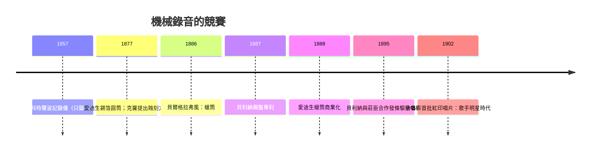

> 第三篇 · 第7章

# 第7.2節 機械聲學硬體：從錫箔圓筒到蠟筒留聲機的聲波針頭刻痕機制

## 一、1857 年的先聲：斯科特的「聲波記錄儀」

早在愛迪生之前二十年，巴黎排字工出身的發明家**愛德華-里昂・斯科特・德・馬丁維爾**（Édouard-Léon Scott de Martinville）於 1857 年取得**聲波記錄儀**（phonautographe）專利：以豬鬃或象牙刻針接在振動膜上，在**手搖旋轉的燻黑紙（或玻璃）圓筒**上劃出聲波曲線。它只能「畫」不能「放」——斯科特的目標是給語言學家做聲譜分析。直到 2008 年，科學家才以光學掃描「放」出他 1860 年錄下的《月光下》（Au clair de la lune），成為世上最早可回放的錄音。這段歷史提醒我們：**記錄與重放，是可以分離的兩個發明**。

## 二、愛迪生與迪克森：錫箔圓筒留聲機（1877）

1877 年夏，正在改進碳粒電話的**湯瑪斯・愛迪生**注意到電話送話器的振動膜會使膜片觸點「嘶嘶作響」，突發奇想：若讓針把這振動**刻**下來，理論上可以再讀回來。他口述一紙草圖交給首席技工**約翰・克魯西（John Kruesi）**，30 小時後機器完工。據載愛迪生對著喇叭口背誦〈瑪莉有隻小綿羊〉，機器竟唱了回來——他自稱當時「渾身戰慄」。1878 年 2 月取得美國專利第 200,521 號。

第一代留聲機（phonograph）的機械結構與訊號路徑：

| 部件 | 機械細節 | 物理角色 |
|---|---|---|
| 喇叭口（horn） | 錐形金屬/紙管 | 聚集聲波、提升膜面聲壓 |
| 振動膜 | 約 1–2 英吋雲母/金屬膜 | $F = A\,p$，聲壓→力 |
| 刻針（stylus） | 接於膜心的短槓桿，尖為藍寶石/鋼 | 位移放大，切入媒材 |
| 錫箔圓筒 | 手搖或馬達，直徑約 4 英吋、每分鐘 60–120 轉 | 媒材 |
| 螺紋導程（lead screw） | 每英吋約 10 條螺紋，帶動刻頭橫向進給 | 每轉一圈前進一條溝距，形成螺旋音溝 |

錄音時針尖在錫箔上**壓出深淺不一的溝紋**（縱向調變，hill-and-dale）；重放時同一機構反向操作：溝紋起伏推動針與膜，膜把位移還原成空氣壓力。錫箔只能重放寥寥數次即磨毀，且必須「喊錄」——機械換能效率太低。

## 三、貝利納的圓盤與蠟筒的進化（1880–90 年代）

愛迪生對留聲機的商業想像先是「辦公室口述機」，唱片的娛樂潛力反由競爭者開發。**亞歷山大・貝爾**與其表親奇切斯特・貝爾、查爾斯・泰恩特 1886 年取得**格拉弗風**（graphophone）專利：以**塗蠟紙筒**取代錫箔——蜡質軟硬適中，刻痕清晰且可用「複製電鍍」翻模量產。愛迪生隨即跟進推出**「完美型」蠟筒留聲機**（1888），並成立愛迪生留聲機公司。1887 年**埃米爾・貝利納（Emile Berliner）**申請**圓盤式 Gramophone** 專利：以蝕刻鋅盤翻製硬橡膠唱片，採**橫向調變**（lateral cut，針左右擺），圓盤便宜、易堆疊、可壓印數千份——唱片工業的地基就此打下，最終打敗了圓筒。

## 四、機械硬體的社會地基

留聲機的刻針、螺紋導程、發條馬達與音溝距（每英吋 100–200 條），全部繼承自**法國/瑞士鐘錶與縫紉機工業**的精密加工能力；貝利納的電鍍複製法則來自電鍍術。而愛迪生以「專利組合」築起帝國：1890 年代「愛迪生專利 trust」掌控圓筒專利，貝利納陣營靠圓盤專利周旋，訴訟打到 1900 年前後，逼得獨立唱片商遷往紐澤西州之外——**法庭成為技術路線的裁決者**，這段經驗直接預演了電影界的「愛迪生戰爭」（第 8 章）。

## 延伸思考

1. 斯科特「只錄不放」vs 愛迪生「錄放一體」：一項發明的價值在於完整閉環。今天的生成式 AI「只生成不回放」的介面，是否也缺了閉環？
2. 圓筒敗給圓盤：圓盤可平放、可印刷封面、可壓印量大。技術勝負常取決於「物流」而非音質——還有哪些影音史案例如此？
3. 縱向 vs 橫向調變是向量幾何問題（重力 vs 慣性對針的干擾方向不同）。若當年的媒材是垂直放置的，勝出的會是哪種調變？
