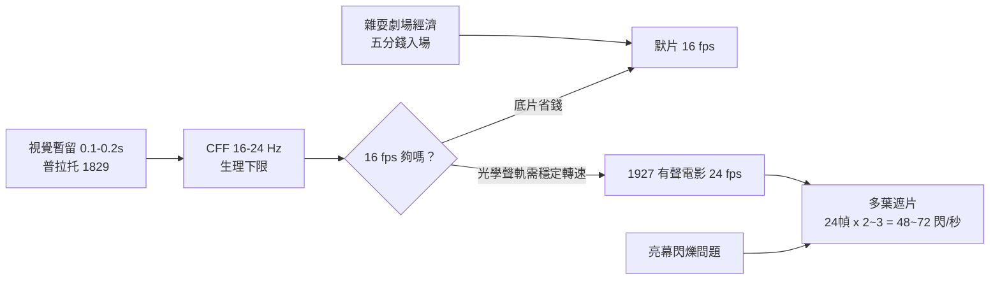

> 第三篇 · 第8章

# 第8.1節 24 幀/秒的生物物理極限：閃爍融合臨界頻率

## 一、數字的由來：從 16 到 24

電影畫格率不是設計出來的，而是**經濟與生理的折衷值**。1890 年代的無聲電影普遍採 **16 幀/秒**（愛迪生活動電影放映機與盧米埃 Cinématographe 皆是），因為：底片貴、攝影機機械極限低、而 16 fps 恰在「看得出連續動作」的門檻之上。到了 1927 年有聲電影降臨，問題來了——聲音刻在光學聲軌上，**放音的音調與轉速直接相關**：放映機轉速不穩或太低，人聲就變得含糊顫抖。工程上需要更高、更穩的轉速；加上當時映演業者已習慣以手搖曲柄「加速」過慢的喜劇片，華納與福斯決定把規格定在 **24 fps**——恰好也符合日後聲軌的頻寬需求。從此 24 幀/秒成為百年不變的全球標準（NTSC 電視的 29.97、PAL 的 25 是另一條支線）。

## 二、生理極限：閃爍融合臨界頻率（CFF）

讓離散閃光「融」為連續光的最低閃爍頻率，稱**閃爍融合臨界頻率**（Critical Flicker Fusion Frequency）：

$$\text{CFF} \approx 16\text{–}24\ \text{Hz（電影院亮度下）}$$

CFF 不是常數，它隨**亮度、視網膜位置、適應狀態**變化：亮幕上可高達 50–60 Hz 以上（暗適應的眼更敏感於低頻閃爍）。普拉托 1829 年的視覺暫留實驗（殘像約 0.1–0.2 秒）是它的先驅測量；費里與波特（Ferry & Porter, 1892/1902）給出經驗律：

$$f_c \approx a\log_{10} L + b$$

即 CFF 隨亮度對數上升。這解釋了電影放映的核心工程矛盾：**單純 24 fps 遮斷（每秒 24 次亮暗）在明亮畫面下仍會感到閃爍**。

## 三、三葉遮片：24 幀配 48 次閃爍

解法是**不增加畫格數，而增加遮斷次數**。放映機在每幀停留期間，以多葉旋轉遮片（shutter）把該幀**切開投影兩次或三次**：

- **雙葉遮片**：每幀投影 2 次 → 24 幀 × 2 = **48 次閃爍/秒**
- **三葉遮片**：每幀投影 3 次 → 24 幀 × 3 = **72 次閃爍/秒**（早期默片與部分放映機採用）

換言之，**空間取樣率（畫格率）由運動平滑度決定，時間取樣率（閃爍率）由 CFF 決定**——兩者是獨立變數，遮片機構正是把它們解耦的機械裝置。這一解耦思想延續至今：現代 3D 放映以 144 Hz 投影左/右眼各 48 或 72 次，LCD 背光的 PWM 調光、120 Hz 電視的背光掃描，全都是同一原理的數位化身。

## 四、經濟脈絡：電影誕生於雜耍劇場

16 fps 的選擇也刻著產業烙印。1890 年代的電影不是「電影院」的產物——美國首映於**雜耍劇場（vaudeville）**與便士拱廊（nickelodeon 的前身）：活動電影放映機（Kinetoscope）投幣式觀看，五分錢看一段一分多鐘的拳賽或舞女短片；歐洲則依託音樂廳與遊藝市集。底片是最貴的耗材（35mm 感光乳劑以碼計價），**每秒少拍 8 幀 = 成本省三分之一**，而雜耍觀眾只要「動起來像真的」就肯付錢。直到畫面變長、有聲化、影院變大變亮，24 fps 才因音質與 CFF 的雙重壓力被鎖定。

| 年代 | 標準畫格率 | 閃爍率（遮片） | 動因 |
|---|---|---|---|
| 1895–1920s | 16 fps | 32–48 次/秒（雙葉） | 底片成本、手搖轉速 |
| 1927– | 24 fps | 48 次/秒（雙葉）／72（三葉） | 光學聲軌音調穩定、CFF |
| 1950s（寬銀幕競賽） | 24 fps | 72–96 次/秒 | 亮幕抗閃爍 |
| 2012–（HFR 實驗） | 48 fps+ | 高頻投影 | 運動模糊、3D |

## 延伸思考

1. 24 fps 是「生理下限 + 成本上限」的歷史折衷——李安以 120 fps 拍《雙子殺手》遭觀眾嫌「太真」。更高畫格率是進步還是破壞了電影的「凝視感」？
2. CFF 隨亮度上升意味著：投影機越亮越需要更高幀率。LED 頭顯需要 90+ Hz，電影院 48 次閃爍就夠——同樣的眼睛，為何標準差這麼多？
3. 若光學聲軌不曾出現（例如聲音早直接壓在 16 fps 之上解決），電影會停在 16 fps 嗎？技術標準的「鎖定」有多偶然？
