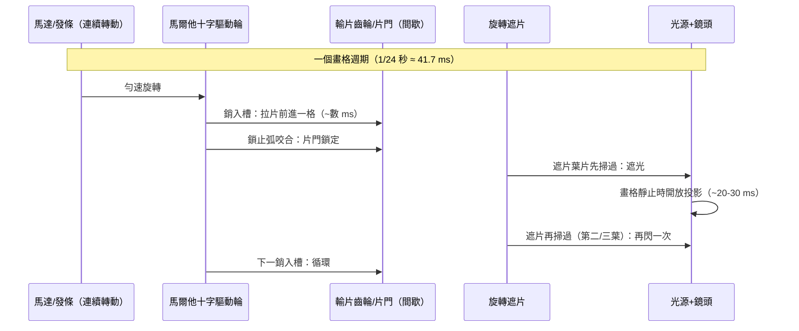

> 第三篇 · 第8章

# 第8.2節 間歇性機構裝置：齒輪、馬爾他十字（Maltese Cross）與電影攝影/放映機的運動學

## 一、為什麼需要「間歇運動」

連續勻速拉動底片，銀幕上每一格都是運動模糊的殘影；要得到清晰的畫格，底片必須**逐格「停—拍／停—映—快進」**：停留時曝光或投影，移動時以遮片擋光。這就是把「連續轉動」翻譯成「間歇轉動」的運動學問題。電影機的心臟，因此是一台**擒縱器**——和鐘錶心跳是同一族機構。這不是巧合：**法國里昂的盧米埃家族本業是照相器材，但整個里昂與巴黎的精密機械生態由鐘錶/縫紉機/紡織機工業供養**；瑞士手錶工匠亦大量轉進早期電影機的加工。

## 二、馬爾他十字的運動學

馬爾他十字機構（Maltese cross / Geneva drive，名稱取自醫院騎士團八角徽記）由兩件構成：

- **驅動輪**：帶一枚（或數枚）圓柱銷與一個偏置的鎖止圓弧（locking cam）；
- **從動十字輪**：四槽十字板，外緣為四段凹弧。

驅動輪勻速旋轉一週：銷進入十字槽、撥轉十字 **90°**；銷退出後，驅動輪上的鎖止弧滑入十字的凹弧，**鎖死**十字使其紋絲不動，直到下一枚銷再進入。設驅動輪有 $n$ 枚銷、週期 $T$，則十字的停留與運動時間由幾何角 $\alpha,\beta$（進出槽的切線角）決定：

$$t_{\text{move}} = \frac{\alpha}{2\pi}\,T,\qquad t_{\text{dwell}} = \frac{2\pi-\alpha}{2\pi}\,T \quad(\alpha < 180^\circ \text{ 不可，需 } \alpha \le 120^\circ \text{ 防死鎖})$$

單銷四槽十字的典型結果：每轉一週，十字轉 90°、停留約 3/4 週期。以 24 幀/秒放映即：**每秒 24 次「拉片—鎖定—投影」**，拉片僅占每幀週期的一小段，其餘時間片門處的畫格紋絲不動地被照亮。

## 三、在放映機裡：24 次/秒的拖片循環

愛迪生活動電影放映機（1893–95，實際工程由**威廉・迪克森**（W. K. L. Dickson）完成，其 1889–91 年以水平進給、48 格/呎的 35mm 規格確立了後世底片標準）採間歇拉片；盧米埃 Cinématographe（1895）更精巧：以**偏心凸輪驅動的抓片爪（claw）**實現間歇，且一機三用（攝影、放映、印片），手搖曲柄、木箱即放映機身。**1895 年 12 月 28 日**，巴黎「大咖啡館」印度廳，盧米埃兄弟以每場一分鐘的《火車進站》《工廠大門》收費放映——這一晚通常被定為**電影誕生日**。而「抓片爪」路線日後演化成所有現代攝影機/放映機的標準間歇機構（Maltese cross 限於四槽 90° 步距，被抓片爪取代以適應更多規格）。

## 四、專利戰與產業經濟

間歇機構本身早有專利傳統（日內瓦鐘錶業用它做旋轉展示台），電影機只是新客戶。愛迪生 1890 年代以 Kinetoscope 專利組合（含 Dickson 的攝影機專利）控告全美放映商與影片商，**1908 年組成電影專利公司（MPPC, the "Edison Trust"）**，逼得獨立片商逃往加州——好萊塢的誕生地，一半是陽光，一半是**離聯邦法院遠一點**。法國則靠盧米埃與梅里愛的輸出走遍世界。齒輪與十字輪的每一次咬合，背後都是專利律師的算計。

| 底片規格 | 誕生年 | 畫格尺寸/定位 | 主要用途 |
|---|---|---|---|
| 35mm | 1889–95 | Dickson 定規格，雙排片孔 | 電影院標準 |
| 16mm | 1923 | 單排片孔，業餘/教育 | 柯達 |
| 8mm | 1932 | 16mm 對半沖印 | 家庭電影 |
| Super 8 | 1965 | 卡匣化 | 家庭/獨立 |

## 延伸思考

1. 馬爾他十字與鐘錶擒縱同源——鐘錶把時間切成等份，電影把運動切成等份。機械時代「時間可被切分」的世界觀，是否正是動態影像誕生的哲學前提？
2. 抓片爪取代馬爾他十字：為何簡單的凸輪-爪比精密的十字輪贏了？「少一件零件」在大量製造中值多少？
3. MPPC 專利帝國最終被反托拉斯法拆解（1915/1948），獨立片商逃往加州——產業地理竟由專利訴訟塑造。今天串流時代的「專利池」是否正在重演？
