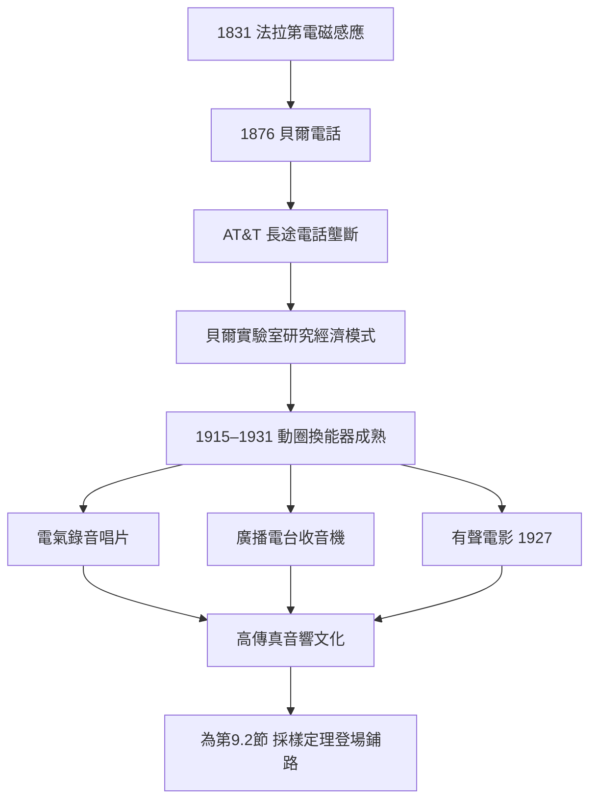

> 第四篇 · 第9章

# 第9.1節 換能器硬體：動圈式麥克風與揚聲器（利用電磁感應將聲波轉為電壓訊號）

## 一句話核心

動圈式麥克風與揚聲器是同一套物理原理的「正放」與「倒放」：聲波推動線圈在磁場中運動就發電（麥克風），電流推動線圈在磁場中運動就發聲（揚聲器）。二者共同依賴 1831 年法拉第發現的電磁感應定律，也是二十世紀一切錄音、廣播、電影聲音的物理起點。

## 歷史與人物

電聲轉換的故事從電話開始。1876 年貝爾（Alexander Graham Bell）的電話以電磁式振膜直接驅動，靈敏度與頻寬都極為有限。真正的突破發生在 AT&T 體系內：1915 年貝爾系統完成橫跨美國的長途電話幹線，1916 年 AT&T 工程師 E. C. Wente 在貝爾實驗室（時為 Western Electric 工程部）研發出電容式麥克風，而 1920 年代後期，動圈式（moving-coil）設計逐漸成熟。1931 年，Western Electric 推出著名的 618A 動圈麥克風，成為廣播錄音室的標準配備；同年代的 RCA 44 系列鋁帶麥克風則是另一條路線。

揚聲器方面，1915 年 Peter Jensen 與 Edwin Pridham 在加州以動圈驅動方式做出第一具實用的動圈揚聲器「Magnavox」，最初被用來擴音喊話給人群聽——他們的第一次商業測試對象是舊金山的歌劇迷與政治集會。1920 年代，Chester Rice 與 Edward Kellogg 在奇異（GE）完成了系統化的動圈揚聲器設計論文（1925 年發表），把共振頻率、阻尼與紙盆面積的關係寫成可計算的工程學。此後動圈結構幾乎壟斷了「把電變成聲」的市場，直到今日。

這背後有深刻的經濟結構：AT&T 憑藉長途電話壟斷與專利授權費模式，把貝爾實驗室經營成一台「基礎研究—專利—授權金」的印鈔機。Western Electric 的錄音設備授權給唱片公司（如 Victor），換取了整個 1920 年代電氣錄音產業的標準地位。換能器硬體不是天才靈感，而是壟斷利潤餵養出來的工程科學。

## 數學：法拉第定律如何變成麥克風

法拉第電磁感應定律寫成：

$$\mathcal{E} = -N \frac{d\Phi_B}{dt}$$

其中 $\mathcal{E}$ 是感應電動勢，$N$ 是線圈圈數，$\Phi_B$ 是穿過線圈的磁通量。在動圈麥克風中，聲壓 $p(t)$ 推動振膜，振膜帶動音圈（voice coil）在環形磁鐵的氣隙中移動，位移 $x(t)$ 造成磁通變化。對於音圈在均勻磁場中以速度 $v(t)$ 運動的情況，可簡化為：

$$\mathcal{E}(t) = -B \ell v(t)$$

其中 $B$ 是磁通密度（特斯拉）、$\ell$ 是氣隙中導線的總長度。聲波是壓力波，若振膜近似一個線性質量—彈簧—阻尼系統，則有二階微分方程：

$$m\ddot{x} + c\dot{x} + kx = S\, p(t)$$

$S$ 為振膜面積。揚聲器則是逆過來：對音圈通電流 $i(t)$，勞倫茲力 $F = B\ell\, i(t)$ 驅動紙盆。設計者的數學功課，就是讓這套力學系統在 20 Hz–20 kHz 內近似線性——這正是後續章節濾波器與頻譜分析大展身手之處。

## 硬體解剖

| 部件 | 麥克風中的角色 | 揚聲器中的角色 |
|---|---|---|
| 振膜／紙盆 | 接收聲壓，推動音圈 | 被音圈推動，壓縮空氣發聲 |
| 音圈 | 在磁場中運動而感應電壓 | 通電後受磁場力而運動 |
| 環形磁鐵（永久磁鐵） | 提供穩定磁場 | 提供穩定磁場 |
| 懸邊與定心支片 | 讓振膜只沿軸向移動 | 同左，並決定共振頻率 |

早期磁鐵是鈷鋼，後來演進到鋁鎳鈷（Alnico），再到鐵氧體與釹鐵硼——材料史直接決定了換能器的靈敏度與體積。

## 前因與後果

有聲電影是關鍵的外溢事件：1927 年《爵士歌手》使用 Western Electric 的 Vitaphone 系統，動圈換能器把唱片聲軌放大到足以填滿戲院。二戰期間，美軍要求輕量化通訊設備，促成小型磁鐵與人聲頻段（約 300–3400 Hz）的窄頻設計哲學——這個窄頻選擇後來又被電話系統繼承，成為數位化取樣頻率 8 kHz 的源頭之一（見 9.2 節）。

## 延伸思考

1. 麥克風與揚聲器物理上互為可逆裝置，為何實務上不拿揚聲器當麥克風用？提示：振膜質量、阻尼與頻率響應的設計目標不同。
2. AT&T 的「壟斷利潤 → 基礎研究 → 專利授權」模式，與今日大型科技公司自建實驗室有何異同？若沒有壟斷，貝爾實驗室會存在嗎？
3. 磁鐵材料從鈷鋼到釹的演進，說明換能器設計其實受制於礦產供應鏈。今日的稀土政策如何影響音響與手機產業？
