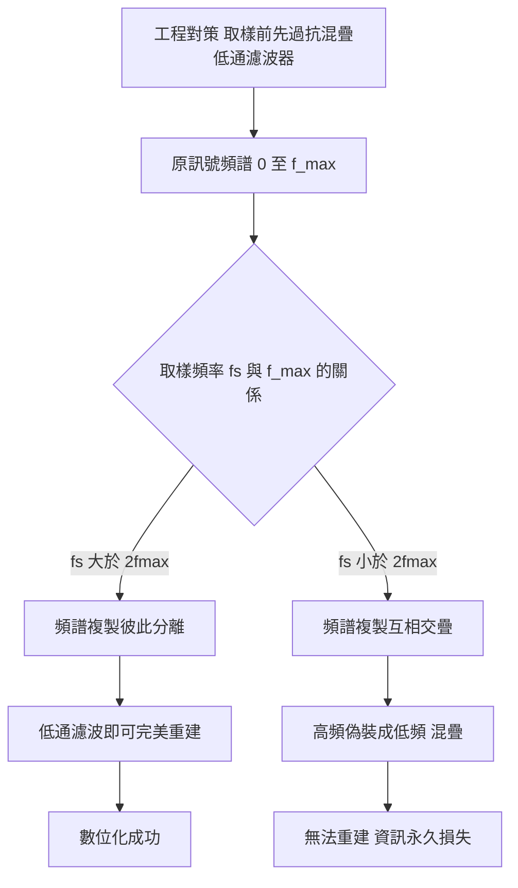
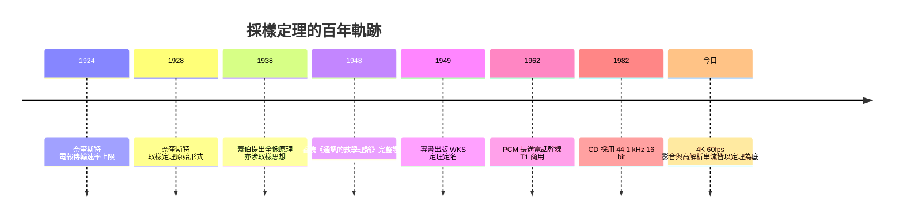

> 第四篇 · 第9章

# 第9.2節 奈奎斯特–香農採樣定理：數位化必須遵循的「兩倍頻率」數學法則

## 一句話核心

要把連續的聲波變成 0 與 1，取樣頻率必須嚴格大於訊號最高頻率的兩倍——這是數位世界的「最低門票」，由貝爾實驗室的奈奎斯特在 1928 年畫出輪廓，香農在 1948 年寫成嚴格定理。

## 歷史與人物

故事始於 AT&T 的長途電話工程問題。1924 年，奈奎斯特（Harry Nyquist）發表〈電報傳輸理論的某些因子〉，指出單位時間內可傳送的電報脈波數有上限，且與頻寬成正比；1928 年他再發表〈電報傳輸理論中的某些課題〉，證明：若一個訊號的頻率成分不超過 $W$ Hz，那麼以每秒 $2W$ 個取樣點就足以完全決定此訊號——這就是採樣定理的最初形式。奈奎斯特的研究動機極為務實：AT&T 要在昂貴的長途線路上榨出最多通話路數，必須知道「頻寬換訊息」的極限在哪裡。

二十年後，同樣出身貝爾實驗室的香農（Claude Shannon）在 1948 年發表《通訊的數學理論》，把奈奎斯特的取樣結果與自己的資訊熵、通道容量定理 $C = B \log_2(1+S/N)$ 統合成一座宏偉的數學大廈；1949 年該文以專書形式出版，同年度香農也正式把採樣定理以自己與奈奎斯特之名重述並給出完整證明（英國學者 Whittaker、蘇聯的 Kotelnikov 亦有獨立貢獻，故亦稱 WKS 採樣定理）。貝爾實驗室的專利授權費經濟模式，使得這些純理論論文背後站著一整套「壟斷收入→自由研究→標準制定」的機器。

## 數學：定理本身與混疊

**採樣定理**：設連續訊號 $x(t)$ 的頻譜在 $|f| \ge f_{max}$ 處為零（帶限訊號），若取樣頻率滿足

$$f_s > 2f_{max}$$

則取樣序列 $x[n] = x(n/f_s)$ 可唯一決定原訊號，且能以理想內插完全重建：

$$x(t) = \sum_{n=-\infty}^{\infty} x[n]\, \mathrm{sinc}\left(\frac{f_s(t - n/f_s)}{2}\right)$$

臨界值 $2f_{max}$ 稱為奈奎斯特率，$f_s/2$ 稱為奈奎斯特頻率。

若違反此條件，高頻成分會「偽裝」成低頻，此現象稱為**混疊**（aliasing）。取樣相當於頻譜以 $f_s$ 為週期無限複製；當複製的頻譜互相交疊，資訊便永久損失：

經典例子：以 $f_s = 8\,\text{kHz}$ 取樣時，一個 7 kHz 的正弦波會被聽成 $8-7=1\,\text{kHz}$ 的低鳴。因此任何數位系統的第一道防線都是「抗混疊濾波器」。

## 從定理到產品：CD 的 44.1 kHz

採樣定理在 1970 年代被工程界徹底消化後，飛利浦與索尼於 1982 年推出 CD，規格為 16 位元、44.1 kHz。為什麼是 44.1 kHz？人耳上限約 20 kHz，理論上 40 kHz 便過關，但實際抗混疊濾波器需要過渡帶，於是取 20 kHz + 2.05 kHz 裕度 × 2 ≈ 44.1 kHz。還有一段工程歷史：早期數位錄音借用了影像錄影機的磁帶作為儲存介質（以視訊行儲存音訊樣本），NTSC 規格每條視訊線可放 3 個樣本、每影格 245 條有效線、每秒 29.97 影格，$3\times245\times29.97 \approx 22050$，雙聲道恰為 44100 Hz。數學下限與錄影機硬體在這裡歷史性地會合。同樣的定理也決定了電話 8 kHz（人聲 3.4 kHz × 2 + 裕度）的窄頻世界。

## 前因與後果

廣播執照制度在此也有伏筆：國家對頻譜的分配（ FCC 等機構的執照拍賣）把「頻寬是稀缺資源」寫進了法律，而香農理論正是稀缺性的數學刻度。當數位化來臨，誰先算清楚頻寬與取樣的極限，誰就贏得標準競爭——這條線一路延伸到第 10 章的電視與第四篇末的數位廣播。

## 延伸思考

1. 採樣定理說 $f_s > 2f_{max}$ 即可，但 CD 為何不取整數 40 kHz，而取 44.1 kHz？「數學極限」與「工程裕度」的張力還有哪些例子？
2. 影像世界的取樣定理表現為「畫素密度 vs 鏡頭解析度」。手機相機動輒數千萬畫素，哪些是行銷、哪些是定理的必然？
3. 抗混疊濾波器若在取樣前「切掉」超音波內容，是否也算一種資訊損失？音響發燒友主張 192 kHz 取樣，你如何用香農理論評估其聽感宣稱？
