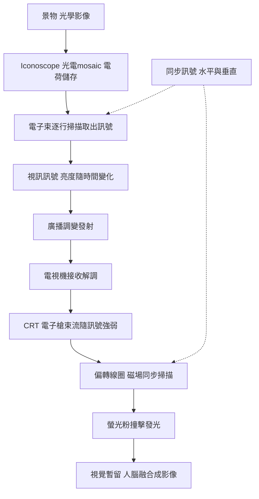

> 第四篇 · 第10章

# 第10.1節 攝影管（Iconoscope）與 CRT 陰極射線管顯像器：電子掃描與交錯掃描的硬體技術

## 一句話核心

電視的誕生是把「機械掃描」換成「電子掃描」的革命：攝影管用電子束讀出光電影像，CRT 用電子束把影像畫在螢光粉上——兩端都是一束被電場與磁場操縱的電子。

## 歷史與人物

電視的專利史幾乎是一部雙雄傳。**弗拉基米爾·茲沃里金（Vladimir Zworykin）**，俄國移民，1920 年代在西屋、後來在 RCA 服務，於 1923 年申請攝影管「Iconoscope」（光電攝像管）的專利，1933 年左右做出實用版本；接收端的「Kinescope」（顯像管）則於 1929 年展示。另一端是**菲洛·法恩斯沃思（Philo Farnsworth）**，愛達荷州的農家少年，16 歲構想出「影像分解器」（Image Dissector）——用一整面光電陰極同時感光，再以磁場把電子像「掃」過取樣孔；1927 年他 21 歲時做出第一套全電子電視系統，1930 年獲得專利。

接下來是長達十年的專利戰。RCA 的茲沃里金系統被法恩斯沃思以優先權證據（包括其高中化學老師保存的 1922 年構想草圖）擊敗，1939 年 RCA 不得不支付一百萬美元授權金並簽訂交叉授權。這場官司是「獨立發明人 vs 企業專利機器」的教科書案例，也再次印證第四篇的主題：RCA 繼承自 AT&T/GE 體系的專利授權費經濟模式，既是研發動力，也是法律武器。

## 硬體解剖

**Iconoscope（攝影管）**：一個真空玻璃管，前端內壁佈滿數百萬顆微小感光銀銫顆粒，構成「光電 mosaic」。景物經鏡頭成像於 mosaic 上，各顆粒因光電效應釋放電子而累積電荷，亮度越高電荷越多；後端電子槍發出一條電子束，逐行掃過 mosaic，把各點儲存的電荷「收回」，取出與亮度成正比的訊號電流。這是一種「儲存式」設計：每一點在兩次掃描之間持續積光，靈敏度因此遠勝法恩斯沃思的連續式 Image Dissector——這也是為何最終量產系統以 Iconoscope 系譜為主。

**CRT（陰極射線管顯像器）**：結構分三段——

| 部位 | 元件 | 功能 |
|---|---|---|
| 頸部 | 電子槍（陰極、控制柵、加速極） | 發射電子束，控制束流強度＝亮度 |
| 錐部 | 偏轉線圈（水平＋垂直兩組） | 磁場使電子束左右、上下掃描 |
| 面板 | 螢光粉層＋鋁膜 | 電子撞擊發光，餘輝維持一影格 |

電子束在螢光粉上的發光是「撞擊式」的：束流大則亮、束流為零則暗。因為螢光粉有餘輝（數十毫秒衰減），加上人眼視覺暫留，逐行的光點被大腦融成連續畫面。

## 數學：掃描的算術與交錯掃描

即時傳輸影片需要遠超過電話線的頻寬。若每影格 $L$ 條線、每線有效畫素 $N$、每秒 $F$ 個影格，垂直解析度理論所需的視訊頻寬約為：

$$B \approx \frac{L \cdot N \cdot F}{2} \ \text{Hz}$$

以 525 線、約 700 畫素、每秒 30 格計，$B \approx 5.5\,\text{MHz}$——這決定了電視頻道要占 6 MHz 的射頻頻寬。

1930 年代的無線電頻譜擠不出這麼多 6 MHz，工程師便用**交錯掃描**（interlacing）欺騙時間：把一個影格拆成兩個「圖場」（field），第一場掃奇數線（1, 3, 5, …），第二場掃偶數線（2, 4, 6, …），每秒 60 個圖場、30 個完整影格。畫面更新率感知是 60 Hz（閃爍少），但實際傳輸量只有逐行 60 Hz 的一半。這是典型的頻域壓縮：把時間維度上人眼不敏感的一半資訊省掉。

## 標準競爭與戰爭的外溢

英國 BBC 於 1936 年 11 月開播世界第一個高解析度（當時定義：405 線）公共電視服務，初期還機械掃描（Baird 系統）與電子掃描（Marconi-EMI 系統）並行試播，三個月後電子系統勝出。美國由行業組織 NTSC 制定標準，1941 年定案 525 線、每秒 30 影格、6 MHz 頻道。二戰把這條路線加速了：雷達需求催生了高功率微波管、精密偏轉電路與大批量 CRT 製造；戰後數十萬名受過雷達訓練的工程師與閒置的工廠產能瞬間湧入電視產業，美國電視普及率在 1950 年代從 9% 飆到 90%——這是典型的軍事技術外溢。625 線系統則在戰後的歐洲定案，形成美規與歐規的長期分立。

## 延伸思考

1. 法恩斯沃思贏了專利卻輸了產業——他的實驗室缺乏 RCA 式的製造與授權機器。「發明權」與「產業權」的落差，在今日的矽谷與專利流氓爭議中如何重演？
2. 交錯掃描是把「頻寬稀缺」轉嫁給觀眾大腦的取巧設計。數位時代逐行掃描（progressive）全面取代交錯，說明稀缺條件消失後，妥協性標準的命運如何？
3. Iconoscope 的「先儲存、後讀出」架構，與今日 CMOS 感光元件每個畫素的積分—讀出週期，本質上有何異同？
