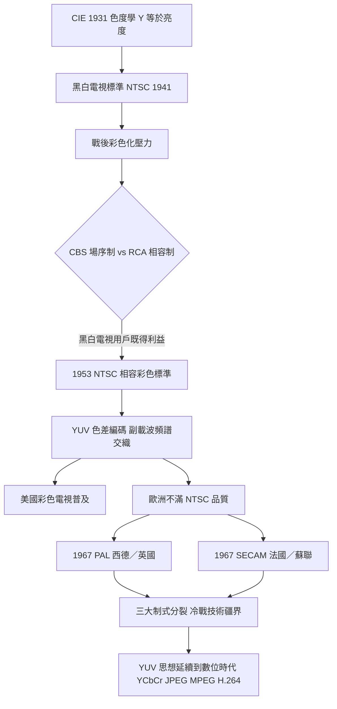

> 第四篇 · 第10章

# 第10.2節 CIE 1931 色彩空間與 RGB 轉 YUV 矩陣：利用人眼「重亮度、輕色彩」的頻寬壓縮電路

## 一句話核心

1931 年科學家用實驗量出了「人眼的色度地圖」，二十多年後電視工程師利用其中的洞見——人眼對亮度敏感、對色彩遲鈍——發明 YUV 編碼，用一條原本只能送黑白影像的頻道，偷偷塞進了彩色。

## 歷史與人物

色彩的科學化始於劍橋。1931 年，國際照明委員會（CIE）在英國劍橋召開會議，綜合約翰·吉爾德（John Guild）與萊特（W. D. Wright）等人以紅、綠、藍三原色進行的配色匹配實驗，正式定義了標準觀察者與 **CIE 1931 XYZ 色彩空間**。實驗方法是讓受試者調整三原色強度，去匹配各種單色光的顏色；由於部分光譜色無法以正的三原色匹配（會出現負值），數學家們做了一次線性變換，造出虛構但全為正值的原色 X、Y、Z——其中刻意讓 **Y 正好等於人眼的亮度函數**（明視覺光譜效率曲線）。這個「把亮度藏進數學座標」的巧思，是二十世紀視聽工程的關鍵伏筆。

黑白電視在 1930 年代末已有穩定標準（BBC 1936、美國 NTSC 1941 年定案 525 線），但戰後要推彩色電視時遇到死結：美國已有數千萬台黑白電視與一條 6 MHz 的頻道限制。1950 年代初，哥倫比亞廣播系統（CBS）推出機械式場序系統（旋轉色輪）雖獲 FCC 短暫採用，卻與黑白電視不相容，1953 年夭折。RCA 支持的 NTSC 於 1953 年 12 月通過**相容式彩色標準**：亮度訊號以原黑白方式傳送（黑白電視照常收看），色度資訊以壓縮後的副載波疊加。這是國家標準競爭的經典戰役——FCC 的執照制度與「相容性」的政治壓力，直接塑造了 YUV 編碼的誕生。

## 數學：亮度、色差與矩陣

利用 CIE 1931 的洞見，攝影機取得的 RGB 先被變換為**亮度**（luma）與兩個**色差**訊號：

$$Y = 0.299R + 0.587G + 0.114B$$

$$U = 0.492(B - Y), \qquad V = 0.877(R - Y)$$

係數 0.299 / 0.587 / 0.114 正來自 NTSC 標準螢光粉對應的人眼亮度加權（綠色貢獻過半，藍色最小）。解碼端可由線性代數完全逆回：

$$R = Y + \tfrac{1}{0.877}V, \quad B = Y + \tfrac{1}{0.492}U, \quad G = \tfrac{Y - 0.299R - 0.114B}{0.587}$$

關鍵在於頻寬經濟學。人眼視覺特性如下：

| 視覺維度 | 空間解析度 | 頻寬策略 |
|---|---|---|
| 亮度（Y） | 高——銳利邊緣、細節全靠它 | 給滿頻寬，約 4.2 MHz |
| 色度（U, V） | 低——色彩只需大面積模糊正確 | 各壓縮到約 0.5–1.3 MHz |

U、V 各只占不到 1 MHz，以相位正交調變（QAM 原理）疊在 3.58 MHz 的色副載波上，塞進黑白訊號頻譜的空隙——黑白電視機的電路把副載波附近的高頻雜訊當成普通細節忽略，畫面照常顯示。這種「頻譜交織」是把 CIE 色度學翻譯成省錢硬體的傑作。

## 硬體細節

攝影端：三管彩色攝影機用分光鏡把光分成三路，各打在一支攝影管上得 R、G、B，再以類比矩陣電路（電阻網路即乘加器）算出 Y、U、V。顯示端：1950 年代的蔭罩（shadow mask）CRT 有三支電子槍，螢光屏上以三角陣列塗佈紅、綠、藍三色螢光粉點，蔭罩鋼板確保各電子束只打到自己的顏色。相容性成本極高：副載波在黑白畫面上會產生細微的點狀紋路（dot crawl），工程師刻意把每影格的副載波相位反轉 180° 來抵消——這些補丁又成為後續 PAL、SECAM 改良的起點。

## 前因與後果

NTSC / PAL / SECAM 的分裂是政治經濟學：歐洲不願支付美國專利授權費，且 625 線、50 Hz 的電力制度不同；西德德律風根的 Bruch 教授設計 PAL（逐行倒相）把 NTSC 最敏感的相位誤差化為色調漂移的問題改成飽和度小誤差；法國則以 SECAM 走調頻色度路線，並與蘇聯集團結盟推廣。彩色電視標準因此成為冷戰技術疆界的具象化。

## 延伸思考

1. YUV 的本質是「把心理物理學寫進硬體」。今日的 JPEG、H.264 仍在用 4:2:0 色度下取樣——同樣是人眼特性，七十年不變。還有哪些視覺盲點正在被壓縮演算法利用？
2. NTSC 因色調易漂移被戲稱「Never Twice the Same Color」。工程妥協造成的品質缺陷，最終如何影響了國際標準的政治版圖？
3. CIE 1931 以少數受試者的配色實驗定義了全人類的色彩座標。標準觀察者的「平均眼睛」對色覺異常者與不同人種是否公平？今日的 HDR 與廣色域又如何修正這張 1931 年的地圖？
