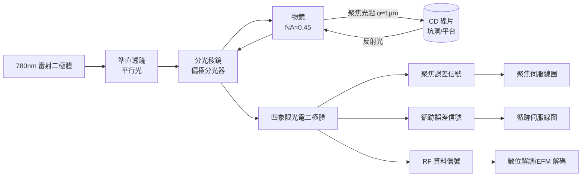

> 第五篇 · 第11章

# 第11.2節 雷射光碟硬體（CD Player）：半導體雷射讀取頭與光學聚焦伺服系統

## 一束 780 奈米的紅光

CD 播放機是消費電子史上第一次把「半導體雷射＋精密光學＋即時數位信號處理」整合進一台千美元以下的家用機器。碟片上的坑洞（pit）與平台（land）以 1.6 μm 的軌距螺旋排列，坑深約 110–130 nm，恰好設計為雷射波長的四分之一光程：光打在坑洞邊緣時，來自坑底與平台的反射光相消干涉，造成反射強度起伏——這就是資料的物理編碼。播放機採用波長 780 nm 的鋁鎵砷（AlGaAs）半導體雷射二極體，之所以選紅外光，是因為當時短波長可見光雷射良率低、壽命短；波長越短聚焦光點越小、可讀容量越高，這條「波長縮減定律」一路推到 DVD 的 650 nm、藍光的 405 nm。

雷射讀取頭的光路是一條精心安排的折返路線，可用下圖概括：

## 像散法聚焦伺服：讓誤差變成電壓

碟片厚度容差、機械振動與熱變形使碟面與物鏡的距離隨時漂移約 ±500 μm，而聚焦景深只有 ±2 μm。CD 播放機採用**像散法**（astigmatic method）：在反射光路中放入一枚微帶像散的柱面透鏡，當焦點精確落在碟面上時，反射光在四象限光電二極體上呈圓形；碟面偏近或偏遠時，光斑變成橫橢圓或縱橢圓。聚焦誤差定義為：

$$
\mathrm{FE} = \frac{(A+C) - (B+D)}{A+B+C+D}
$$

其中 $A,B,C,D$ 為四個象限的光電流。FE 信號過零點即正焦位置，這個近似線性的「S 曲線」被回饋給物鏡下方的聚焦線圈（音圈馬達，與喇叭音圈同構），以每秒上千次的頻率即時修正。這是**零點平衡式伺服控制**的教科書案例：感測器天生輸出誤差、致動器天生消除誤差，回饋迴路的頻寬與相位裕度決定播放機抗震能力。

## 三光束循跡：一半信號、一半偵錯

資料軌只有 1.6 μm 寬，光點卻約 1 μm，碟片偏心可達 ±70 μm。播放機不用單一光束，而是以繞射光柵把雷射分成一主二副的「三光束」：主光束讀資料，兩道副光束落在軌道兩側。循跡誤差為：

$$
\mathrm{TE} = \frac{E - F}{E + F}
$$

$E,F$ 為兩副光束的光電流。軌道正中時兩側反射對稱、TE 為零；偏軌時 TE 極性反轉，伺服迴路把光點拉回。這個設計讓「讀取」與「對準」共享同一組光學系統，是日本工程界「以冗餘感知取代絕對精密」哲學的典範——碟片不需要製造得完美，因為伺服系統每秒都在補償。

## 從光強到比特：EFM 與 CLV 控制

光電二極體的類比信號經整形後成為 EFM（Eight-to-Fourteen Modulation）碼。設計者把每 8-bit 資料映射為 14-bit 的特殊碼字，保證相鄰 1 之間至少有 2 個、至多 10 個 0，使坑長落在 3T–11T（T≈231 ns）之間——這既是光學頻寬的限制，也是碟片刻錄母版的時鐘重建依據。加上 3 個合併位元，最終碟上資料率為 $1.41 \times \frac{17}{8} \times \frac{588}{494} \approx 4.32$ Mbps。碟片以恆定線速度（CLV）1.2–1.4 m/s 旋轉，馬達轉速從內圈 500 rpm 連續降到外圈 200 rpm，由主軸伺服根據資料緩衝器的填充率閉環控制——CD 播放機因此是一台「四重伺服」（聚焦、循跡、滑行、主軸）同時運作的精密機器。

## 前因後果與產業經濟

1970 年代飛利浦的 LaserDisc 失敗教會了工程師一件事：消費者能接受昂貴的機器，但不能接受昂貴的碟片與低良率。CD 規格談判中，Sony 堅持 12 cm 直徑（傳說中為容納 74 分鐘的貝多芬第九交響曲），飛利浦堅持 11.5 cm，最後 12 cm 勝出——直徑每放大 1 cm，良率曲線都會重畫。CD 的成功奠定了光學讀取頭作為通用元件的地位，直接催生 CD-ROM、DVD、藍光，並讓「DVD 專利聯盟」（6C：東芝、松下等；3C：飛利浦、Sony、先鋒）以每台機器收取 4–5 美元授權金的模式，把「規格即收租」制度化。而當 2000 年代快閃記憶體與硬碟容量暴增，機械式光學讀取頭被淘汰時，這套伺服控制的工程知識又轉移到硬碟磁頭定位與光學感測領域——伺服的數學不會死去，只是換了載體。

## 延伸思考

1. 像散法聚焦的誤差曲線只在 ±3 μm 內線性，超出範圍伺服會失鎖；播放機如何用「搜尋-捕獲」策略處理跌落與啟動？
2. 藍光將波長縮到 405 nm、物鏡 NA 提高到 0.85，光學極限逼近繞射極限 $\lambda/2\mathrm{NA}$；下一世代的「光碟」為何敗給了網路頻寬而非物理極限？
3. 三光束循跡把「一個量測問題」拆成「兩個差分量測」，這種對稱差分設計在今天的原子力顯微鏡與光學陀螺儀中如何重現？
