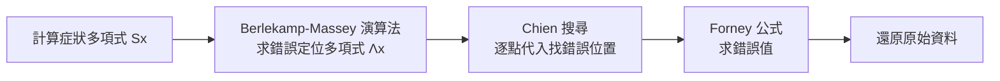

> 第五篇 · 第11章

# 第11.3節 裡德-所羅門碼（Reed-Solomon Error Correction）：光碟刮傷也能修復的代數幾何晶片

## 兩位波蘭血統數學家的一篇論文

1960 年，任職於 MIT 林肯實驗室的歐文·里德（Irving S. Reed，1923–2012，生於美國但學統承自波蘭學派的有限體傳統）與古斯塔夫·所羅門（Gustave Solomon，波蘭裔美國數學家）在《Society for Industrial and Applied Mathematics Journal》上發表了〈Polynomial Codes over Certain Finite Fields〉。論文只有短短數頁，卻提出了一種革命性的構想：**不要把資料當成一串位元，而把它當成有限體上的多項式**；只要在碼字中加入足夠的「檢查符號」，接收端就能從任何少於一定數量的錯誤中，用代數方法把原始多項式完整還原。

與其前輩漢明碼（逐位元糾錯）不同，RS 碼是「符號級」的碼：一個符號可以是 8 個位元組成的位元組，只要這個位元組內有再多錯誤，都算「一個」錯誤。這個特性使 RS 碼天生適合對抗**突發錯誤**（burst errors）——而光碟上的一道刮痕、磁帶上的一粒灰塵，正是典型的突發錯誤。

## 有限體 $\mathrm{GF}(2^8)$ 上的多項式算術

RS 碼的數學舞台是伽羅瓦體 $\mathrm{GF}(2^8)$：256 個元素（恰好一個位元組），加法即 XOR，乘法以一個 8 次不可約多項式（CD 規格採用 $x^8+x^4+x^3+x^2+1$）為模。CD 的糾錯採用兩層交錯的 RS 碼，稱為 CIRC（Cross-Interleaved Reed-Solomon）：

- **C1 碼**：$\mathrm{RS}(32,28)$，每 28 個資料位元組加 4 個奇偶位元組，可糾正 2 個符號錯誤；
- **C2 碼**：$\mathrm{RS}(28,24)$，可糾 2 個符號並檢出 4 個；
- 兩層之間以不同步長交錯（interleave），把碟片上連續的一長串錯誤「打散」成兩層碼各自看得見的散落小錯。

一個 $\mathrm{RS}(n,k)$ 碼把訊息 $m(x)$（$k$ 個係數）乘上生成多項式

$$
g(x) = \prod_{i=0}^{2t-1} (x - \alpha^{i})
$$

其中 $\alpha$ 是 $\mathrm{GF}(2^8)$ 的本原元素，$t$ 為可糾正的符號數。編碼就是**多項式除法**：計算 $m(x) \cdot x^{2t} \bmod g(x)$，把餘式（$2t$ 個位元組）附在訊息後面。硬體上，這個除法用一排 $2t$ 級的**線性回饋移位暫存器**（LFSR）實現：每輸入一個位元組，做一次 $\mathrm{GF}(2^8)$ 乘法（查表即可，256 位元組的對數/反對數表）與 XOR，資料流過一遍，餘式就留在暫存器裡。整個 C1 編碼器只是幾十個暫存器與 XOR 閘——1980 年代的 CMOS 晶片綽綽有餘。

## 從刮痕到還原：Berlekamp-Massey 與硬體

解碼比編碼難得多，其經典三步驟是：

1. **症狀子**（syndrome）：$S_i = r(\alpha^i)$，即用接收多項式 $r(x)$ 在生成多項式的根上取值，全為零表示無誤；
2. **Berlekamp-Massey 演算法**：由症狀子求出錯誤定位多項式 $\Lambda(x)$——1969 年 Massey 把它重述為線性遞迴序列的最短線性回饋問題，使其可用 LFSR 硬體迭代實現；
3. **Chien 搜尋與 Forney 公式**：逐一代入 $\alpha^{-j}$ 找根（錯誤位置），再用 Forney 公式算出錯誤值並改正。

CD 的設計目標極為具體：碟片可容忍直徑約 2.2 mm 的污點或刮痕——交錯機制把這樣的突發錯誤分散到不同 C2 碼字中，CIRC 總計可糾正每幀約 3,500 個連續錯誤位元、遮蔽（concealment，用前後樣本內插）約 12,300 個。超過極限的殘餘錯誤才交給「掩蔽電路」用線性內插硬撐，聽覺上幾乎無感。這是**代數幾何思想第一次大規模進入消費電子**。

## 前因後果：從太空到口袋

RS 碼最早的重大應用不是 CD，而是 1977 年的航海家（Voyager）太空船——深空通訊用 $\mathrm{RS}(255,223)$ 配合迴旋碼，把從數十億公里外傳回的影像錯誤率壓到近乎零。接著 CD（1982）、數位視訊廣播 DVB、DVD、行動通訊，直到今日 QR Code（每個 QR 碼內嵌多個 RS 區塊）與 5G 控制通道。Berlekamp 與 Massey 等人 1960 年代末開發的解碼演算法，配合 1980 年代 VLSI 技術，把理論家的代數變成矽片上的電路：飞利浦與 Sony 在紅皮書中規定 CIRC 為強制標準，任何播放機晶片都必須含有一個完整的 RS 解碼器。DVD 聯盟的授權金經濟同樣涵蓋這些必要專利——糾錯電路的數學專利成為「每台播放機抽稅」的合法性來源。今日，RS 碼的後裔（LDPC、極化碼）雖在通道編碼上取而代之，但 QR Code、儲存系統與深空通訊中，RS 仍是不可取代的符號級守門員。

## 延伸思考

1. CIRC 的交錯深度需在碟片上「隔開」相關資料，這使播放機必須緩衝大量資料才能交錯解開；延遲與糾錯力的取捨，在今日的串流協議（如 FEC over RTP）中如何重演？
2. Berlekamp-Massey 的複雜度是 $O(t^2)$，而 Chien 搜尋是 $O(nt)$；若改用 1970 年代的歐幾里得解碼法，硬體暫存器數量有何不同？
3. QR Code 讓每個人都隨身攜帶 RS 碼，你是否想過：當你掃描防疫實聯制或行動支付條碼時，執行的正是 1960 年那篇六頁論文的代數？
