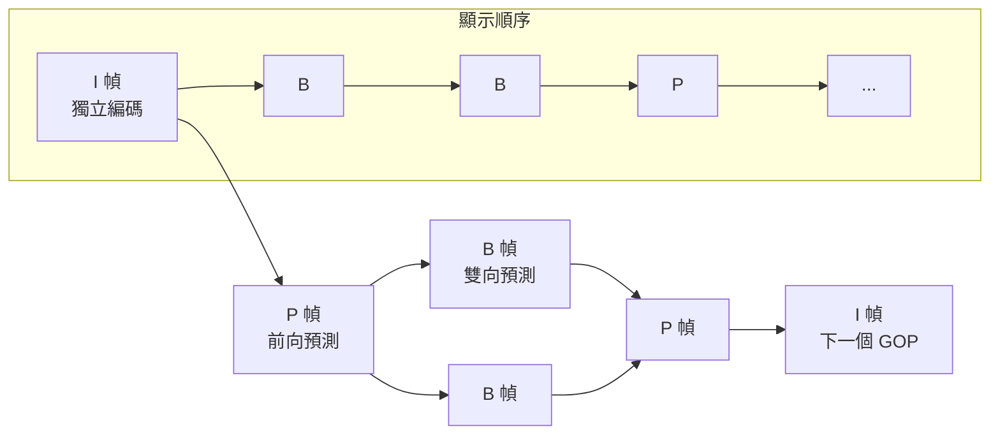
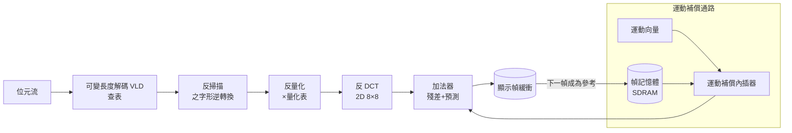

> 第五篇 · 第13章

# 第13.1節 硬體加速解碼：I 幀、P 幀、B 幀的動態補償電路設計

## 為什麼視訊壓縮需要「幀的類型學」

JPEG 壓縮一張影像；MPEG 壓縮「時間上相關的影像序列」。相鄰兩幀之間，多數像素幾乎不變——真正改變的只是少數移動的物體。MPEG 的解法是把序列切成**畫面群**（Group of Pictures, GOP），其中包含三種幀：

- **I 幀**（Intra）：完全自足的幀內編碼（DCT＋量化＋熵編碼，如 JPEG），是解碼的「錨點」與隨機存取的入口，資料量最大；
- **P 幀**（Predictive）：以**先前**已解碼幀為參考，只編碼每個宏區塊的運動向量與殘差；
- **B 幀**（Bidirectional）：可同時參考前後兩幀，甚至以兩者的運動補償平均做內插，壓縮率最高，但需要「顯示順序 ≠ 解碼順序」的重排緩衝。

一個典型 GOP 如 `I B B P B B P B B I`，I 幀約佔碼率的 30–50%，卻只佔幀數的十分之一。B 幀的存在使 MPEG-1/2 比「只有 P 幀」的方案多節省約 30–50% 位元率，代價是解碼器必須管理三個幀緩衝區與精確的時序控制。

## 宏區塊與運動補償的數學

MPEG-1/2 以 **16×16 宏區塊**（macroblock）為運動補償單位（4 個 8×8 亮度區塊＋2 個 8×8 色度區塊）。對每個宏區塊，編碼端在參考幀的搜尋範圍內找最匹配的區域，記下**運動向量** $(mv_x, mv_y)$（半像素精度），並只對**預測殘差**做 DCT：

$$
e(x,y) = f(x,y) - f_{\text{ref}}(x + mv_x/2,\; y + mv_y/2)
$$

半像素值由雙線性內插（相鄰四像素平均）取得。解碼端的硬體流程因此分為兩條並行的資料路徑：熵解碼→反量化→反 DCT 得到殘差；另一路從參考幀記憶體依運動向量讀取並內插出預測值；最後兩者相加寫入顯示緩衝：

## 硬體細節：為何需要專用電路

即時解碼 MPEG-2 主檔（720×480、30 fps、4–8 Mbps）需要每秒數億次基本運算。1990 年代的解法是**功能專用化的流水線**：C-Cube 的 CL9100、LSI Logic 的 L64002 等單晶片 MPEG-2 解碼器，內含 VLD 查表 ROM（霍夫曼表固定寫死）、IDCT 蝶形運算陣列、以及與 SDRAM 間的 DMAC。真正的設計難點有三：

1. **幀記憶體頻寬**：B 幀雙向參考、半像素內插每次讀 4 個像素，記憶體存取是效能瓶頸。設計者以巨集位址產生器（連續讀一整列）與內建快取降低 DRAM 往返；
2. **B 幀重排**：解碼順序 `I P B B` 顯示順序 `I B B P`，解碼器必須同時持有 I（或 P）與 P 兩幀的參考緩衝，B 幀解碼後依顯示時間戳（PTS）送出；
3. **錯誤恢復**：任一宏區塊解錯會沿運動補償傳播，因此 P 幀中允許「跳過宏區塊」（skipped macroblock，直接複製參考幀），並以切片（slice）為同步重設單位。

## 前因後果：MBAFF、H.264 與摩爾定律

H.264/AVC（2003，JVT 聯合制定）把宏區塊工具箱推向極致：引入 **MBAFF**（Macroblock-Adaptive Frame/Field coding，逐宏區塊自適應選擇幀/場編碼以處理交錯視訊）、可變區塊大小運動補償（16×16 至 4×4）、1/4 像素精度的六抽頭 Wiener 內插濾波器、環路去方塊濾波器（deblocking filter，需跨區塊讀寫，成為新的硬體瓶頸）、以及 CAVLC/CABAC 熵編碼。CABAC 的二元算術解碼有嚴重的資料相依，無法深度流水線化，反而迫使 2000 年代末的 SoC 用多個平行解碼核心與多執行緒 GOP 切分。隨著摩爾定律推進，1995 年一台 DVD 播放機需要的 300 美元專用晶片，到 2008 年已被吸收為手機 SoC 裡的一個硬體區塊（如 ARM、高通的視訊硬核），最終走上**通用 GPU 的可程式化解碼**（NVIDIA NVDEC、AMD VCN）：專用晶片未曾消失，而是變成了通用晶片裡的一個固定功能單元。

| 幀類型 | 參考幀 | 壓縮率 | 解碼緩衝需求 | 隨機存取 | 典型碼率占比 |
|---|---|---|---|---|---|
| I 幀 | 無 | 低（≈JPEG） | 只需自身 | 是（入口） | 30–50% |
| P 幀 | 前一 I/P | 中 | 參考幀＋本幀 | 否 | 15–30% |
| B 幀 | 前後 I/P | 高 | 兩個參考幀＋重排 | 否 | 5–15% |

## 延伸思考

1. B 幀帶來「先解碼後顯示」的延遲，這對視訊會議是不可接受的；H.264 為低延遲場景設計的 baseline profile 為何禁用 B 幀？
2. 運動補償的搜尋是編碼端最昂貴的步驟，但解碼端「免費」享受其成果——這種「編碼貴、解碼便宜」的不對稱如何塑造了消費電子（機上盒便宜、廣播設備昂貴）的產業分工？
3. 當 GPU 上的通用平行演算法開始追上固定功能解碼器，硬體加速的界線應該畫在哪裡？
