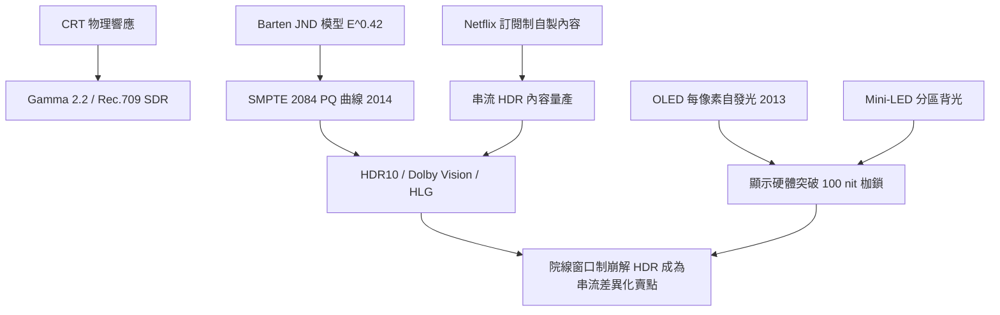

> 第六篇 · 第14章

# 第14.2節 PQ 曲線與廣色域顯示面板：OLED/Mini-LED 顯示硬體與心理物理學曲線

## SDR 的百年枷鎖

從 CRT 時代繼承的 Rec.709 / sRGB 標準，定義了約 100 nit 峰值亮度與有限的色域。其 gamma 2.2 編碼源自 CRT 陰極射線管的物理響應，暗部階調粗糙，亮部早早截斷——太陽、霓虹、爆炸在 SDR 世界裡永遠是一片死白。突破這道枷鎖需要三件事：更亮的顯示硬體、更廣的色域、以及一套貼合人眼感知的全新編碼曲線。

## OLED：每像素自發光的顯示革命

OLED（有機發光二極體）的概念可追溯到鄧青雲（Ching W. Tang）1987 年在柯達的實驗，但真正量產是 2007 年 Sony 推出 OLED 電視、以及 2013 年 LG 開啟大尺寸 OLED 面板量產之後。OLED 的革命性在於**每個像素自發光**：不需要背光，黑色像素直接熄滅，對比度理論上無限；反應時間以微秒計，徹底消滅液晶的殘影。其代價是有機材料老化——藍色材料壽命最短，早期電視有燒屏之虞，也限制峰值亮度。

與之競爭的是 **Mini-LED 分區背光液晶**：將背光從數十顆 LED 細分為數千甚至上萬顆微型 LED，組成數百至數千個可獨立控制的調光分區（local dimming zones）。液晶依然負責顯像，背光則像一張粗解析度的「亮度地圖」在後方明暗調控。Mini-LED 能輕鬆達到 1000–3000 nit 峰值亮度、無燒屏之虞，但分區邊緣會有光暈（haloing）——本質上是對 OLED「完美黑」的工程妥協。兩條路線的競逐，構成 2015 年後顯示器市場的主旋律。

## PQ 曲線：把心理物理學寫進標準

硬體亮起來了，訊號怎麼編碼？2014 年，Dolby 主導的 **SMPTE ST 2084** 標準問世，即「PQ（Perceptual Quantizer）曲線」，目標是在 10–12 bit 下覆蓋 0.0001 至 10000 nit 的巨大動態範圍而不產生可見帶狀失真。其設計奠基於 Barten 模型：人眼可分辨的最小亮度差與背景亮度近似 $JND \propto E^{0.42}$，據此 PQ 曲線以 B-spline 擬合出一條冪次遠陡於 gamma 的非線性曲線，其本質相當於 $E' = E^{1/26}$ 級的高度非線性映射——暗部段落的斜率極陡（精細刻度），亮部則大幅壓縮。這是「心理物理學直接成為工業標準」的罕見案例。與 PQ 並行的還有 BBC/NHK 的 HLG（Hybrid Log-Gamma），兼顧廣播相容性。色域方面，Rec.2020 與 DCI-P3 將可再現顏色範圍大幅擴張，依賴鎵系材料（如量子點）提升色純度。

HDR 的內容與傳輸格式隨之分化：**HDR10**（開放、靜態 metadata）、**Dolby Vision**（Dolby 主導、動態逐鏡 metadata、12 bit）與 **HDR10+**（三星陣營的動態 metadata 方案）。Dolby Vision 在 Netflix、Apple TV+ 與好萊塢母帶製作中全面落地，2014 年起的串流 HDR 戰爭也是一場專利與授權費的商業戰。

## Netflix 與好萊塢：訂閱制改寫顯示標準

HDR 的普及動力並非電視台，而是串流。Netflix 自 2007 年從郵寄 DVD 轉型線上訂閱，2013 年以《紙牌屋》跨入自製內容，2014 年開始供應 HDR 影片，並將 Dolby Vision、HDR10 支援列為裝置認證門檻。串流平台挾訂閱營收直接向片廠訂購 HDR 母帶，繞過院線與廣播的舊窗口制度；好萊塢的「院線窗口制」（電影先上映 90 天才發行家用媒體）在 2020 年疫情期間徹底崩解，HDR 母帶的經濟價值因此完全轉移到串流鏈路。一台電視是否支援 Dolby Vision，已不再是規格問題，而是內容生態的入場券。

| 項目 | SDR（Rec.709） | HDR10 | Dolby Vision |
|---|---|---|---|
| 編碼曲線 | Gamma 2.2 | PQ（ST 2084） | PQ（ST 2084） |
| 位元深度 | 8 bit | 10 bit | 12 bit |
| 峰值亮度 | ~100 nit | 1000+ nit | 4000–10000 nit |
| Metadata | 無 | 靜態（MaxFALL/MaxCLL） | 動態逐幀 |
| 色域 | Rec.709 | Rec.2020 容器/P3 內容 | Rec.2020 容器/P3 內容 |
| 授權 | 開放 | 免權利金 | Dolby 授權費 |

## 延伸思考

1. PQ 曲線把「人眼感覺」寫成工業標準——若未來顯示器突破 10000 nit，是該擴充 PQ 還是另起爐灶？
2. OLED 與 Mini-LED 的競爭本質是「完美黑」與「極致亮」的路線之爭，哪一種更貼近電影創作者的母帶意圖？
3. Dolby Vision 的封閉授權與 HDR10 的開放路線，對照音訊界 Dolby Atmos 與開源格式的歷史，顯示技術的標準之爭是否終究由生態而非技術決定？
