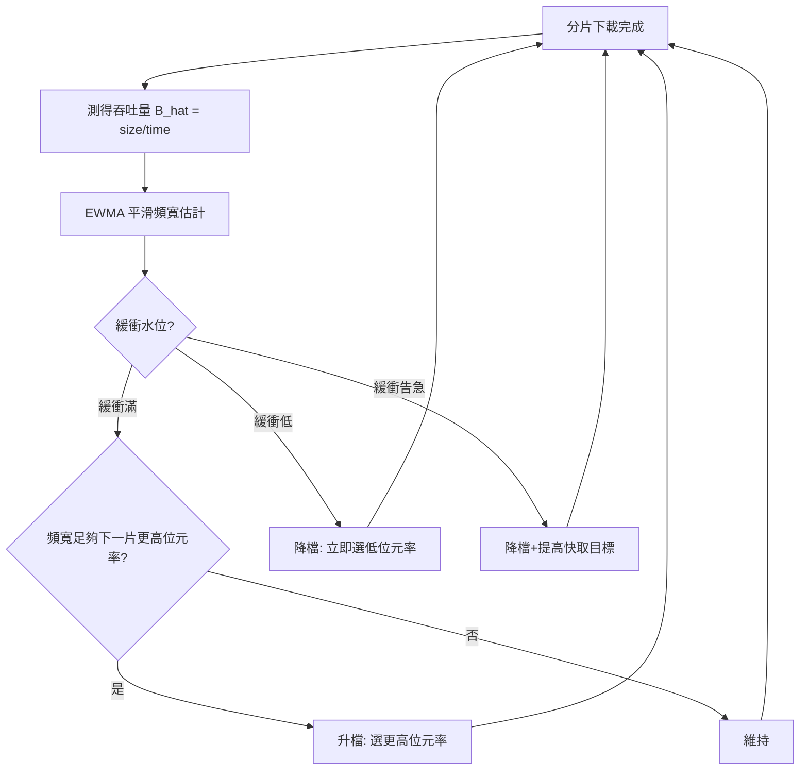

> 第六篇 · 第14章

# 第14.3節 雲端串流伺服器與 CDN 路由硬體：HLS / DASH 動態速率切換演算法

## 從「下載完再看」到「邊下邊看」

2010 年前後，影音傳輸經歷最後一次典範轉移。早年影片以漸進式下載（progressive download）播放，觀眾得等緩衝，檔案一旦播到未下載處便卡住。真正的解方是**串流**：影片被切成數秒的小檔案，播放器依網路狀況即時選擇畫質。Apple 在 2009 年為 iPhone 發表 **HLS（HTTP Live Streaming）**，將影片切成 10 秒左右的 TS/fMP4 分片（segment），配上一份播放清單（m3u8）描述各畫質版本；MPEG 社群隨後在 2012 年推出開放標準 **MPEG-DASH**。HTTP 協議的選擇是關鍵——它天生穿越防火牆、可被任何快取代理服務，串流從此搭上 CDN 的便車。

## CDN：把伺服器搬到你的城市隔壁

**內容傳遞網路（CDN）** 的思想源自 1990 年代末 Akamai——其創辦人 Tom Leighton 的核心洞見是：網路擁塞多發生在跨洲骨幹，若把內容複製到靠近使用者的**邊緣節點（edge node）**，延遲與壅塞都能大幅改善。邊緣節點由快取伺服器陣列構成，以一致性雜湊（consistent hashing）決定哪台機器負責哪支影片，DNS 或 anycast 路由則決定使用者連到哪個節點。2010 年代，Netflix 做出驚人決定：自建 **Open Connect** 專用 CDN，把「預測你在深夜會看什麼劇」的推薦資料與快取預載結合——白天先把熱門內容推送到各 ISP 機房的 Open Connect Appliance（OCA），夜晚尖峰時觀眾就近讀取。這是「大數據預測＋硬體布點」的合體工程，也讓 Netflix 與 Comcast 等電信商之間爆發誰該付互連費用的「流媒體戰爭」，最終促成 2015 年美國 FCC 強化網路中立性規則。

## ABR：每三秒做一次的即時決策

自適應位元率（Adaptive Bitrate, ABR）是串流的靈魂演算法。每個分片下載完成時，播放器必須決定：下一片選 1080p 還是 480p？決策依據兩個狀態——**頻寬估計**與**緩衝水位**。

頻寬估計最簡單的方法是「吞吐量法」：以最近一次分片下載量除以下載時間，$\hat{B} = \dfrac{\text{segment size}}{\text{download time}}$，再以指數加權移動平均平滑之。但突發頻寬與行動網路的波動會讓估計劇烈震盪。緩衝導向的演算法（如 BBA，buffer-based）則改問「我的緩衝還剩幾秒」：緩衝滿時升畫質、見底時降級。學界代表作 BOLA 與工業界研究（MIT 的 Pensieve 甚至以強化學習取代手寫規則）顯示，ABR 本質上是馬可夫決策過程（MDP）——狀態為 (頻寬估計, 緩衝水位, 各畫質碼率)，動作為下一片選哪個位元率，目標是最大化「畫質 − 卡頓懲罰」的長期報酬。

## 4G/5G 與訂閱制經濟：前因與後果

ABR 與 CDN 之所以成為主流，前因是 **4G LTE（2009–）** 的普及讓行動裝置擁有足夠下行頻寬，而智慧型手機把「螢幕」帶進每個口袋；後果則是整個影視產業的權力重組。Netflix 從郵寄 DVD 的倉庫物流公司轉型為雲端串流巨頭，靠的正是 AWS＋Open Connect 的雙層架構與訂閱制現金流。訂閱經濟改寫了內容財務學：院線窗口制的 90 天空窗被「同步上線」擊碎，2020 年疫情只是加速了早已發生的崩解。到 2010 年代末，全球網際網路流量過半是影音，CDN 成為數位基礎設施的隱形命脈，Akamai、Cloudflare、Fastly 與 Netflix 自建網路之間的競合，甚至影響到各國的網路中立性立法。

| 演算法世代 | 代表 | 決策依據 | 特點 |
|---|---|---|---|
| 第一代 | 吞吐量法 | 最近下載速率 | 簡單、易震盪 |
| 第二代 | BBA / BOLA | 緩衝水位 | 抗震盪、可能保守 |
| 第三代 | MPC / Pensieve | 頻寬+緩衝+預測 / 強化學習 | 最佳化長期 QoE |

## 延伸思考

1. ABR 以「卡頓懲罰」為代價換取畫質——當演算法替你默默降畫質時，你希望它誠實告知嗎？
2. Netflix 自建 CDN 繞過商用 CDN，這對 Akamai 等廠商與網路中立性規範意味著什麼？
3. 5G 之後，邊緣運算能否讓「4K 互動式直播」的位元率決策從播放器前移到基地台？
