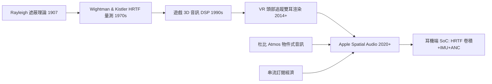

> 第六篇 · 第15章

# 第15.1節 雙耳定位與頭部傳遞函數（HRTF）：耳機硬體的 3D 聲場卷積運算晶片

## 為什麼兩隻耳朵能聽出三維空間？

人只有兩個聲音接收器，卻能分辨聲音來自前方、後方、頭頂或腳邊——這件事困擾了聲學家一個多世紀。1907 年 Lord Rayleigh 的「遮蔽理論」（duplex theory）提出兩大線索：**耳間時間差（ITD）**，低頻聲音抵達兩耳的時間差最多約 0.6 毫秒；**耳間強度差（ILD）**，頭部遮蔽使高頻聲音在遠側耳朵衰減。但僅靠這兩個線索，前後方的聲音會產生完全相同的 ITD/ILD——你無法分辨聲音在面前還是後腦。

關鍵的第三線索藏在你的**耳廓**裡。外耳複雜的皺褶像一座小型聲學迷宮，不同方向的入射聲波在耳廓內反射共振，在耳道入口處疊加出方向專屬的頻譜「指紋」。1970 年代，神性大學的 Fred Wightman 與 Doris Kistler 以堵塞耳道式麥克風量測數百個方向的脈衝響應，證實了**頭部傳遞函數（Head-Related Transfer Function, HRTF）**的完備性：只要把聲音與正確的 HRTF 做卷積，戴耳機的聽者就會「聽見」聲音出現在該方向。

## HRTF 的數學：一個卷積完成空間化

HRTF 本質上是線性時不變系統的頻率響應。設單聲道源訊號為 $s(t)$，左、右耳的方向專屬脈衝響應為 $h_L(t)$ 與 $h_R(t)$，則雙耳輸出為：

$$y_L(t) = h_L(t) * s(t), \qquad y_R(t) = h_R(t) * s(t)$$

其中 $*$ 表卷積。實作上以 FFT 轉換到頻域相乘後反轉換，或以有限脈衝響應（FIR）濾波器直接時域卷積——一組典型 HRTF 約 128–512 個係數，對每個聲源、每個方向都需執行兩次卷積；若聲場中還有虛擬牆面反射（如杜比 Atmos 渲染），則需再乘上早期反射與殘響網路。這對即時運算的要求催生了專用硬體：從 CREATES 那代的 DSP 到今日手機 SoC 內的音訊 NPU，3D 聲場渲染已是「每毫秒數百萬次乘加」的常態工作負載。

## 個人化問題與 Apple Spatial Audio

HRTF 的麻煩在於它高度個人化——你的耳廓形狀由基因決定，用「平均頭」量測的通用 HRTF 在他人耳中常導致定位失準甚至「顱內音」。解法有三條路線：(1) 光學掃描耳廓、以聲學模擬合成個人 HRTF；(2) 量測少量關鍵方向再插值；(3) **Apple Spatial Audio** 的折衷——AirPods 內建的高階方案雖用通用 HRTF 資料庫，但以耳道內麥克風量測耳道阻抗微調個人化參數，並透過頭部追蹤（iPhone/手錶的 IMU 與藍牙低延遲同步）讓虛擬聲場「固定在世界座標」——你轉頭，聲音不動。這項 2020 年隨 AirPods Pro 成熟的技術，把電影院的 Atmos 物件式音訊（object audio）搬進耳機：聲音不再是聲道，而是帶三維座標的「物件」，由渲染器即時決定它該被哪組 HRTF 卷積。

硬體端的配合同樣關鍵：AirPods Pro 內的音訊系統級晶片需在毫秒級延遲內完成多聲源 HRTF 卷積、頭部姿態濾波與主動降噪（ANC）的自適應反饋——降噪本身也是卷積與 LMS 自適應濾波的應用。耳機從被動換能器，蛻變為「耳朵上的空間音訊運算平台」。

## 前因後果：從遊戲引擎到版權經濟

空間音訊的商業化動力來自三個場域。其一是**遊戲**：遊戲引擎 3D 音訊渲染的需求早在 1990 年代就催生了 Aureal A3D 等硬體；其二是**VR**：2014 年起的 VR 熱潮使頭部追蹤雙耳音訊成為臨場感成敗的關鍵；其三是**串流與音樂產業**：Apple Music 於 2021 年以杜比 Atmos 空間音訊為賣點，唱片公司重新混音流行金曲，空間音訊成為訂閱制的差異化籌碼。同時，YouTube 等平台的 AI 降噪與混音工具也逐步內建空間處理；而串流平台對音訊內容的版權偵測（如 YouTube Content ID 的音訊指紋比對）則在另一端維繫著這個生態的商業秩序——空間化的音訊物件一樣得通過指紋審查。

| 線索 | 頻率範圍 | 生理來源 |
|---|---|---|
| ITD 耳間時間差 | < 1.5 kHz | 頭部直徑造成路徑差 |
| ILD 耳間強度差 | > 1.5 kHz | 頭部聲學遮蔽 |
| 頻譜指紋 | 2–16 kHz | 耳廓皺褶共振 |

## 延伸思考

1. 若每個人的耳廓都是獨一無二的「聲學指紋」，HRTF 個人化是否會成為下一個生體辨識應用？
2. 空間音訊讓串流平台重混舊歌，這對原混音師的著作人格權意味著什麼？
3. 當耳機同時做降噪、頭部追蹤與空間渲染，延遲與功耗的三角取捨該由硬體還是演算法解決？
