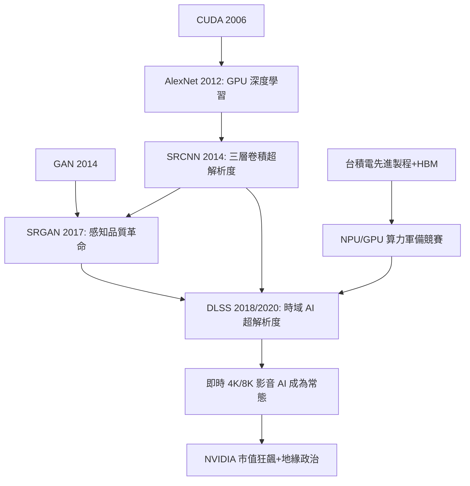

> 第六篇 · 第15章

# 第15.2節 AI 晶片（GPU / NPU）與神經網路超高解析度（SRCNN / GAN）

## 從遊戲顯卡到深度學習引擎

2010 年代影音畫質革命有一個常被忽略的共同前提：**算力**。NVIDIA 在 2006 年推出 CUDA，讓遊戲用的 GPU 變成通用平行運算平台；2012 年 Alex Krizhevsky、Ilya Sutskever 與 Geoffrey Hinton 以兩張 GTX 580 訓練 AlexNet 奪下 ImageNet 冠軍，正式宣告「GPU 深度學習」時代來臨。此後 NVIDIA 轉型為 AI 公司，資料中心晶片（從 Tesla、A100 到 H 系列）成為市值支柱，2020 年代一度躋身全球市值最高企業之列——影音 AI 的每一項突破，背後都是這條算力軍備競賽曲線，而曲線的物理基礎則是台積電的先進製程（7nm、5nm、3nm）與先進封裝。台積電在先進製程上的獨占地位，使晶片製造成為 2020 年代地緣政治的核心議題：美國 CHIPS 法案、出口管制與「矽盾」論述，都直接影響影音 AI 晶片的供給與迭代速度。

## SRCNN：三層卷積開啟神經超解析度

**超高解析度（Super-Resolution, SR）** 的傳統做法是插值（雙線性、Lanczos），本質是固定權重的濾波，無法「無中生有」出細節。2014 年，香港中文大學的董超、湯曉鷗等人提出 **SRCNN（Super-Resolution CNN）**，首次證明深度學習可超越傳統方法：網路僅三層卷積——第一層學習影像區塊的稀疏特徵（對應傳統方法中的字典學習），第二層做非線性映射，第三層重構高解析度影像。它以大量低解析度／高解析度影像對做端對端訓練，損失函數為均方誤差：

$$\min_\theta \; \big\| f_\theta(x_{LR}) - y_{HR} \big\|^2$$

SRCNN 的意義不在效能而在**範式**：影像復原從手工特徵走向資料驅動。隨後 SRGAN（2017）引入生成對抗網路（GAN, Ian Goodfellow 2014 提出）與感知損失，讓生成影像在「人眼感知」上遠勝 MSE 訓練的模型——雖然其像素級誤差更大。GAN 的對抗訓練（生成器 vs 判別器）賦予模型「幻想」細節的能力：毛髮、紋理、文字邊緣得以被逼真補出。代價是**幻覺（hallucination）**：模型補出的紋理未必是真實場景的還原，這在鑑識與新聞影像上引發了倫理爭議。

## DLSS：把 AI 寫進即時渲染管線

2018 年，NVIDIA 推出 **DLSS（Deep Learning Super Sampling）**，將神經超解析度工程化到遊戲即時管線：先以低解析度渲染，再由 AI 模型放大到目標解析度。DLSS 2.0（2020）起採用時域資訊——以當前幀加上前幾幀的運動向量（motion vectors），如同計算攝影的多幀對齊思想移植到渲染領域——實現「渲染 1080p、輸出 4K」的近乎免費畫質提升。此後 AMD FSR、Intel XeSS 跟進，AI 超解析度成為 GPU 的標配功能，也成為顯卡行銷的核心戰場。影音串流端同樣受惠：NVIDIA 的 RTX Video Super Resolution、以及各串流平台的 AI 轉檔管線，讓老電影以 4K HDR 重製的成本大幅下降。

## NPU：為矩陣乘法而生的硬體

神經網路的運算主體是卷積與矩陣乘法（GEMM），其特性是高度平行、低精度可用。傳統 CPU 的通用控制邏輯在這裡是浪費，於是「NPU（神經網路處理器）」應運而生——以數千個 MAC（乘加）單元組成的**矩陣乘法引擎**，配備 INT8/FP16 低精度資料路徑，把每瓦算力推向極致。蘋果 A 系列的 Neural Engine、華為達文西架構、高通 Hexagon 皆是此類。然而 AI 晶片真正的瓶頸常不在算力而在**記憶體頻寬**：一秒鐘能做千兆次乘加，若資料餵不進來便形同虛設。解方是 **HBM（高頻寬記憶體）**——將 DRAM 堆疊後以矽穿孔（TSV）與 GPU 同封裝互連，頻寬可達每秒數 TB。HBM 的供應（SK 海力士、三星、美光）與先進封裝（CoWoS，由台積電提供）同樣成為 AI 產業的戰略資源。

| 特性 | CPU | GPU | NPU |
|---|---|---|---|
| 架構哲學 | 通用控制流 | 大量平行執行緒 | 專用矩陣乘法引擎 |
| 精度 | FP64 為主 | FP32/FP16 | INT8/FP16 為主 |
| 強項 | 分支、I/O | 圖形、訓練 | 推論、低功耗 |
| 記憶體 | DDR | GDDR/HBM | 晶上 SRAM＋LPDDR |
| 每瓦效能 | 低 | 中 | 高 |
| 影音角色 | 播放器、轉碼排程 | 渲染、訓練、DLSS | 手機端降噪、超解析度 |

## 延伸思考

1. GAN 超解析度補出的細節是「合理的幻想」——在鑑識影像與歷史修復中，這條界線該由誰劃定？
2. 當 AI 晶片的效能瓶頸是 HBM 與先進封裝而非電晶體，摩爾定律的敘事該如何改寫？
3. 台積電製程的獨占地位使影音 AI 的演進繫於一座島嶼——科技史是否正重演石油地緣政治的劇本？
