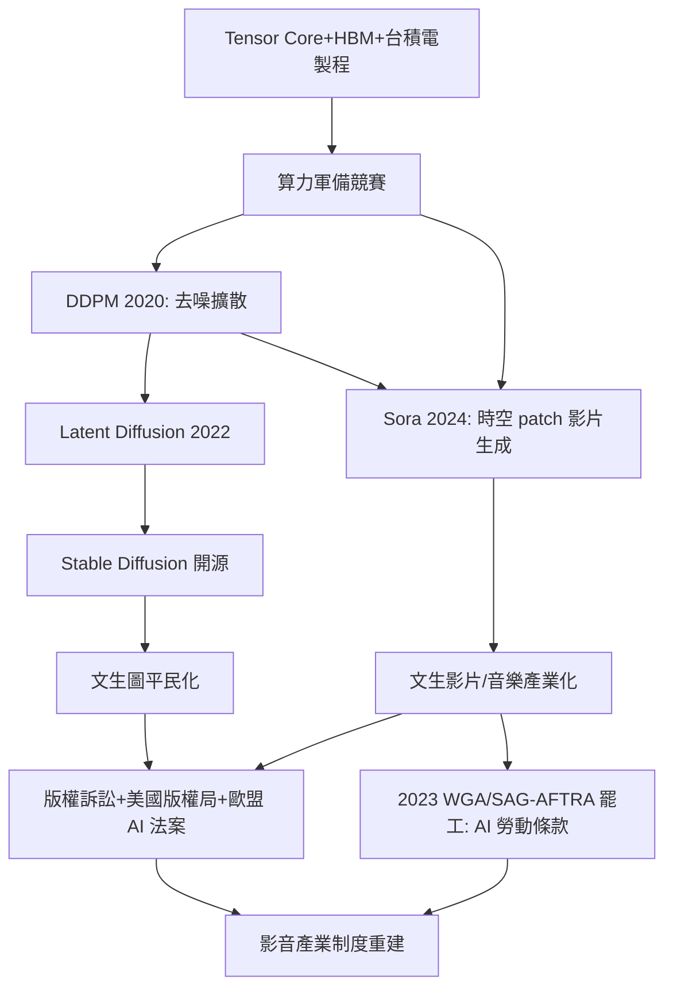

> 第六篇 · 第15章

# 第15.3節 擴散模型（Diffusion Models）：文字生成影片與音樂背後的隨機微分方程與算力硬體

## 從 GAN 到擴散：生成模型的改朝換代

2014 年 GAN 開啟了神經網路「無中生有」的能力，但對抗訓練不穩定、模式崩塌（mode collapse）始終是頑疾。2020 年，Jonathan Ho 等人發表 **DDPM（去噪擴散機率模型）**，以一個樸素到近乎哲學的想法席捲生成模型界：與其讓兩個網路互相搏鬥，不如學會「把噪聲一步步擦掉」。

## 擴散的數學：加噪與去噪的對稱之舞

**前向過程（加噪）** 是一條固定、不需學習的馬可夫鏈：對真實資料 $x_0$ 反覆施加高斯微擾 $T$ 步：

$$q(x_t \mid x_{t-1}) = \mathcal{N}\!\left(\sqrt{1-\beta_t}\, x_{t-1},\; \beta_t I\right)$$

其中 $\beta_t$ 是微小且預先排定的噪聲表。$t$ 越大，影像越接近純高斯雜訊。其妙處是可以一步跳到任意時刻：$x_t = \sqrt{\bar\alpha_t}\,x_0 + \sqrt{1-\bar\alpha_t}\,\epsilon$，$\epsilon \sim \mathcal{N}(0,I)$。

**反向過程（去噪）** 則是待學習的鏈：訓練一個神經網路 $\epsilon_\theta(x_t, t)$，預測「這張帶噪影像裡混入了哪個噪聲」，以變分下界推得的簡化損失 $\|\epsilon - \epsilon_\theta(x_t,t)\|^2$ 訓練。生成時從純雜訊出發，反覆去噪即可「雕刻」出影像。骨幹網路是 **U-Net**：對稱的編碼器–解碼器加上跳躍連接，可在多尺度上保留空間細節；2020 年代更以 Transformer（DiT）部分取代。采樣步數多、速度慢的問題，由 DDIM、蒸餾與**流匹配**等路線緩解，並可視為對底層隨機微分方程（SDE/ODE）的數值求解——擴散模型本質上是在學習反轉一條把資料推向熱平衡的 SDE，這讓它與統計力學的朗之萬動力學血脈相連。

## Stable Diffusion 開源與 Sora：產業秩序的重擊

2022 年 8 月，Stability AI 釋出 **Stable Diffusion**：以潛在空間擴散（latent diffusion，將 U-Net 放在 VAE 壓縮後的潛空間上運算，算力需求驟降）加上 CLIP 文字編碼器，實現文生圖，並以開源授權釋出。一夜之間，文生圖從封閉實驗室進入人人可跑的筆電，Midjourney 等閉源產品與開源生態並行。2024 年 2 月，OpenAI 發表 **Sora**：以「時空 patch」的 Transformer 為骨幹的影片擴散模型，可生長達一分鐘、具物理一致性的影片——影音生成從「玩具濾鏡」跨入「內容生產」門檻。音樂端，Suno、Udio 等擴散／自迴歸混合模型亦快速成熟。

這波浪潮衝擊了整個影音產業的制度地基。**版權之爭**：訓練資料多取自未經授權的網路影像與音樂，藝術家與 Getty 等公司提起集體訴訟，美國版權局明確表示「純 AI 生成物不受版權保護、註冊須揭露 AI 成分」，歐盟則以《AI 法案》（2024）要求訓練資料透明義務。**勞動衝擊**：2023 年，美國編劇工會（WGA）與演員工會（SAG-AFTRA）先後發動大罷工——這是好萊塢數十年來首次雙工會同時罷工，AI 是核心爭點：片廠不得以 AI 取代編劇署名、演員數位分身（digital replica）須經明確同意與補償。罷工結果為 AI 時代的勞動契約寫下第一批條款。**平台治理**：YouTube 一方面以 Content ID 音訊／視訊指紋維繫版權秩序、以 AI 降噪與 AI 超解析度優化觀看體驗，另一方面被迫面對生成內容氾濫，推出 AI 內容揭露標籤制度——生成、偵測、版權、勞動四條戰線同時開打。

## 算力硬體：訓練在資料中心、推論在邊緣

擴散模型的算力食量驚人：訓練一個影片擴散模型動輒數千張 GPU 連跑數月，靠的是 HBM 高頻寬記憶體、NVIDIA Tensor Core（矩陣乘法的混合精度加速單元）與大規模互連網路（NVLink、InfiniBand），背後是台積電先進製程與 CoWoS 封裝的產能政治。手機端則由 NPU 執行量化後的小型擴散模型，實現即時 AI 修圖與降噪——生成式 AI 因此成為驅動整個半導體產業的新引擎。

## 延伸思考

1. 擴散模型「去噪即創作」的數學，是否暗示創造力本身可以被形式化為一條反轉熵增的軌跡？
2. 若 AI 生成內容不受版權保護，卻以受保護作品訓練而成，版權制度的「創作激勵」邏輯該如何修補？
3. 2023 罷工寫下的 AI 條款，會成為各國勞動法典的範本，還是好萊塢特例？
