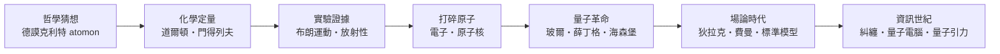

# 前言：看不見的微觀基石

> 「如果有人說他能完全明白量子力學，那恰恰說明他還沒入門。」——費曼
> 「萬物由原子與虛空組成。」——德謨克利特，約公元前 430 年

## 一場跨越兩千四百年的拆解

人類大概是最喜歡拆東西的物種。拆開一輛戰車、一台鐘錶、一個細胞，都不稀奇；真正的壯舉，是拆開**物質本身**——拆到再也拆不下去的那一刻，再發現「拆不下去」這個假設也是錯的。

這條路走了兩千四百年：

有意思的是，這場拆解的每一站都由**完全不相干的力量**共同推動：希臘的奴隸制城邦自由催生了原子哲學；修道院課綱壓制了它一千年；曼徹斯特的啤酒廠資助了道爾頓的天平；法國斷頭台斬掉了拉瓦錫；德國戰敗與普魯士大學文化把玻恩送去哥廷根；貝爾實驗室的電話壟斷利潤養出了戴維森的電子繞射；冷戰的國防預算建起了 LHC；而 21 世紀的密碼焦慮，正在把量子電腦從物理系的黑板上拖進估值百億的創業公司。

## 這本書是寫給誰的

寫給好奇物質是什麼的人，也寫給喜歡聽故事的人。你會看到：

- 湯姆森發現電子，他的兒子卻因證明電子「是波」而拿諾貝爾獎——父子隔代打臉的傳奇。
- 玻爾茲曼以一己之力對抗整個德語學術界為原子辯護，自殺三年後，實驗證明他是對的。
- 薛丁格在海爾戈蘭島療養？不，是海森堡在海那個島上頓悟矩陣力學；薛丁格則帶著一對情侶在阿羅薩山上寫出方程式。
- 愛因斯坦說「上帝不擲骰子」，玻爾回敬：「別替上帝下指令。」這場論戰打了三十年，最後以一條不等式、三次諾貝爾獎和「局域實在論」的死亡落幕。

## 閱讀路線

全書五篇十五章、四十五節，嚴格依時間軸推進：

1. **從哲學遐想到化學原子論**（前 5 世紀 – 19 世紀末）：德謨克利特、道爾頓、門得列夫、玻爾茲曼。
2. **打碎原子**（1897–1913）：電子、原子核與玻爾模型。
3. **量子力學狂飆突進**（1924–1927）：物質波、矩陣力學、波動方程、不確定性原理。
4. **場論與粒子王國**（1928–1960s）：狄拉克、QED、夸克與標準模型。
5. **量子資訊與引力前沿**（1935 – 至今）：EPR 到阿斯佩實驗、量子計算、弦論與量子宇宙學。

所有故事皆有史實依據。有趣，但絕不虛構。

讓我們從一個笑著說「萬物由原子與虛空組成」的希臘老頭開始。
