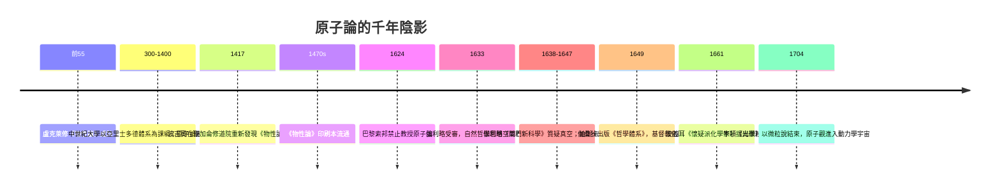

# 沉寂千年：原子論作為禁忌的猜想

從公元前五世紀的阿布德拉到公元十七世紀的巴黎，原子論在歐洲整整沉睡和蟄伏了兩千餘年。它不是自然死亡的科學假說，而是一項被宗教、教育制度與書籍命運聯手封存的猜想。它的復活，歷經了一次偶然而致命的手抄本重見天日、一場力學風暴、以及牧師們虔誠的「偷渡」。

## 盧克萊修的手抄本：幾乎死去的長詩

盧克萊修（Titus Lucretius Carus，約前 99–前 55）的《物性論》（De rerum natura）是古代原子論唯一完整倖存的大部頭著作。他以六步格詩的鎏金筆法，把伊壁鳩魯的原子論寫成挽歌式的宇宙頌歌：萬物由不可分的原子與虛空組成；世界由無設計者——因此沒有死後懲罰，也就不必懼怕宗教；靈魂由原子構成，隨肉身解散。詩中甚至預演了無數後世科學母題：風雨山巖的原子磨損、雨水由微滴凝成、疫病藉微粒子傳播。它在思想史上的地位，被後世譽為「西方科學古曲第一聲」。

這部詩卷在基督教化的羅馬帝國中被斥為不敬（有異教徒聲音稱其可能出自瘋人或自殺者之手；聖哲羅姆記載他「服毒自殺」），中世紀數百年間幾乎無人抄寫閱讀。若一件手稿六百年抄一次，這已是一個瀕危物種。轉機出現在 1417 年一月：人文主義書籍獵人波吉奧·布拉喬利尼（Poggio Bracciolini，1380–1459），時任教宗秘書，康士坦斯大公會議的隨行，走訪萊茵河畔聖加侖（St. Gallen）隱修院時，在書架上找到了一份九世紀的《物性論》抄本。他以僱工體系迅速轉抄，寄回佛羅倫斯，隨後印刷術（1470 年代已有版本刊行）使這封「古代的絕筆信」廣泛流通。馬基維利、蒙田、伽利略、牛頓都讀過它——原子論得以在文藝復興復活，靠的不是一套論證的勝利，而是一冊手抄本與一頁印刷品的低調重現。

## 「無神論」之名：宗教污名與大學封鎖

原子論為何成為禁忌？因為它一旦成立，便動搖整個神學秩序：沒有神意安排的世界、沒有靈魂的特殊地位（靈魂也是原子）、可以從物質的必然性解釋一切。中世紀大學遵循亞里士多德—阿奎那體系，而宗教改革與反宗教改革雙方，都不時將「原子謬說」與伊壁鳩魯無神論捆綁。巴黎索邦神學院在 1624 年嚴禁教授原子論，甚至將持此說者逐出學界。在伽利略被宗教法庭定罪（1633）之後，凡與亞里士多德連續體相左的宇宙圖像都要謹慎行事。

## 伽桑狄：把原子「掛」在神身上的牧師

皮埃爾·伽桑狄（Pierre Gassendi，1592–1655），法國天文學家與數學家，他在 1649 年出版的《哲學體系》（Syntagma Philosophicum）中完成了一項高難度的聖典轉譯：保留原子與虛空的物理學，同時把它「基督教化」——原子是上帝初始創造、賦予運動又時時以神意維持的受造物；靈魂雖與身體互動，仍是不朽的非物質實體；「偶然」並不存在於創世者心中。這個精巧的折衷，使原子論第一次能以正統的、哲學的、甚至虔敬的形象在大學與書信網中生存。歷史的悖論是：從古代到近代，原子論能沿用什麼名字、能以何種禮節被討論，完全取決於它與神學之間的談判。

## 波義耳、牛頓：微粒說的原本「自然哲學」

英國化學家兼自然哲學家羅伯特·波義耳（Robert Boyle，1627–1691）復興了伽桑狄路線，以「微粒」（corpuscles）作為原子論的通行名詞，並在《懷疑派化學家》（The Sceptical Chymist, 1661）中把亞氏四元素與煉金術三要素（硫、汞、鹽）一併打入懷疑，代之以可由實驗探究的微小質點。他與牛頓一樣敬虔——牛頓（Isaac Newton，1643–1727）在《光學》（Opticks, 1704）結尾著名的一段設問中，把物質微粒推入上帝起頭後即可自行運轉的世界觀：「上帝造成物體的粗大粒子以及它們的內在形相時，凡能造成各種不同物體者，我曾考慮，它們在起初或有不同的形相與大小，此後繼續不變，而自然界由此產生的各樣形體，便是這些粒子的變化與組合。」微粒的動力學在那裡，但牛頓的總設計圖依然指向一位聖者與奇蹟的創造者。

## 為何原子論只能停留在「哲學猜想」

自德謨克利特至牛頓，原子論延續了近兩百年而仍未成為科學的核心領域，其制度與文化原因值得深究：

1. **驗證缺位**。原子過小，無法觀察、無法秤重。凡是無法像幾何般由公設推出、像天文般由望遠鏡校正的學說，只能排名哲學猜想的末等。反觀同時代的光學與力學——一門有測量工具的學科——則迅速科學化。
2. **大學課綱的惰性**。亞里士多德自然哲學仍是職位晉升的通行證，原子論在大陸大學屬於「不合體統」邊緣理論，反而多在倫敦皇家學會、《哲學會刊》、私人書信網中生存。
3. **煉金傳統的牽制**。煉金術（以及其後的燃素說）把物質變化最終歸結為「質」的轉換（硫汞、性質對立），時間上早於「量」的計算；它養育了大批化學工匠與藥劑師，卻把他們的精力導向「嬗變之夢」而非「計重之學」。

於是古典原子論走到十八世紀時，是一部有著偉大哲學血統、被宗教審查擦洗得略無鋒芒、又缺乏驗證手段的古董。它像一枚種子，需要下一次制度革命——化學家手中的天平與氣體量筒——才能破土。

