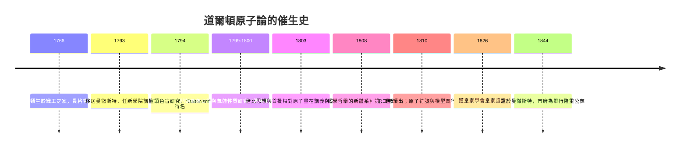

# 道爾頓 1808：定量化學與原子量

## 英格蘭北方的貴格學校教師

約翰·道爾頓（John Dalton, 1766–1844）出生於坎布里亞的伊格爾斯菲爾德織工之家，貴格會（Quaker）信徒。貴格會既不容於國教牛津、劍橋，反而在邊緣形成了一條驚人的知識通路：他們創辦自己的學校、重視實用與手工、以誠實交易與精密簿記為信條，並鼓勵成員觀察自然作為虔敬的證明。這條「貴格科學網」日後孕育出開耳文、愛丁頓、約瑟夫孫等一串科學家。因為非國教徒不得入公費大學，道爾頓只能由一位盲眼哲學家約翰·高夫（John Gough）私人指導，靠在貴格學校教數學與自然哲學餬口。知識的傳承有時不靠皇帝的特許，而靠小教派的賑濟冊。

他早年的成名作是他自己的病：他與哥哥同患色盲，1794 年在曼徹斯特文學與哲學學會宣讀《論顏色視覺的異常》，指出血液中或有吸收某色光的缺陷。這一病症後來被英語世界稱作 Daltonism——一個人把姓氏變成了醫學詞彙。也因為貴格的尷儉戒律禁止佩戴鮮豔衣物，這位分不清紅與綠的學者終其一生只有灰與深色的袍。

## 曼徹斯特：棉花、蒸汽與化學

1793 年，二十七歲的道爾頓搬到曼徹斯特，任新學院（New College）數學與自然哲學講師，數年後成為獨立為業的私人教師與研究者，加入曼徹斯特文學與哲學學會（Manchester Literary and Philosophical Society，1781 年創立，貴格商人為中堅），後任其秘書乃至會長。這座城市正是英國工業革命的心臟：棉紡廠的蒸汽機、漂白染印的酸與鹼、染料與礦石，都在呼喚更好的化學知識；曼徹斯特的商人家族資助學會、氣象儀器與科學演講。道爾頓一生自此以「氣象日記」為業：五十七年間每日以儀器記錄溫度氣壓達二十萬餘條，直至臨終前幾小時還寫下最後一條。正是為解釋「大氣為何是均質混合物，重的氧不像糖漿般沉在底下」，他被推到原子假說的門檻。

## 1808：定量之網收攏原子

十八世紀末，拉瓦錫的天平革命（詳 03.1）與氣體化學已為定量鋪路。約瑟夫·普魯斯特（Joseph Proust）在 1794–1799 年確立定比定律（law of definite proportions）：同一化合物中各元素之重量比恆定，不因取樣或產地而變。道爾頓的洞察是反問：**為何這個比例恆定？** 他的答案是：因為化合物是「複雜原子」（化合物原子）由固定數目的元素原子組成。而此前 Richter 比化學親合法的資料顯示，兩元素可有兩種以上化合物，重量比呈簡單整數倍——這正是倍比定律（law of multiple proportions）的形狀。若元素由不可分的原子組成，倍比便是必然：1 份 A 與 1、2、3 份 B 相配，這些比例應是 1:2:3 這樣的整數。道爾頓自己做氧化氮等系列實驗也印證了這個關係。

道爾頓在《化學哲學的新體系》（A New System of Chemical Philosophy）第一卷（1808，第二部 1810 年續出）中，把這張定量之網織成原子論：元素=單一種類的原子；化合物=原子以最簡單整數比結合；並發表**世上第一張相對原子量表**，以氫=1 為標準：

| 元素 | 符號 | 道爾頓原子量（氫=1） | 近代值（C=12 標準換算之氫=1） |
|---|---|---|---|
| 氫 H | ● | 1 | 1.0 |
| 碳 C | ○ | 5 | 12（比重） |
| 氧 O | ⊙ | 7 | 16 |
| 氮 N | ⦶ | 5 | 14 |
| 磷 P | ◧ | 9 | 31 |
| 硫 S | ⊗ | 13 | 32 |

他還設計了一套幾何符號與實木模型來表示原子，在曼徹斯特的教學演示中令聽者印象深刻。

## 甜蜜的錯與理論的極限

原子論被接受時，附著著一套缺陷：道爾頓只配有「化學家」的視野，他用最簡法則自行定式——水=HO（氫氧 1:1）、氨=NH、一氧化碳=CO——結果把好幾個原子量定錯：他認為氧的原子量是 7 而非 16，正是錯認水分子式之後果。他更堅持「原子不可分」與「化合物原子」混用（今日所謂的分子，乃由 Avogadro 補定，見 02.2 節），且此後幾十年對修正運動一口咬定不放。他的化學理論裡還混雜著自己的物理假說（原子「熱質氣氛」），他本人一生大多留在曼徹斯特，不出遠門參會，與歐洲大陸通信稀疏，這在無期刊評審對接的年代，使他錯過了不少理性辯論的機會。

然而瑕不掩瑜：道爾頓把原子從哲學猜想變成化學計量的工作假說。從 1808 年起，「元素一原子」的框架成為化學的默認語言； Berzelius 的分析資料在幾十年內不斷重塑原子量表（此為 Avogadro 與 Cannizzaro 的貢獻，詳 02.2）；而曼徹斯特的染料、鹼業工業日後以「化學當量」做的生產調度，正以這張表為基礎。歷史的因果在這裡極乾淨：貴格小教派的教育自由、曼徹斯特化學工業的需求、個人那本始終不輟的氣象日記，共同合成出科學史上第一張把「眼不見的原子」放上秤的表。
