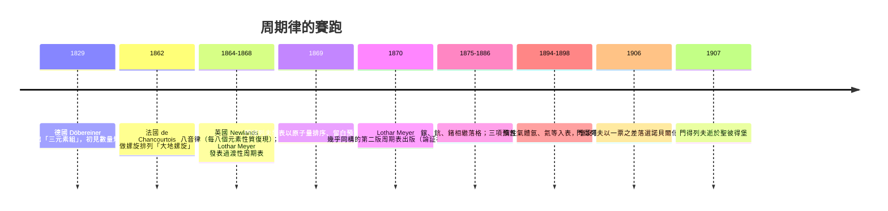

# 門得列夫周期表：微觀家族圖譜

## 從西伯利亞寄來的一個名字

德米特里·門得列夫（Dmitri Ivanovich Mendeleev, 1834–1907）生於西伯利亞的托波爾斯克，是他父親（擔任中學校長，後失明失職）的家中十幾名子女中最末一位。母親瑪利亞·柯爾尼耶娃是位鋼鐵般的人物：丈夫去世、家鄉的玻璃工廠（她經營）燒毀之後，她帶著兩個兒子長途跋涉四千公里前往莫斯科與聖彼得堡，想把德米特里送進大學。聖彼得堡師範學院的檔案（他父親曾任職而享其名額）接納了他；她本人在送他入學後旋即去世。門得列夫終身把《化學原理》獻給她：「這是我最後能獻給……她的工作。」——俄羅斯的廣袤、階層與公文制度，同時是他的枷鎖與磨刀石：普通學生身份不得入彼得堡名牌大學，他就往南方教書、讀碩士，再在海德堡留學（1859–1861，於本生實驗室工作過）的資本回到國都。

## 混沌的表象：63 種元素與一張教材的大綱

1860 年代的化學正深陷雙重迷霧。其一，原子量與分子式的「化學式大戰」未息（詳 02.2），元素的原子量各人各表；其二，新元素急速湧現（光譜分析法 1859 年問世後，鉈、銦、鎵、鍺接連入冊），無人能預言情報。門得列夫在 1860 年的卡爾斯魯厄會議上親耳聽過康尼查羅的論証，回國後採用一致的原子量。

轉機來自一個平凡的教學崗位：1867 年他受聘聖彼得堡大學任化學教授，接管無機化學課程；找不到體面的教科書，他索性自己寫，這就是《化學原理》（Osnovy khimii，1868–1870）。為有條理地安排 63 種元素的章節，他先按原子量把元素寫上卡片，像玩「耐心牌」（patience，一種接花牌）一樣在旅途中反覆排布：同族者性質相似（鹼金屬、鹵素），自一到右性質漸變，而跳到下一行又回到鹼金屬的「口音」。1869 年 2 月 17 日（儒略曆），他寫出「根據原子量與化學親合力之相似性所列的元素系統的嘗試」，三月由門生 Menschutkin 在俄國化學會宣讀。

## 留白：預言一個未知的世界

門得列夫的獨門絕招不是排成表，而是**為未發現的元素留空格，並預言其性質**：他在鈣與鈦之間留下「原子量約 45」的空，在鋅後留下「約 68」的空，在砷後留下「約 72」的空，甚至起了假名 eka-boron、eka-aluminium、eka-silicon（梵文「一」以示「下一代」）。1875 年法國 Lecoq de Boisbaudran 發現鎵（Ga），性質幾乎就是 eka-aluminium——只是比重起初報 4.7，門得列夫寫信說應為 5.9，複測果然是 5.9；1879 年瑞典 Nilson 發現鈧（Sc，= eka-boron），1886 年德國 Winkler 發現鍺（Ge，= eka-silicon），實測密度 5.5 而預言 5.5。三擊三中，大陸學界為之眩目：一家化學體系居然能「生產」未來的實驗資料。1894 年惰性氣體氬的出現曾一度像臉上的巴掌，門得列夫則以新「零族」消化之——他的表格因此更具確定性。

## 賽跑者與「數據為王」的時代

他不是孤立的先知：德國的洛塔爾·邁耶（Lothar Meyer，1830–1895）以原子體積的周期性曲線獨立逼近同一規律，1864 年出過小周期表，1868 年的修訂若及時發表可與門得列夫相拮抗；英國的紐蘭茲（John Newlands）1865 年的「八音律」（law of octaves）被皇家學會嘲笑為「按字母排也一樣」。勝負的分水嶺在於**本體論的重量**：邁耶只描述規律，門得列夫預言實例、修正原子量錯誤（如鈹、鈾、銦），一張以數據為骨架的體系構築起「可檢驗、可作預言」的科學表現。十九世紀末，德國化學家在刊物上寫道：「周期系統已成為化學的星曆表。」

## 落選項與代價

門得列夫的晚年則帶著思想者的蒼涼。他生性直言，為學生請命、為農民與關稅發聲，也在 1890 年為學潮代言而被迫辭去大學教職；後來受沙皇政府之命任度量衡局局長，創俄國的計量制度。他的政治姿態（包括批評政府、同情學生）與他在 1906 年的諾貝爾（Nobel）化學獎之落選，被史家多番討論：當年瑞典評審在門得列夫與提出標準原子量表改訂案的對手之間，只差一票，門得列夫落選；1907 年 1 月 20 日他在聖彼得堡肺炎去世，享年 72，出殯之日全城送行，在 1907 年諾獎化學獎（授予生物化學家 Eduard Buchner）揭曉之後。科學史上，這是「並不清純的儀式」（諾貝爾獎秘史稱其「痛苦的 遺憾」）；那個被全城送葬的名字，最終成為元素周期表上一個不知名的因子——元素 101 鍆（Mendelevium, 1955）。

而在科學觀念的長河裡，他的勝利把原子論推到一個新高度：既然所有元素的性格抄自一個表格數字（原子量）的次序與句法，那麼它們理應共有一個更深的微觀粒子體系。這為後來的電子層、原子核與量子力學的搭建，預備了一條「家族血統」的譜系（詳見第三章）。
