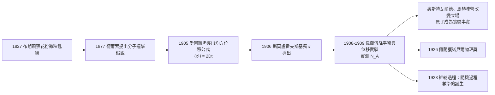

# 布朗運動：隱形分子的撞擊證據

## 花園顯微鏡下的亂舞

1827 年夏，蘇格蘭植物學家羅伯特·布朗（Robert Brown, 1773–1858）——曾隨「調查者號」遠航澳洲、為數千種植物命名的大英博物館植物學家——在顯微鏡下研究花粉。他把紫花奇加利（Clarkia pulchella）的花粉微粒懸浮於水中，看到直徑約一微米的顆粒在液體中持續不規則地抖動與游移。他起初懷疑這是「生命質」的活力，隨即以礦物灰、玻璃屑、乃至從埃及石像取回的岩石碎屑反覆實驗——凡微粒皆舞，與生命無關。1828 年他以私人小冊發表《論 1827 年 6、7、8 月間以顯微鏡觀察花粉所致微粒之一般運動》，第一次把一個偶然的觀察定義成現象：布朗運動。

此後近八十年，它懸在「看見了什麼」與「說明了什麼」之間。物理解釋層出不窮（電力、毛細、熱流），卻無法累積，因為沒有理論給出一個可反駁的數字。而原子論的形而上地位同樣懸而未決：克勞修斯、麥克斯韋、波茲曼（詳 03.3）已把氣體壓強與溫度解作分子碰撞的統計平均，但沒有人「見過」分子。

## 1905：愛因斯坦把亂舞寫成公式

1905 年，二十六歲的伯恩專利局職員愛因斯坦連發數篇論文，其中一篇（1905 年 5 月完成，年底刊於《物理年鑑》）專攻布朗運動。他的關鍵轉向是：**問題不在描述一顆顆粒的圓舞，而在導出一個可量測「分子存在」的可觀測量**。他以統計力學處理懸浮粒子的滲透壓與擴散、粘滞力之平衡，推出懸浮粒子位移的均方值隨時間線性增長：

$$
\langle x^2 \rangle = 2Dt
$$

其中 $D$ 是擴散系數，取決於溫度、粘度與粒子半徑；代入氣體常數 $R$，便可反推每摩爾的分子數 $N_A$——只要測出位移，就「數出」了不可見的分子。幾乎同時，波蘭的斯莫盧霍夫斯基（Marian Smoluchowski）獨立得出等價結果（1906 年發表）。1877 年教士德爾索（Delsaux）已猜測亂舞源於分子碰撞，愛因斯坦的功績是把它變成**一條可以拿到顯微鏡下對帳的公式**。

## 1908–1913：佩蘭的攻城結算

讓公式落在玻璃片上，是法國物理學家讓·佩蘭（Jean Perrin, 1870–1942）的功績。他須先解決一個手工難題：找到大小均一的微粒。他與助手研磨藤黃與乳膠樹脂，用離心機反覆分離，篩得半徑相同的球狀顆粒，做成可控的膠體懸液。然後設計兩套互不相干的量法：

1. **沉降平衡的分佈**。平衡時微粒濃度隨高度按波茲曼因子遞減：
$$
n(z)=n(0)\,\exp\!\left(-\frac{mgz}{kT}\right)
$$
他以顯微鏡逐層聚焦，數載片上若干微米高差的粒子數，檢驗其是否成一條指數曲線——這相當於把大氣壓高程公式縮進一滴水中。由曲線的斜率即可**獨立**讀出 $k$，從而得 $N_A$。
2. **位移的時間定律**。每三十秒記錄一次大量微粒的位置，證實 $\langle x^2\rangle$ 確與 $t$ 成正比，斜率代入愛因斯坦公式又一次算出 $N_A$。

兩種根本不同的測量得到一致的 $N_A \approx 6.3\text{–}7\times10^{23}$，與普朗克從黑體輻射（1900）得到的 $6.55\times10^{23}$、以及氣體動力論的估算相差在實驗誤差之內。佩蘭自 1908 年起發表系列結果，1913 年出版《原子》（Les Atomes）向公眾總結陳詞，1926 年因「物質不連續結構之研究與原子平衡之確證」獲諾貝爾物理學獎。

## kingmaker：把哲學戰場化為實驗裁決

佩蘭深知自己量的不只是分子，還有哲學。當時能量學派首領奧斯特瓦爾德（Wilhelm Ostwald）拒絕「原子」——那是不可見、不可驗證的形而上假設；馬赫（Ernst Mach）亦以「感覺之外不可證」拒斥。1908 年之後形勢劇變：奧斯特瓦爾德在 1909 年《化學原理》新版中讓步承認原子論「已获得實驗基礎」；馬赫晚年雖未正式認輸，維也納學派的年輕人已在演算他的「感覺要素」與統計力學的邊界。原子從假說轉為資料，正是這幾年之間的事。

這場勝利同時是數學的豐收。1900 年法國博士生巴施利耶（Louis Bachelier）已用同一條隨機曲線為巴黎證券市場的價格建模；1923 年諾伯特·維納（Norbert Wiener）把布朗運動建立為嚴格的連續隨機過程（維納過程），此後成為隨機過程理論、熱噪聲、金融數學乃至量子場論的基礎。原子問題最終以一種優雅的方式落幕：不可見之物不必親眼所見，只消留下可測的統計足跡。
