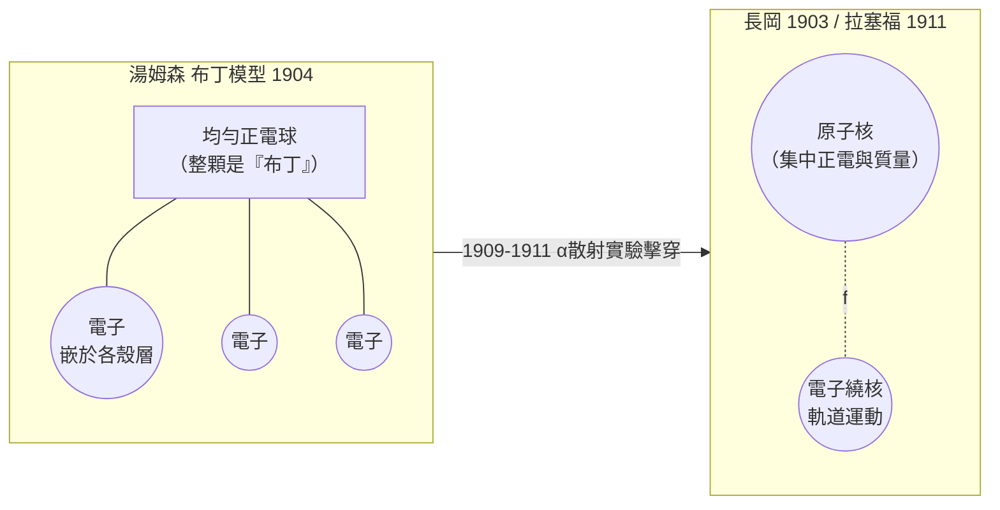

# 葡萄乾布丁模型：原子內部第一個想像

電子被發現後，一個尷尬的問題立刻浮上桌面：整個原子是電中性，若電子帶負電且只是原子的一小部分，那其餘的部分——占質量絕大部分的「剩餘者」——必然帶正電。它長什麼樣？在哪裡？二十世紀初，人類第一次被迫想像一個從未有人見過的內部世界。

1904 年，湯姆森提出他著名的模型：原子是一個半徑約 $10^{-10}$ 公尺、均勻帶正電的球體，電子如同葡萄乾嵌在布丁裡，靜靜分布在正電「海洋」之中。這個被後人暱稱為「葡萄乾布丁模型」（plum pudding model，英國人自己也戲稱之）的圖像，絕非兒戲般的猜想，而是湯姆森精心計算的成果。他指出，若要電子在正電球中穩定排列，它們必須分布在若干同心殼層上；他甚至以此解釋元素的化學週期性——殼層數目與電子排列對應著門得列夫的週期表。他也試圖說明：電子受擾動時會繞平衡位置振盪，振盪電荷輻射電磁波，或許能解釋原子的發射光譜與放射性。

在那個原子物理學剛剛萌芽的年代，這個模型頗有解釋力：它同時容納了電中性的原子、週期表結構與化學鍵的雛形。更重要的是，它是第一個把電子視為「原子的零件」而非外來離子的嚴肅理論，開啟了「原子內部也有結構」這個整個二十世紀物理的母題。

把布丁放回時代的脈絡裡看，更能體會它的分量。1900 年前後，「原子究竟是什麼」在學界仍是禁忌與笑柄兼備的問題：馬赫與化學中的能量論者（Ostwald 一派）都拒絕看不見的原子的實在性。而湯姆森的模型恰好站在一條關鍵的證據鏈上：兩篇游離理論（X 射線使氣體導電）、放射性序列與電子組成假定，共同把「原子有內部結構」從哲學猜想轉為可計算的物理問題。他 1907 年出版的《氣體導電論》與 1904 年的布丁模型，其實是同一套思想的兩面：內部光電離、外層決定化學性質，都必須靠電子的分布來「安排」。

模型的技術細節也常被忽略：湯姆森用了一個近乎現代的「結構穩定性」分析。他要證明電子在球中會自發形成正多面體式的排列（四個、六個、二十個對稱位），而當電子數目跨過某些關鍵值，排列便從一種幾何跳到另一種幾何——遷移時電子會釋放或吸收能量。他把這些「跳變」與化合價、甚至與放射性蛻變的大額能量釋放並列解釋。今天回頭看，這種「由狀態跳變解釋性質突變」的思路，正是量子力學後來的母語；只是當時他用的幾何，還不是後來的量子數。

然而歷史的幽默在於，最先拆毀這座布丁的，正是湯姆森最傑出的學生。紐西蘭人拉塞福（Ernest Rutherford），1895 年來到卡文迪許，是湯姆森一手提拔的第一位「研究生學者」。師徒二人最初合作密切，1896 年共同研究 X 射線對氣體的游離效應；湯姆森離開麥吉爾大學聘書甚早，而拉塞福在蒙特婁麥吉爾大學靠菸草大王資助的實驗室，與化學家索迪（Frederick Soddy）合作，於 1902 年提出放射性「衰變」理論：原子並非永恆不變的終極存在，一種元素的原子會自發地蛻變為另一種元素的原子。拉塞福後來回憶，當這話被說出口時，同行視之為「一種荒誕的說法」——在牛頓式的宇宙裡，原子是造物的第一塊磚，不可動搖、不可分割；如今第一塊磚自己會腐爛、會轉化，連「元素」這個化學的基石範疇都開始流動。這對煉金術的古老夢想與現代物理的嚴謹同時開了玩笑，也為後來的核能時代埋下了第一顆種子。

布丁模型與其他競爭模型的爭戰，於是成為二十世紀初科學史上一場典型的「範式前競爭」：沒有決定性實驗，各方靠解釋力、簡潔性與門派勢力角力。日本長岡半太郎在 1903 年提出過土星模型——電子如土星環繞帶正電的核心旋轉——數學上幾乎預示了後來的行星模型，只因遠在東京、無人聞問而寂寂無聞。

這張圖預告了後續三章的主線。1909 至 1911 年，握著「炮彈」的拉塞福將用金箔實驗把布丁打碎。耐人尋味的是，湯姆森本人直到晚年仍守著自己的模型，甚至 1914 年還在修改它——科學史記住了拉塞福的妻子曾轉述的一句玩笑：拉塞福說「他們對湯姆森的模型做了太多偏愛的蜜月」。師徒之間的科學交鋒，最後以拉塞福的勝利與湯姆森的大度告終：正是這位被超越的老師，在世時栽培了九位諾貝爾獎得主。布丁被打碎之日，正是原子物理長大之時。
