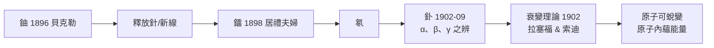

# 放射性解密：原子並非永恆不變

1896 年 3 月，巴黎的週末日午後，亨利・貝克勒（Henri Becquerel）隨手做了一個後來改寫世界的實驗。他家學淵源——父親與祖父都是研究螢光與磷光的物理學者，家中藏有大量礦物標本。倫琴發現 X 射線的消息傳到巴黎後，彭加勒（Henri Poincaré）在院士會議上展示 X 光照片，並提出猜測：能發螢光的物質，或許會同時發射 X 射線。貝克勒為驗證此說，選了家中收藏的鈾鹽硫酸铀醯鉀——一種他熟悉其磷光性質的晶體——用黑紙包裹底片、置於日光下曝曬。果然洗出了影像，他一度以為日光激發磷光時伴隨了輻射。

真正的洞察來自一次「失敗的天氣」。連日陰雨，實驗無法進行，貝克勒便把包好底片與鈾鹽的抽屜收起；幾天後他鬼使神差地決定先沖洗看看，結果底片上竟有清晰的影像——沒有日光、沒有磷光，鈾鹽自己吐出了輻射。貝克勒意識到：這是一種全新的、自發的、與光照無關的射線，而發射者就是元素鈾本身。他稱之為「鈾射線」，此後研究多由弟子接手，本人如大多數人一樣，低估了這顆火種的亮度。

把火種燒成燎原之勢的，是一對收入微薄的夫妻。波蘭裔的瑪麗・斯克沃多夫斯卡（Marie Skłodowska）靠自學與家教艱難來到巴黎，1895 年與皮埃爾・居禮（Pierre Curie）結婚；1897 年她為博士論文選題，選中了貝克勒這樁冷門。她的天才之處在於「測量」：皮埃爾早年與兄長雅克發明的壓電石英驗電器，能把微弱的游離電流轉換為可比的數字。瑪麗系統地測量各種礦石、鹽類與金屬鹽的放射性，發現放射強度只與樣品中鈾的含量成正比，與化學狀態、溫度、光照一概無關——於是她大膽斷言：放射性是「原子的性質」，是元素的內在屬性。這一判斷，正是原子內部世界存在的第一條定量證據。

更驚人的在 1898 年：她發現瀝青鈾礦（pitchblende）的放射性遠強於其鈾含量所能解釋的程度，「其中必定藏有一種新元素」。夫婦二人自此投入一場史無前例的化學苦役：在巴黎市立物理化學學校一間漏雨的木棚裡，用人鍋攪煮成噸的礦渣、進行數以千計的結晶與分離——因為他們知道新元素的存量微乎其微，必須藉其放射性當「指南針」逐步追蹤。1898 年 7 月，他們宣布發現「釙」（polonium），以瑪麗的故國波蘭命名——這個名字本身就是一份政治宣言；同年 12 月，他們宣布了放射性強上數千倍的「鐳」（radium），並交由化工企業共同分離提煉。1902 年，他們終於從近十噸礦渣中取得十分之一克氯化鐳，測得其原子量；1903 年，夫妻倆與貝克勒共享諾貝爾物理獎，瑪麗成為史上首位女性諾獎得主。

與此同時，拉塞福與索迪在麥吉爾大學沿放射性逐級追蹤「產物」，1902 年提出衰變定律：放射性元素放出 α、β 射線，蛻變為親代元素的什麼「後代」，序列最終休止於穩定產物。1903 年，兩人又估算出每克鐳每小時釋出上百卡路里熱能——「放射性蛻變的能量」，這個如此低調的命名，預告了半世紀後核時代的來臨。熟知的 γ 射線由韋拉爾（Paul Villard）於 1900 年辨認，而 α 粒子最後在 1909 年由拉塞福親手證明為氦核。

放射性很快走出實驗室，成為時代的商品與夢想：鐳在 1900 年代售價一度高達每克數十萬美元，成為當時最昂貴的物質之一；鐳射療法治癌興起，「放射療法」（Curietherapie）、「放射性礦泉」與夜光錶盤風行一時，甚至出現摻鐳的牙膏與飲料。瑪麗與皮埃爾自願把提煉工藝公開而不申請專利，相信科學屬於全人類。代價也隨之而來：皮埃爾 1906 年死於車禍，瑪麗接任索邦首位女教授，長期暴露於輻射，1934 年死於再生性不良貧血，實驗筆記至今仍具放射性；美國製錶女工「鐳女孩」們的口腔潰爛與集體訴訟，反而成為二十世紀職業衛生與科學倫理的起點。原子並非永恆不變——這句話碎裂的不只是牛頓的宇宙，也重新丈量了科學與社會的契約：不認識核能量的力量與危險前，人類已急著要品嘗它了。
