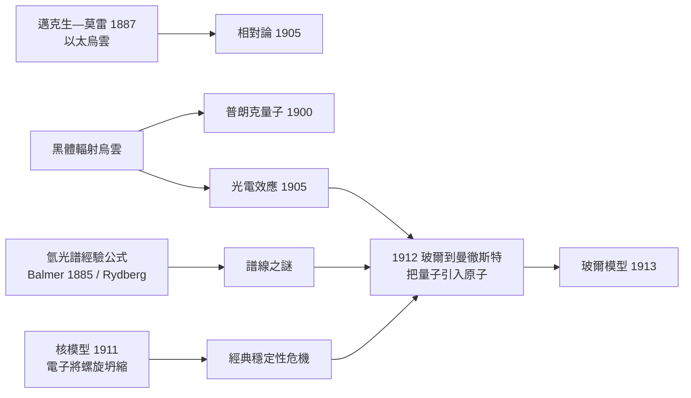

# 經典電動力學危機：拉瑟福原子的瞬間崩潰問題

拉塞福的行星模型解開了 α 散射之謎，卻立刻掉進一個更老的陷阱。這個陷阱在 1897 年就被埋下：拉摩（Joseph Larmor）證明，任何作加速運動的帶電粒子會輻射電磁波，其功率由「拉摩公式」給出：

$$P = \frac{e^2 a^2}{6\pi\varepsilon_0 c^3}$$

做圓周運動的粒子，速度方向時時改變，加速度 $a = v^2/r$ 恆不為零——換句話說，繞核旋轉的電子每一刻都在輻射。輻射帶走能量，電子依能量守恆只能步步滑向原子核，其軌道半徑將呈螺旋狀收縮。稍加計算便知這場災難有多快：以氫原子的第一玻爾軌道尺度估算，電子從 $10^{-10}$ 公尺跌落到原子核所需時間的量級約為

$$t \sim 10^{-11}\,\text{s}$$

——不到一億億分之一秒。按十九世紀物理的鐵律，拉塞福原子根本不可能存在：它應當在誕生的瞬間就「嘶」的一聲，坍成一道閃光。可是化學家站了一百多年的化學那些事實，分明說原子是穩定的：氫氣放了幾億年還是氫氣，沒有誰家的桌子在你眼前化為一道紫外閃光。

理論家並非坐視不管。有人提議電子或許在空間的某種特殊分布上達成動力學平衡（類似湯姆森模型的殼層解)；有人猜電子可能成對旋轉而抵消輻射; 長岡半太郎的土星模型也面臨同樣問題。但都只是打補丁——真正的出路還沒有現形，因為當時還缺一塊拼圖：對「原子如何發光」的定量描述。

這塊拼圖其實已經躺在抽屜裡三十年。1885 年，一位瑞士中學教師巴耳末（Johann Balmer）憑氣質與直覺，用一條經驗公式把氫原子可見光譜的四條線（656、486、434、410 奈米）整理得整齊得可疑；1890 年里德堡（Johannes Rydberg）把它推廣為通式 $\dfrac{1}{\lambda} = R_H\left(\dfrac{1}{n_1^2}-\dfrac{1}{n_2^2}\right)$。1908 年帕邢（Friedrich Paschen）又在紅外區找到新的線系，完全服從同一公式。這些公式如此精確而「數學化」，卻沒有任何經典理論能解釋：為什麼原子發出的是一組間斷的、公式化的「線」，而不是一根連續的彩虹？如果電子螺旋落入核中，它應發出逐漸變頻的連續輻射，直到熄滅——一個死掉原子的安魂曲，而不是一組精確到八位數的譜線。

牛頓—馬克士威大廈的另一條裂縫，早在世紀之交就被點名。1900 年 4 月，開爾文勳爵在皇家學會的著名演說中說，物理學的天空「基本明朗」，只漂浮著「兩朵烏雲」：一是地球相對於以太運動的邁克生—莫雷實驗零結果，二是黑體輻射的能量分布困境。第一朵烏雲在五年內化作相對論；第二朵烏雲，則在 1900 到 1913 年間，經普朗克的量子、愛因斯坦的光電效應，一路延燒到原子本身。

正是在這樣的十字路口，維勃克—哥本哈根的年輕博士尼爾斯・波耳（Niels Bohr）出現了。1911 年他剛在哥本哈根完成一篇金屬電子論的博士論文，取得獎學金先到劍橋投奔湯姆森——卻陰錯陽差地被冷落；1912 年春他轉往曼徹斯特，名為參加拉塞福的實驗課程，實則日夜在圖書館與黑板上把放射性、核模型與量子概念攪在一起。他後來回憶，正是從拉塞福身上，他學到「對於那些藏在實驗事實背後的東西，要窮追不捨」。波耳面對的問題清單很短：如何讓原子既服從散射事實、又不必坍縮，還順手解釋那組間斷的光譜線。還沒有誰解答過。1911 年 11 月，他到曼徹斯特拜訪拉塞福，帶來了他的博士論文與滿腹金屬電子論；他同時聽取了蓋革與馬斯登的工作報告，把 α 散射與他對原子的一般討論帶回哥本哈根與劍橋，內心已隱然認定：原子的穩定性問題是「經典物理被逼到牆角的徵兆」，不解释、只要鎖定證據，就必須與經典切割。

這種「切割」絕非容易的事。什麼叫放棄經典電動力學？在當時，這不僅是技術問題，更是哲學問題：馬克士威理論與 Maxwell 方程是維多利亞物理學最輝煌的大廈，法拉第電磁場、赫茲電波、馬可尼無線電全部奠基其上；若說電子在原子裡不走馬克士威的規則，便是在要求整個文明的物理常識為一個小至不可見的角落讓路。拉摩本人、傑文斯甚至普朗克最初都把量子化視為一種「材料的怪癖」——只發生在振子裡，並不通用。玻爾的勇氣在於：他沒有等新理論建立好才下注，而是先用「定態＋躍遷」這兩條臨時的公理，把行將崩潰的拉塞福原子以及三十年沒人能解的巴耳末公式綁上一條船。他之所以敢，正是因為他同時看見了三組彼此獨立的事實——α 散射、原子穩定性、分立譜線——若不引入本質上的新原則，任何修補都注定前後矛盾。這種「多箭齊證」的推理，是科學革命前夕最典型的思想形態。

