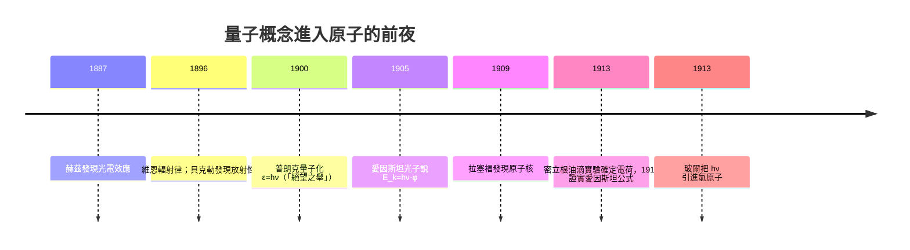

# 普朗克與光電效應：玻爾的深刻啟發

1900 年 10 月 19 日，柏林的德國物理學會會議上，一位五十二歲的普魯士科學院院士站起來，念出一條憑「內插」得到的公式：它把黑體輻射的光譜能量分布與溫度、頻率連起來，兩頭分別退化為維恩公式與瑞利—金斯公式，中間首次精確吻合實驗。這是普朗克（Max Planck）的輻射公式。他隨即面對一個尷尬的問題：這是一條「猜出來」的經驗律，它憑什麼成立？

接下來兩個月，普朗克陷入他所謂「最緊張的工作」；12 月 14 日他提交論文，宣布公式背後的代價是：腔壁振子發出或吸收能量時，只能取離散的份額

$$\varepsilon = h\nu$$

其中 $h = 6.626\times10^{-34}\,\mathrm{J\cdot s}$，就是後來以他命名的普朗克常數。多年後他在致友人的信中自剖：這是一種「絕望之舉」（ein Akt der Verzweiflung）——為使公式的推導自洽，他「不惜與物理學的一切傳統訣別」。這句話背后，正是一個保守主義者的革命悖論：普朗克出身基爾的書香門第，一生崇拜牛頓—馬克士威體系，視熵與熱力學第二定律為物理學最神聖的支柱，一度勸人不要進入純理論物理、「大厦已無可發現」。他決不想推翻經典力學——他只是不肯在數據面前撒謊。量子概念因此是被「逼」出來的，普朗克本人接下來十餘年還屢屢回頭，想把它收回經典框架裡去。歷史卻沒給他台階下。

真正看清這顆種子力量的，是瑞士伯爾尼專利局一位二十六歲的三級技術員。1905 年，愛因斯坦發表《關於光的產生和轉化的啟發性觀點》，比普朗克激進整個時代：他不只說「振子吸收能量是量子化的」，而說光本身就是一份一份的「能量子」（後稱光子），每一份 $h\nu$。用它解釋雷納德（Philipp Lenard）觀察到的光電效應：紫外光打在金屬上打出電子，其最大動能只依賴光的頻率、與光強無關，且存在截止頻率 $\nu_0$——這些用波動說毫無辦法，用光子說一條公式寫盡：

$$E_k = h\nu - \phi$$

$\phi$ 是金屬的脫出功。愛因斯坦因此拿了 1921 年諾貝爾獎——委員會小心翼翼地只提「光電效應定律」，絕口不提相對論，可見當年光量子概念有多麼離經叛道；普朗克自己在推薦信裡都承認，他對愛因斯坦「在推論中或許失之於過分自由」有所保留。

質疑持續了整整十年。美國芝加哥大學的密立根（Robert Millikan）本來是光電效應的疑論者，他花近十年以極精巧的真空裝置逐項檢驗，1915 年公布的結果卻令他自己震驚：愛因斯坦公式在每一個細節上都精確成立，連斜率都精確給出 $h$ 值。他寫道，這個「一切想望中的荒謬」的粒子光電假說，竟被實驗證明為真——一位懷疑者被迫成為見證人。這一幕在物理學史上不斷重演：實驗者精心設計要反駁的新理論，最後反而把它釘牢在事實上。

這些爭論並非純粹的實驗室內政，而是德國科學文化的一場自我拷問。1900 年前後的柏林大學，以太爾莫動力學與精密光譜學為最高學術品位，講求「勿越事實一步」——普朗克的量子化因此首先被視為「數學上的暫定技巧」而受容忍；在英法，瑞利與金斯等人則更堅守連續思想，兩種傳統對同一組數據做出相反的解讀。耐人尋味的是，把這枚常數接往實驗現場的，恰恰是屬於「工業文化」的一批人物：芝加哥的密立根靠美國鋼鐵與石油時代的資源建造精工儀器，荷蘭的克瑟斯（Heike Kamerlingh Onnes）以低溫技術企業化地生產液氦與超導發現，他們的作風使得「檢驗新理論」從沙龍思辨變成了有財務預算、設備折舊與研究助理的高投入工程。物理革命，就是在這種科學的產業背景裡被完成驗收的。1913 年愛因斯坦應聘柏林、入籍普魯士科學院，這座帝國首都自此成為量子論的智識中心，直到納粹興起才把這群人推向歐洲與美洲的洋流。

普朗克與愛因斯坦之間，也因此結成一段奇特的時代友誼：普朗克是第一個公開擁護相對論的大人物，兩人同台演講、一起在柏林科學院共事；但當量子力學的統計詮釋興起時，兩位「老革命」又都成了守舊派。這種「昨日的異端、今日的正統、明日的保守」的循環，是科學社會學最耐人尋味的規律。對接下來的玻爾而言，這些年積累的只有一件事：$h$ 是真的。它不只出現在爐膛與光電管裡，而是宇宙的刀工——任何與 $h$ 有關的現象，都在告訴人們原子世界的尺寸。玻爾的天才，在於第一個把這把刀用在刀口上：原子為何不坍縮。他調用的不是新的實驗，而是這枚已經被普朗克與愛因斯坦磨亮的常數。
