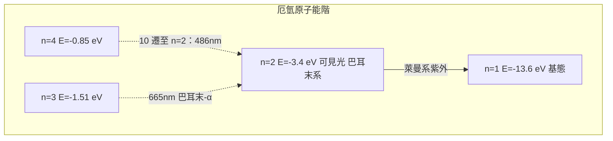

# 玻爾模型：電子的量子化軌道

1913 年，二十八歲的丹麥人尼爾斯・玻爾在《哲學雜誌》上連發三篇論文，史稱「三部曲」——《論原子與分子的構造》第一部，以及帶著氫原子的兩篇。他把拉塞福的核、普朗克的 $h$ 與里德堡的經驗公式一次焊接成一個模型，原子物理在這一年誕生。

玻爾的推理是大膽的「開刀式」：既然經典電動力學預言的螺旋坍縮與事實（原子存在、譜線間斷）不符，那就乾脆放棄經典規則，只保留有數據支持的部分。他宣告兩條新公理：第一，電子只能在若干「穩定軌道」（定態）上運轉而不輻射，這些軌道的條件是角動量量子化

$$L = n\hbar,\qquad n = 1, 2, 3, \ldots$$

$\hbar = h/2\pi$。第二，電子只能在定態之間「跳躍」（躍遷），躍遷時吸收或發射一個光子，其頻率由兩個態的能量差決定：

$$h\nu = E_2 - E_1$$

這就是玻爾頻率條件。對氫原子，由庫侖力＋量子化條件，他解出定態半徑 $r_n = a_0 n^2$（其中 $a_0 \approx 0.529$ Å，被稱為玻爾半徑），與能階 $E_n = -\dfrac{13.6\,\mathrm{eV}}{n^2}$。把它代入頻率條件，氫光譜公式便自然而然地湧出來，理論精度達到萬分之一以上。

此模型的驗證接踵而至，而且來自兩個十分不同的方向。第一個是光譜的「預言」：玻爾根據理論預言在遠紫外區應有一整套萊曼系，1914 年萊曼果然在氫原子光譜的高頻端找到了它；1915 至 1924 年間，帕邢、布拉開、蓬德等紅外線系也一一被發現，全部服從同一公式。第二個是電子的「直接碰撞」——1914 年在柏林，弗蘭克（James Franck）與赫茲（Gustav Hertz）讓電子束穿透稀薄的汞蒸氣，發現電子能量低於 4.9 電子伏時毫發無損地穿過，一到了這個能量就會把能量原封不動交給汞原子、自身驟然減速。這正是玻爾所說的「分立的能階」在實驗上的直接現形——他們本來以為自己在測量「電離電位」，玻爾親自來信指點：你們量到的，是從基態到第一激發態的躍遷。

另一條戰線是 $Z$ 值。1913 年，還只有二十五歲的莫斯萊在拉塞福實驗室，用新近發明的 X 射線分光計測量各元素特徵 X 射線的頻率，發現 $\sqrt{\nu}$ 與元素的「序數」呈完美的線性關係——證明了原子序 $Z$ 就是核電荷數，週期表的化學排序從此擁有了物理根源；玻爾模型也順利推廣到「單電子離子」（如 He$^+$），連精細修正都能算出來。玻爾模型在 1910 年代末風一時，把原子物理從少數人的猜想變成整個歐洲與美國實驗室的日常事業。

然而玻爾自己並不真信這些「軌道」是實在的。他常說，模型是把「畫得極美的圖」和「較不美的圖」之間做選擇；它只對氫原子最有效，對氦與多電子原子便步履維艱；它無法計算譜線強度，也無法解釋為什麼某些譜線更亮或更暗（所謂「選擇定則」是純經驗的）。慕尼黑的索末菲（Arnold Sommerfeld）在 1915 至 1916 年間以相對論修正推廣出「橢圓軌道」與空間量子化，勉強解釋了氫光譜的精細結構（差一項直到 1928 年才由狄拉克的正確自旋修正補上）；索氏繪製的的「迴紋針與模型」的文化，也成為量子論舊時代的標誌——他說這些繪出的軌道就像「沙堡」一樣早晚要被潮水沖走。沖走它的是 1925 至 1926 年的海森堡與薛丁格；但在此之前，玻爾已用這些「不可能的軌道」為量子力學攢下了全部經驗事實的清單。

玻爾人的性格也在這些年定型，並將從此人塑造整個二十世紀核物理共同體的文化。1885 年生於哥本哈根一個知識分子家庭（父親是生理學教授），丹麥統一當代的世俗化、文化自由主義、以及小國寡民式的親密學術圈子，塑造了他一種特有的「謙遜的雄心」：他在研討會與講稿中不斷自我糾正語句，用「我不是在陳述意見，我是在理解事物」這類近乎喃誦的語氣；“互補” 之後 "相補" 這些大字眼都是他晚年才提出，早年他只是「只肯為事實讓步的人」的化身。1917 年他力促哥本哈根大学创立自己的理论物理研究所（1921 年落成），不用纳税人的大实验设施，而以「每個人都该有一個自己的小辦公室、每個人都在走廊上吵起來」的原則，招收來自德、荷、日、俄、美各國的青年——卡爾薩烏（Kramers）、海森堡、泡利、狄拉克、卡皮察皆曾出入其中。哥本哈根精神——坦率的批評、日常的共同進食與弟子敢於糾正老師——成為拉塞福─湯姆森實驗室文化在理論一側的鏡像，二十世紀科學的兩大學術傳統自此成形。
