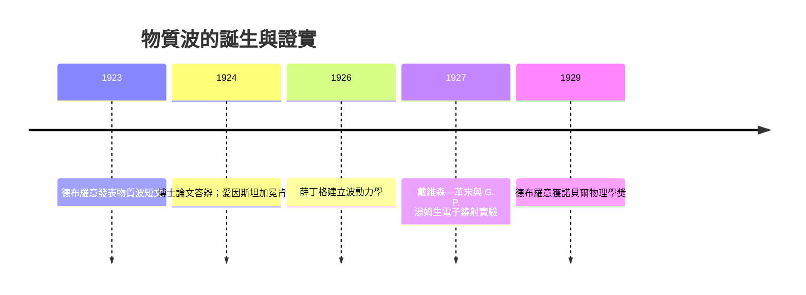

# 物質波：電子也可以有波有粒

## 一位貴族攝政王子的「跨界猜想」

1924 年 11 月，巴黎索邦大學的答辯廳裡坐著一位身世顯赫的年輕人——路易・維克多・德布羅意（Louis-Victor Pierre Raymond de Broglie）。他的家族是法國歷史悠久的貴族世家，德布羅意家族自十七世紀以來出過元帥、外交官與部長，爵位為「公爵」（duc），其祖父更曾擔任法蘭西第三共和國初期的總理。「de Broglie」這個姓氏在法國政界如雷貫耳，照理說路易應該走上仕途。

他的兄長莫里斯・德布羅意（Maurice de Broglie）卻是家族中的異數：放棄海軍軍官生涯，在自家私人實驗室裡研究 X 射線光譜學，成為著名的實驗物理學家。路易原本也走人文路線，十八歲時拿到歷史學士學位。但第一次世界大戰改變了一切——他被徵召到埃菲爾鐵塔下的無線電報站服役，天天操作波動訊號。戰後，他在兄長的實驗室裡親眼看到 X 射線既能展現波動的干涉，又能打出粒狀的閃爍計數，這個親身的經驗成為他日後最大膽猜想的種子。

## 對稱性的最大膽推理

1919 到 1923 年，物理學界正在為「光的波粒二象性」頭痛：干涉與繞射千年無疑是波，但光電效應與康普頓效應（1923）卻鐵證如山地顯示光具有粒子性。愛因斯坦的光量子假說從 1905 年的邊緣異端，逐漸變成難以否認的事實。

路易・德布羅意問了一個只有思想不受拘束的新人才會問的問題：**如果光波可以像粒子，那麼粒子為什麼不能像波？** 這是徹底的對稱性推理。1923 年他連發三篇短文於《法國科學院院報》，提出每個運動中的物質粒子都伴隨一個「相位波」（onde de phase），其波長與動量成反比：

$$\lambda = \frac{h}{p}$$

其中 $h$ 是普朗克常數。這個式子看似簡單，卻是劃時代的宣言：全宇宙最「硬」的物質粒子——電子——居然有波長。由此出發，他解釋了舊量子論中首先由玻爾猜出的氫原子定態條件：電子繞核一周的軌道必須恰好容下整數個波長，才能駐波共振，這正是玻爾硬性規定的 $n$ 整數來源。原本憑空規定的量子條件，第一次獲得了幾何上的理由。

他在博士論文中還預言：電子束穿過小孔時應該出現繞射現象，就像光的楊氏雙縫實驗。這是可檢驗的推論，也是全文最動人的部分——他勇於承認當時的實驗技術還做不到，但認為未來一定有人能做到。

## 朗之萬的求證與愛因斯坦的加冕

答辯過程並不平靜。評審委員之一的著名物理學家保羅・朗之萬（Paul Langevin）對這篇論文又驚又疑：結論荒謬，論證卻漂亮得無懈可擊。他聰明地留了一手——把論文的一份副本寄給當時世界最高權威愛因斯坦，徵詢意見。

愛因斯坦讀後的反應成為科學史上的名場面。他回信給朗之萬說：這位年輕公爵揭開了「巨大帷幕的一角」（a corner of the great veil）。愛因斯坦當時正在撰寫關於玻色——愛因斯坦統計的論文，他立刻意識到德布羅意的物質波正是自己統計理論背後的物理基礎，並在自己的論文中公開引用與推崇。有了愛因斯坦的背書，額外的懷疑一掃而空；1924 年 11 月論文順利通過。

有趣的是，郎之萬還開玩笑地對另一位年輕物理學家薛丁格說：「既然粒子有波，你不如找找它的波動方程。」——這條線索會在兩年後開花結果。

## 諾貝爾獎與新紀元

1927 年，戴維森與革末在貝爾實驗室、湯姆生父子中的兒子 G. P. 湯姆生在阿伯丁，先後用電子束撞擊晶體，得到了清晰的電子繞射圖樣，波長正合 $\lambda = h/p$。物質波從猜想變成實測事實，前後不到三年。

1929 年，35 歲的路易・德布羅意獲頒諾貝爾物理學獎——是史上第一位因博士論文而獲諾貝爾獎的人。法國貴族世家出了一個改寫物理學的人，他也成為法國科學的代表人物：終身院士、法國科學院 permanent secretary，戰後還推動法國投身原子能與大科學建設，證明貴族傳統與現代科學可以奇妙地融合。

德布羅意的猜想為量子力學的第二條路線——波動力學——鋪好了地基。在他之後，波粒二象性不再是光的專利，而是微觀世界的基本律法。

