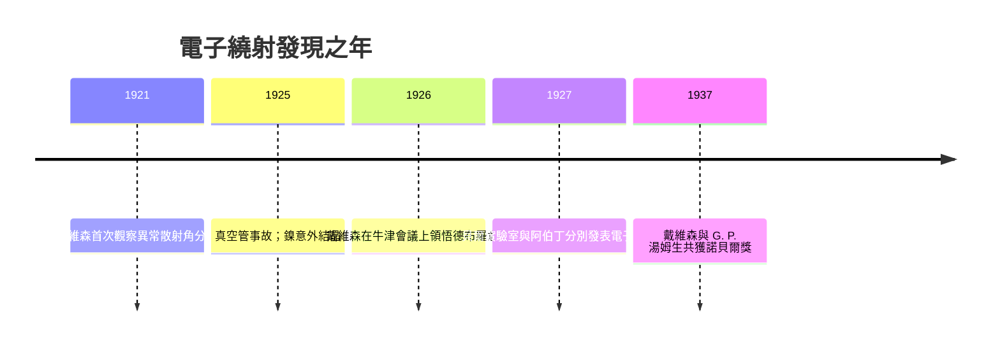

# 戴維森—革末實驗：電子繞射證實物質波

## 貝爾實驗室的一場「意外」

1926 年春天，美國紐約州的西方電氣公司（Western Electric，貝爾實驗室的前身）實驗室裡，克林頓・戴維森（Clinton Davisson）正對一組莫名其妙的數據發愁。他和助手雷斯特・革末（Lester Germer）從 1921 年起就在研究電子撞擊金屬表面後的散射，原本的目標非常「工程」：真空管裡的電子如何與金屬交互作用，這關係到真空管電子學的可靠度。這是典型的工業實驗室作風——不為哲學難題而做，卻總在工程問題的夾縫裡挖出基礎科學的金礦。

1925 年 2 月，實驗室發生了一起事故：裝著鎳靶的真空管爆炸破裂，鎳在高溫下暴露於空氣而嚴重氧化。兩人花了好幾個星期把鎳加熱、清理、重鍍，結果發現加熱的高溫使多晶的鎳重結晶，長出大顆粒的單晶面——意外地製造出近乎完美的晶體表面。重跑實驗後，散射電子的角分布突然出現一系列銳利的峰，如同光繞射的圖樣。

戴維森起初把這些峰誤會成原子的內部結構（1921 年前後他一度誤判為「電子殼層效應」）。直到 1926 年夏天，他到英國牛津參加會議，聽到玻恩、法蘭克等人熱烈討論德布羅意的物質波，才恍然大悟：那些峰就是電子繞射！他帶著新想法回美國，與革末全力重做實驗，量出電子的德布羅意波長 $\lambda = h/p$，與峰值角度完美吻合。1927 年，《物理評論》的論文向全世界宣告：德布羅意猜對了。

## 湯姆生父子的奇妙巧合

幾乎同時，在英國蘇格蘭阿伯丁大學，喬治・佩吉特・湯姆生（G. P. Thomson）也做出了電子繞射。他是 J. J. 湯姆生——1897 年發現電子的那位——的兒子。父親用陰極射線磁偏轉與荷質比證明電子是**粒子**，兒子卻讓電子束穿過極薄的金屬箔，拍出同心圓環的繞射圖樣，證明電子是**波**。

結果父子兩人在 1906 與 1937 年先後獲得諾貝爾物理學獎，後人留下那個流傳百年的雋語：

> 「父親證明電子是粒子，兒子證明電子是波。」

兩個實驗各自獨立、互不相識地完成，是量子力學史上少見的「雙重確認」——任何單一實驗室的失誤都逃不過這種交叉檢驗。

## 工業實驗室的科學天賦

戴維森—革末實驗還揭示了二十世紀科學生態的重要轉變：大公司的產業實驗室開始成為基礎科學的重鎮。貝爾系統（AT&T）靠電話事業的壟斷利潤養出一批不受論文壓力、自由探索的科學家；真空管、金屬純度、真空技術，這些全是通訊產業的直接需求，卻反向餵養了量子物理。這條路線之後一再重演：電晶體（1947）、雷射、宇宙微波背景輻射（1964），都出自貝爾實驗室。戴維森也因此在 1937 年與 G. P. 湯姆生共享諾貝爾獎。

## 電子繞射的深遠餘波

電子繞射不只是哲學上的確認，更迅速變成實用工具。由於電子的波長遠短於可見光（加速到幾萬伏特時僅約 0.01 埃的量級），電子繞射成為探測固體表面原子排列的顯微鏡，日後衍生出低能電子繞射（LEED）、穿透式電子顯微鏡（TEM）等整個電子顯微學家族，徹底改變材料科學與半導體工業。

