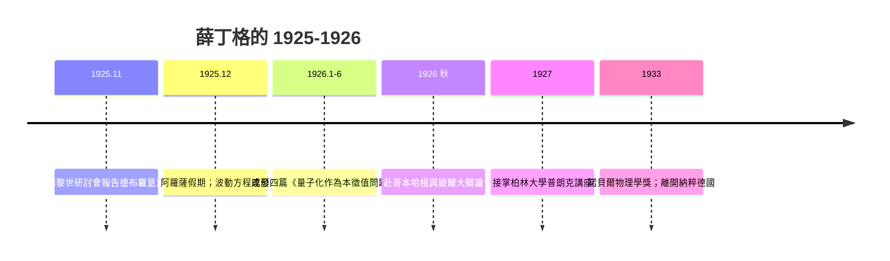

# 薛丁格從物質波出發：尋找波動方程

## 阿爾卑斯山上的靈感

1925 年聖誕假期，36 歲的埃爾溫・薛丁格（Erwin Schrödinger）沒有留在蘇黎世的家，而是帶著一位舊日的維也納女友前往阿爾卑斯山滑雪勝地阿羅薩（Arosa）度假。回来的時候，他的手稿裡出現了二十世紀物理學最重要的方程——薛丁格方程式。科學史家對他有句著名的調侃：這位物理學家的私生活與他的科學一樣「量子式的疊加」：他與合法妻子安娜維持著終身婚姻，同時也有一系列公開的情人關係；蘇黎世的同事們早已見怪不怪。這種維也納世紀末的自由風氣、以及他對東方哲學與叔本華的著迷，某種程度上滋養了他不循常規的思維。

薛丁格的人生本來也是半路轉向：他出身維也納一個油氈廠富商之家，在玻爾茲曼執教過的維也納大學受教於其門風，深諳統計力學與連續介質的波動傳統。這一點至關重要：當德國哥廷根、哥本哈根的年輕人把量子世界越搞越「離散、跳躍、反直觀」時，薛丁格這位老派的連續論者本能地抗拒。

## 德拜的當頭一棒

催化劑來自同事彼得・德拜（Peter Debye）。1925 年 11 月，薛丁格在蘇黎世聯邦理工（ETH）的研討會上報告德布羅意的物質波。德拜聽完淡淡地說了一句足以載入史冊的話：

> 「談論波的時候，你至少要有一個波動方程。」

這句話像刺一樣扎進薛丁格心裡。他開始嘗試性地尋找一個描述德布羅意波的方程。幾週後，在另一場研討會上他宣布：「我的同事德拜說必須有一個波動方程——看，我找到了一個！」

## 1926 年的「狂飆突進」

1926 年上半年，薛丁格以驚人的爆發力連續發表了四篇論文，總題為《量子化作為本徵值問題》（Quantisierung als Eigenwertproblem），一二月一篇，三四月各一篇，六月一篇。在其中他把原來非相對論的波動方程寫成：

$$i\hbar \frac{\partial}{\partial t}\psi = \hat{H}\psi$$

對氫原子，把這個方程當成數學物理學家最熟悉的本徵值問題來解，氫光譜的巴耳末系自動湧出—— $E_n$ 不再由任何人為規則規定，而是本徵值，就像小提琴弦的共振頻率一樣自然。量子化第一次「被解釋」而不是「被規定」。他還導出定態微擾論、與矩陣力學的等價性，並討論波包與經典軌道的關係（後來的 WKB 近似的先聲）。

整個歐陸物理學界為之傾倒。老一輩的普朗克、愛因斯坦都私下表示欣賞：終於有一個保留「波動、連續、可理解」的量子理論了。蘇黎世的薛丁格一夕之間與哥廷根、哥本哈根分庭抗禮。

## 爭論、柏林與都柏林

薛丁格本人對他方程裡的 $\psi$（波函數）的物理意義卻理解錯了：他希望 $\psi$ 是某種真實的電荷分布的波，粒子的「粒子性」只是波包的表觀。這個圖像在氫原子的自由空間裡看似可行，但波包會很快擴散崩解，而且無法解釋光電效應的全有全無。玻爾與海森堡與他在 1926 年秋天於哥本哈根展開激烈辯論，薛丁格病倒在玻爾家中仍不肯讓步，雙方把嗓門吵到沙啞——這場辯論最終誕生了玻恩的概率詮釋與玻爾的互補原理。

1927 年薛丁格接替普朗克在柏林大學的講座，與普朗克、愛因斯坦、勞厄並肩，自然地成為反對「哥本哈根正統」一方的精神領袖。1933 年納粹上台，他雖非猶太人，卻因容忍政治異見（庇護被解職者）及對納粹的消極態度而離開柏林，先到牛津，1939 年輾轉抵達愛爾蘭都柏林高等研究院（愛爾蘭總理德瓦萊拉親自設立的機構），主持理論物理長達十七年，培養了戰後愛爾蘭的科學傳統；晚年他以《生命是什麼》一書啟發了整個分子生物學世代（DNA 的發現者克里克與華生都自承受此書鼓舞）。1933 年他與狄拉克共享諾貝爾物理學獎。

一個維也納的富商之子，一段阿爾卑斯的假期，一份德拜隨口的提醒——薛丁格方程式就這樣成為微觀世界的「牛頓第二定律」。

